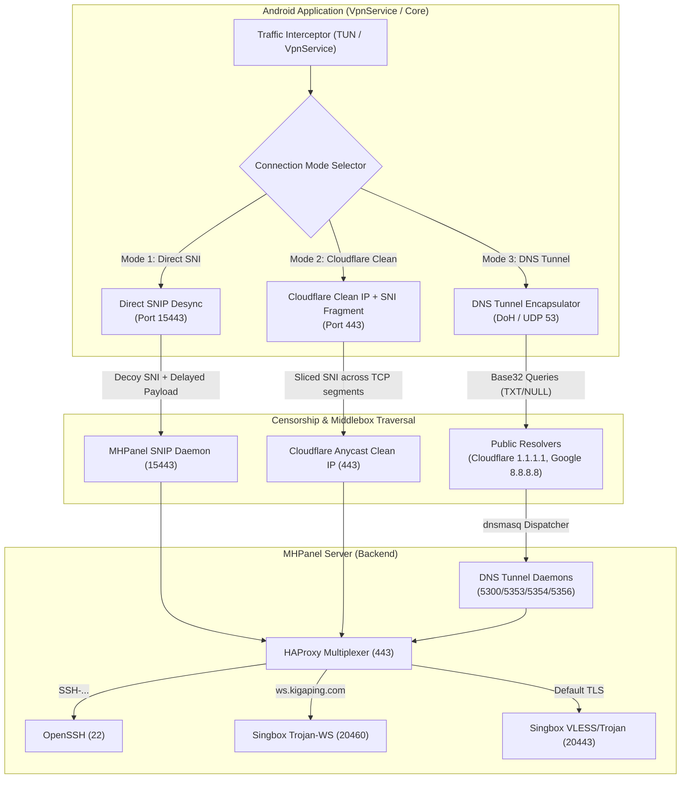
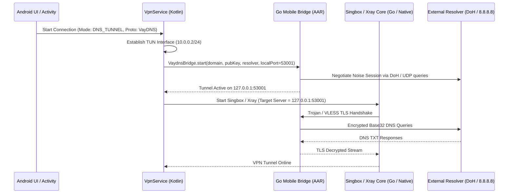

# MHPanel Multi-Transport & DNS Tunneling: Android Implementation Specification
**Document Version:** 2.0 (For Android Developers & System Architects)  
**Reference Components:** MHPanel Core, SNI-Spoofing Client v3.0, VayDNS Engine, DNSTT, Slipstream

---

## 1. Architectural Overview & The 3 Transport Modes

Modern network censorship in Iran operates across three distinct levels:
1. **DPI Pattern Matching & SNI Blocking:** Real-time inspection of TLS `ClientHello` packets.
2. **IP Null-Routing / IP Blocking:** Blackholing server IP addresses.
3. **National Intranet / Whitelist Filtering (Internet Blackout):** Only whitelisted protocols (primarily standard DNS queries to domestic/public resolvers) are routed.

To guarantee uninterrupted connectivity, MHPanel provides a **Unified Multi-Transport Architecture** with 3 selectable connection modes:



---

## 2. The 3 Connection Modes Explained

### Mode 1: Direct SNI Spoofing (`direct_sni`)
* **Use Case:** Normal network conditions when the VPS IP is not IP-blocked.
* **Mechanism:**
  1. The Android client opens a TCP connection to the VPS on port `15443`.
  2. Sends an 8-byte framing header: `SNIP` (4B) + `TargetPort` (2B uint16) + `FakeLen` (2B uint16).
  3. Sends a decoy `ClientHello` (e.g. `speedtest.net` or `auth.vercel.com`).
  4. Waits 3ms delay.
  5. Relays the real TLS traffic. The server strips the decoy and multiplexes to the target inbound.

### Mode 2: Cloudflare Clean IP + SNI Fragment (`cloudflare_clean`)
* **Use Case:** When the VPS IP is filtered or blocked, but Cloudflare Anycast edge IPs are accessible.
* **Mechanism:**
  1. The client dials a verified Clean Anycast IP (e.g., `104.18.119.142:443` or `104.25.165.92:443`).
  2. The TLS `ClientHello` targeting `ws.kigaping.com` is sliced across TCP segments right through the SNI extension boundary (`fragment_size = 2`, `fragment_delay = 5ms`).
  3. DPI inspection engines cannot reconstruct the SNI across fragmented segments in real-time.
  4. Cloudflare terminates TLS and forwards the WebSocket request to the origin server.

### Mode 3: DNS Tunnel Transport (`dns_tunnel`)
* **Use Case:** Complete internet blackouts (ملی شدن اینترنت) or extreme censorship where all TCP/UDP traffic to foreign IPs is blocked, but DNS queries to resolvers (e.g., `8.8.8.8`, `1.1.1.1`, or domestic resolvers) pass through.
* **Mechanism:**
  1. All V2Ray / Singbox / TCP traffic is encapsulated into DNS queries.
  2. The queries are sent via DNS-over-HTTPS (DoH) or UDP port 53.
  3. The resolver routes `*.v.vpn.kigaping.com` or `*.t.vpn.kigaping.com` to the server's authoritative DNS (`dnsmasq` on port 53).
  4. The server decapsulates the stream and delivers it to HAProxy port 443, reaching V2Ray (Trojan-WS, VLESS) or SSH.

---

## 3. DNS Tunnel Protocols Supported

| Protocol | Server Port | Default Subdomain | Engine / Compat | Encryption / Transport |
| :--- | :--- | :--- | :--- | :--- |
| **VayDNS (V-DNS)** | `5353` | `v.vpn.kigaping.com` | VayDNS Native / KCP | Noise (Curve25519) + KCP + SMUX + uTLS |
| **DNSTT** | `5300` | `t.vpn.kigaping.com` | DNSTT SlowDNS | Noise (Curve25519) + SMUX + DoH / UDP |
| **MasterDNS** | `5356` | `t.kigaping.com` | DNSTT Chunked | Noise + SMUX (High-speed MTU chunking) |
| **Slipstream** | `5354` | `s.vpn.kigaping.com` | Slipstream QUIC | QUIC Datagrams covert channel over DNS |
| **NoizDNS** | `5355` | `v.vpn.kigaping.com` | Anti-DPI Noise | Magic `0x4E5A` + Random Padding + DNSTT |

### Server Public Keys on Record
* **VayDNS PubKey:** `4438c41e91bf44b10a9e1a67bbade78f99137a875efc189ba54a6c95ecc2650a`
* **DNSTT PubKey:** `b3290012dd13fe7df78551fdfbccfdfce5d3c594522fef40bf8284e4313b3a31`
* **MasterDNS PubKey:** `b3290012dd13fe7df78551fdfbccfdfce5d3c594522fef40bf8284e4313b3a31`

---

## 4. Android Implementation Architecture

For Android applications, there are two primary integration patterns:

### Pattern A: Go Mobile Library (`.aar`) - Recommended
Compile the Go client library directly into an Android Archive (`.aar`) using `gomobile`.



### Pattern B: Embedded Binary in `jniLibs`
Bundle the static binaries (`vaydns-client`, `snispoof-client`) into the APK under `jniLibs/arm64-v8a/libvaydns.so` (renamed to `.so` so Android extracts it with executable permissions in `/data/app/.../lib/`).

---

## 5. Android Code Implementation (Kotlin & Go Mobile)

### 1. `VpnService` Socket Protection
To prevent the DNS queries from looping back into the VPN TUN interface, all outbound sockets must be protected with `VpnService.protect(socket)`:

```kotlin
class MhPanelVpnService : VpnService() {

    private var localBridgePort = 53001

    fun startVayDnsBridge(domain: String, pubKeyHex: String, resolverUrl: String) {
        thread(isDaemon = true, name = "DNS-Tunnel-Thread") {
            try {
                // Pass protection callback to Go Mobile bridge
                VaydnsBridge.start(
                    domain,
                    pubKeyHex,
                    resolverUrl,
                    localBridgePort,
                    object : VaydnsBridge.SocketProtector {
                        override fun protectSocket(fd: Int): Boolean {
                            return protect(fd)
                        }
                    }
                )
            } catch (e: Exception) {
                Log.e("MhPanelVPN", "Error starting DNS tunnel bridge: ${e.message}")
            }
        }
    }
}
```

### 2. V2Ray / Sing-box Outbound Configuration
When Mode 3 (DNS Tunnel) is active, the outbound configuration points directly to `127.0.0.1:53001`. The DNS tunnel acts as a transparent byte-stream relay to the server's HAProxy:

```json
{
  "outbounds": [
    {
      "type": "trojan",
      "tag": "proxy",
      "server": "127.0.0.1",
      "server_port": 53001,
      "password": "Sb_fhatutsq",
      "network": "ws",
      "tls": {
        "enabled": true,
        "server_name": "ws.kigaping.com",
        "insecure": false
      },
      "transport": {
        "type": "ws",
        "path": "/trojan-ws",
        "headers": {
          "Host": "ws.kigaping.com"
        }
      }
    }
  ]
}
```

### 3. Resolvers & Fallback Hierarchy for Iran
When configuring the DNS tunnel on Android, provide automatic resolver rotation:

```kotlin
enum class DnsResolver(val type: String, val endpoint: String, val displayName: String) {
    CLOUDFLARE_DOH("doh", "https://cloudflare-dns.com/dns-query", "Cloudflare DoH (Encrypted)"),
    GOOGLE_DOH("doh", "https://dns.google/dns-query", "Google DoH (Anycast)"),
    GOOGLE_UDP("udp", "8.8.8.8:53", "Google Public DNS (UDP)"),
    CLOUDFLARE_UDP("udp", "1.1.1.1:53", "Cloudflare DNS (UDP)"),
    SHECAN_UDP("udp", "78.157.42.100:53", "Shecan Anti-Sanction (Iran Low Latency)"),
    QUAD9_UDP("udp", "9.9.9.9:53", "Quad9 Secure (UDP)")
}
```

---

## 6. Verification & Health Monitoring

The Android UI can verify DNS Tunnel status and measure real latency:
1. **TCP Ping:** Open a lightweight TCP probe to `127.0.0.1:53001`.
2. **DNS Handshake Probe:** Measure the round-trip time of a synthetic 1-byte read/write stream through the tunnel.
3. **Traffic Statistics:** Monitor bytes transmitted and received via `TrafficStats.getUidTxBytes(uid)`.

---

## 7. Build Checklist for Android Engineers

- [ ] Add `VpnService` permission in `AndroidManifest.xml` (`android.permission.BIND_VPN_SERVICE`).
- [ ] Implement socket protection (`protect(socket)`) for all outbound resolver connections.
- [ ] Bundle `vaydns` Go Mobile package or static client binary for `arm64-v8a` and `armeabi-v7a`.
- [ ] Provide a simple 3-way toggle in UI:
  - **Mode 1:** Direct SNI Spoof (Port 15443)
  - **Mode 2:** Cloudflare Clean IP + SNI Fragment (Port 443)
  - **Mode 3:** DNS Tunnel Transport (VayDNS / DNSTT / MasterDNS)
- [ ] Pre-populate server domain (`v.vpn.kigaping.com`) and public key (`4438c41e91bf...`).
