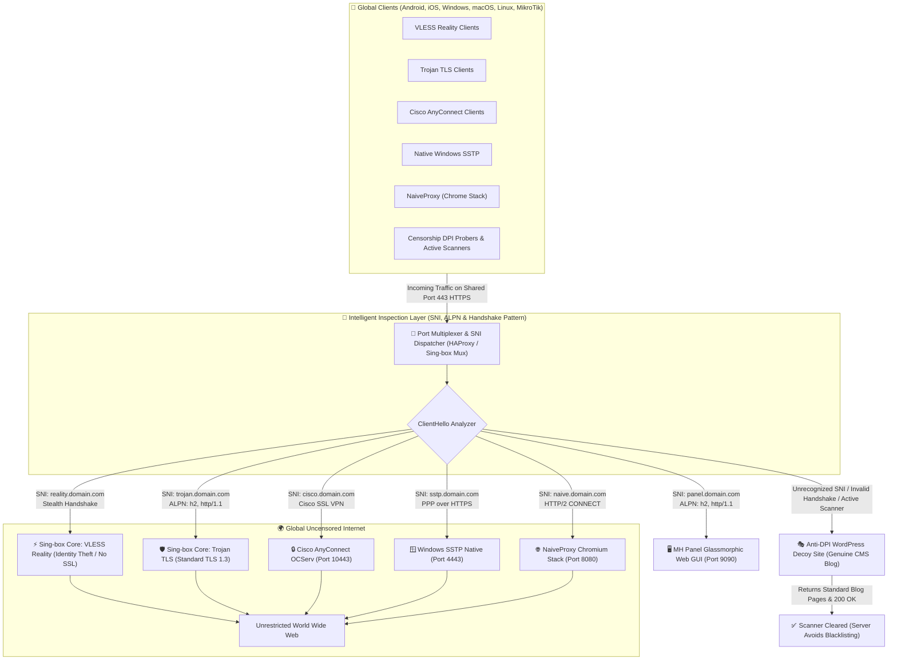
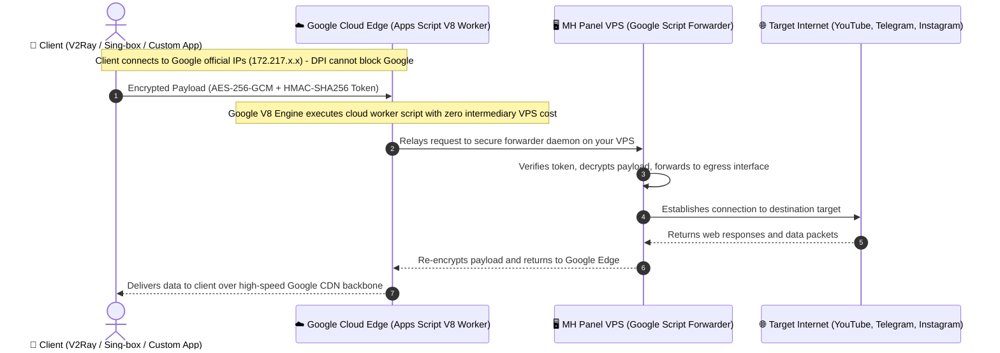
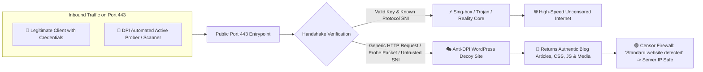
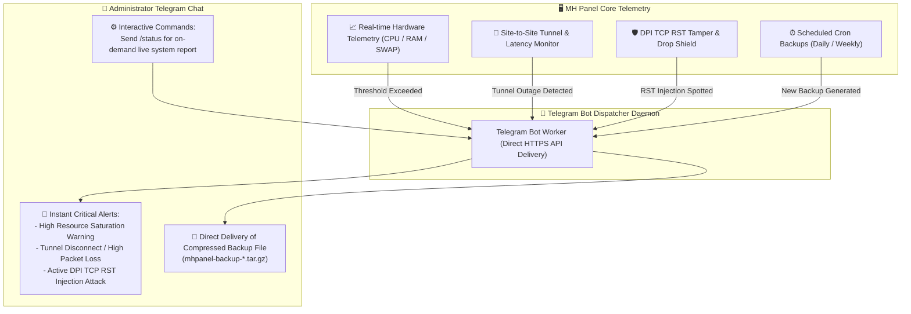
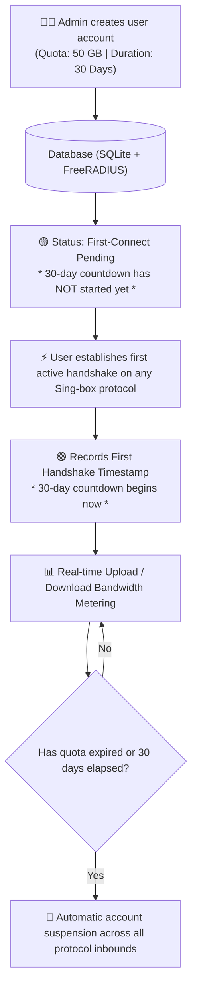

# 🚀 MH Panel - Enterprise Unified VPN, Anti-Censorship Tunnels, Sing-box Universal Suite & MikroTik Management Hub

<p align="center">
  <a href="README.md"><b>🇬🇧 English Documentation</b></a> |
  <a href="README_FA.md"><b>🇮🇷 مستندات فارسی (جامع)</b></a> |
  <a href="README_RU.md"><b>🇷🇺 Документация на русском</b></a>
</p>

<p align="center">
  
  
  
  
  
  
</p>

---

## 🌟 What's New in Version 1.6.0

Version **1.6.0** is the most comprehensive and battle-tested release of **MH Panel**, introducing unbreakable censorship evasion mechanisms, cloud edge tunneling, active-probe deception, automated bot surveillance, and enterprise backup lifecycle management:

1. ☁️ **Google Apps Script Full-Tunnel Proxy Engine (V8 Edge Worker):**
   - Routes traffic through Google's indestructible global edge network (`172.217.x.x` and `142.250.x.x`).
   - Automated cloud deployment via Google Apps Script API or seamless copy-paste assistant.
   - High-throughput server-side forwarder daemon authenticated with HMAC-SHA256 tokens and AES-256-GCM cipher encryption.
   - Dedicated management studio in MH Panel with 1-click token issuance, client link generator, and real-time connectivity probing.

2. 🎭 **Anti-DPI WordPress Decoy Site (Active Probing Deception):**
   - Automated deployment of an authentic, fully functional WordPress blog/shop on a designated decoy domain or port 443 fallback.
   - Fools Deep Packet Inspection (DPI) scanners and active probers: unauthenticated scans or connection probes receive genuine WordPress HTML/CSS/JS with HTTP 200 OK responses, completely concealing proxy infrastructure.

3. 🤖 **Telegram Bot Management, Real-time Alerts & Automated Backup Delivery:**
   - Direct integration with administrator Telegram bots without requiring auxiliary external proxies.
   - Instant critical push notifications for server resource saturation (high CPU, RAM exhaustion, disk/swap alerts).
   - Real-time detection of DPI TCP RST packet injection attacks and tunnel interface drops.
   - Scheduled automatic delivery of compressed panel backups (`.tar.gz`) directly into the administrator's Telegram chat.

4. 💾 **1-Click Full Backup & Instant Restore Suite:**
   - Complete snapshot encompassing panel settings, Sing-box core inbound/outbound definitions, FreeRADIUS SQLite database, SSL certificates, and kernel tunnels.
   - Instant 1-click safe restore with automated integrity checks and service hot-reloading.

5. ⏱️ **First-Connect Triggered Traffic Accounting (Sing-box Core):**
   - User validity period (e.g., 30 days) begins counting down from the exact timestamp of the **first active handshake**, rather than the administrative creation date.

6. 🔀 **Universal Multi-Protocol Port 443 Multiplexer (Port Sharing):**
   - Co-existence of over 26 VPN and proxy protocols (VLESS Reality, Trojan, Hysteria 2, TUIC v5, NaiveProxy, Cisco AnyConnect, SSTP, and Web Panel) on shared port 443/8443 via intelligent SNI & ALPN routing with zero port conflicts.

7. 🌍 **Universal 8-Language Localization with Smart Scrollbar Mirroring:**
   - Full native translations for: **Persian (FA)**, **English (EN)**, **Russian (RU)**, **Arabic (AR)**, **Italian (IT)**, **Spanish (ES)**, **Simplified Chinese (ZH)**, and **German (DE)**.
   - Directional scrollbar inversion: In RTL mode, content scrollbar rests on the far left edge and sidebar scrollbar on the far right edge; mirrored in LTR mode.

8. 📱 **Mobile & Desktop Ergonomic UI 2.0:**
   - Real-time instant quick-search filter in the sidebar for rapid access to all 35+ protocol suites and tools.
   - Pinned top header, independently scrollable navigation container, and pinned language switcher footer (zero sticky scroll detachment).
   - Touch-optimized bottom navigation drawer on mobile with 38px squircle avatar containers.

---

## 📐 Visual Architecture & Traffic Flow Pipelines

### 1. Universal Multi-Protocol Port 443 Sharing Architecture

Allows running every modern protocol simultaneously over a single public HTTPS port (443) behind an intelligent Layer-4/Layer-7 SNI dispatcher with authentic decoy fallback:



---

### 2. Google Apps Script Full-Tunnel Proxy Pipeline

Bypasses aggressive DPI filters by relaying traffic via official Google Cloud Edge workers (`script.google.com`):



---

### 3. Anti-DPI WordPress Decoy Site vs Active Probers



---

### 4. Telegram Bot Alert Engine & Automated Backup Dispatch



---

### 5. Sing-box First-Connect Triggered Accounting Lifecycle



---

## 📚 Supported Protocols & Engines Matrix

| # | Protocol | Underlying Engine | Default Port | Security Architecture & Key Strength |
|:---:|---|---|:---:|---|
| 1 | **VLESS Reality** | Sing-box Core Suite | 443 | Modern standard; steals identity of foreign TLS websites, eliminates SSL cert setup, 100% stealth against DPI. |
| 2 | **Trojan TLS** | Sing-box Core Suite | 8443 (or 443 shared) | Masks traffic as authentic HTTPS browsing with valid TLS 1.3 certificates. |
| 3 | **Hysteria 2** | Sing-box Core Suite | 7443 (UDP) | Custom QUIC with Brutal congestion control; unthrottled performance across lossy networks. |
| 4 | **TUIC v5** | Sing-box Core Suite | 8448 (UDP) | QUIC HTTP/3 protocol with 0-RTT handshakes, low mobile battery consumption, and high resilience. |
| 5 | **Shadowsocks 2022** | Sing-box / Rust | 8388 | Modern AEAD 2022 ciphers; ultra-low latency with active probing protection. |
| 6 | **NaiveProxy** | Sing-box / Chromium | 8080 | Emulates Google Chrome's actual network stack; traffic is completely indistinguishable from web browsing. |
| 7 | **Google Apps Script Proxy** | Google V8 + Node.js | Google Webhook | Relays through Google Cloud edge network; immune to regional IP blocking. |
| 8 | **Anti-DPI WordPress Decoy** | Nginx + PHP/WP | 80, 443 fallback | Real WordPress blog serving realistic content to probing requests to prevent censor blacklisting. |
| 9 | **AmneziaWG (AWG)** | Linux Kernel Driver | 51820 (UDP) | Obfuscated WireGuard with header junk packet injection (`Jc`, `Jmin`, `Jmax`) and custom handshakes (`S1`, `S2`, `H1-H4`). |
| 10 | **Standard WireGuard** | Linux Kernel Driver | 51821 (UDP) | Ultra-lightweight kernel VPN with dual-stack IPv4 and IPv6 subnet assignment. |
| 11 | **Cisco AnyConnect** | OCServ | 10443 (or 443 shared) | Enterprise SSL VPN compatible with official Cisco clients across all desktop and mobile operating systems. |
| 12 | **Windows SSTP** | sstpd | 4443 (or 443 shared) | Native Windows support out of the box without requiring third-party software installation. |
| 13 | **IKEv2 / IPsec** | StrongSwan | 500, 4500 (UDP) | Native iOS, macOS, and Windows support with MOBIKE seamless network roaming. |
| 14 | **L2TP / IPsec** | xl2tpd + Libreswan | 1701, 500 (UDP) | Legacy protocol with hardware acceleration, compatible with routers and gaming consoles. |
| 15 | **OpenVPN (TCP / UDP)** | OpenVPN Community | 1194 | Supports OpenVPN 2.6, Scramble XOR patches, and UDPspeeder acceleration. |
| 16 | **SSH WebSocket (WSS)** | OpenSSH + Python WS | 22, 4444 | Direct SSH tunnel with WebSocket reverse proxy and BadVPN UDPGW (port 7300) for gaming. |
| 17 | **ShadowTLS v3** | Sing-box Core | 8444 | Wraps Shadowsocks traffic inside genuine TLS handshakes without needing private keys of target sites. |
| 18 | **SlowDNS / DNSTT** | DNSTT Suite | 53 (UDP) | Guaranteed tunnel during total international internet shutdowns via recursive DNS queries. |
| 19 | **VayDNS & Slipstream** | DNS Suite | 5353 (UDP) | Modern compressed and encrypted DNS tunneling protocol. |
| 20 | **Tor Bridges** | Tor Core | 9050, 9051 | Snowflake, obfs4, and WebTunnel bridges for hidden access to the Tor network. |
| 21 | **MTProto Proxy** | Python / Rust | 8445 | Official Telegram proxy with fake TLS secrets to bypass Telegram ISP blocking. |
| 22 | **WSTunnel** | WSTunnel Core | 8088 | Bidirectional WebSocket tunnel with full TLS encryption. |
| 23 | **Rathole** | Rathole Engine | 8089 | High-performance Rust tunnel with minimal CPU and memory footprint for site-to-site bridges. |
| 24 | **Chisel Tunnel** | Chisel Go | 8090 | HTTP/WebSocket based multiplexed tunnel. |
| 25 | **GOST v3 Relay** | GOST Multi-Node | 8091 | Multi-node mesh chaining relay for transit routing. |
| 26 | **Kernel L2/L3 Tunnels** | Linux Kernel Drivers | Variable | IPIP, SIT (6in4), GRE, GRETAP, IP6GRE, IP6GRETAP, VXLAN, and GENEVE. |

---

## ⚡ Quick Installation

### System Requirements:
- **Operating Systems:**
  - Ubuntu 24.04 LTS (Noble Numbat)
  - Ubuntu 22.04 LTS (Jammy Jellyfish)
  - Ubuntu 20.04 LTS (Focal Fossa)
  - Debian 12 (Bookworm) / Debian 11 (Bullseye)
- **Minimum Specs:** 1 vCPU, 1 GB RAM, 10 GB SSD.
- **Privileges:** Root access (`root`).

### 1-Line Automated Installer (Recommended):

```bash
bash <(curl -fsSL https://raw.githubusercontent.com/t-51/MHPanel/main/install.sh)
```

### Manual Installation via Git:

```bash
git clone https://github.com/t-51/MHPanel.git /www/wwwroot/mhpanel
cd /www/wwwroot/mhpanel
sudo bash install.sh
```

Upon installation completion, panel credentials (Web URL, Port, Admin Username, Password, and API Key) will be displayed on your terminal.

---

## 🧭 Interactive Master CLI (`mhpanel`)

Access the complete server management console anytime directly from your terminal:

```bash
mhpanel
```

```text
  ======================================================================
     🚀 MH PANEL Enterprise Master CLI Console (Version 1.6.0)
  ======================================================================
  [1]  Execute Automated Full Suite Installation (All Protocols & Tools)
  [2]  Step-by-Step Custom Installation Wizard
  [3]  Lightweight Web Panel Only Installation
  ----------------------------------------------------------------------
  [4]  Live System Diagnostic Report & Service Status
  [5]  Manage, Install, Remove & Reconfigure VPN Protocols
  [6]  Anti-Censorship Tunnels Hub & MikroTik RouterOS Bridge
  [7]  Web Panel Settings (Credentials, Port, SSL, Restart)
  [8]  SSL Certificate Management (Let's Encrypt & 10-Year IP SAN)
  [9]  Network & Kernel Optimization (BBR, IPv4/IPv6 Forwarding)
  [10] Full Backup & Restore Suite (Create / Restore Archive)
  [11] Anti-DPI WordPress Decoy Site Studio
  [12] Telegram Bot Settings & Alert Testing
  [13] Check & Apply Official Updates from GitHub
  [0]  Exit
  ======================================================================
```

---

## 📄 License

This project is licensed under the open-source [MIT License](LICENSE).
Built with passion for digital freedom and resilient internet communications.
