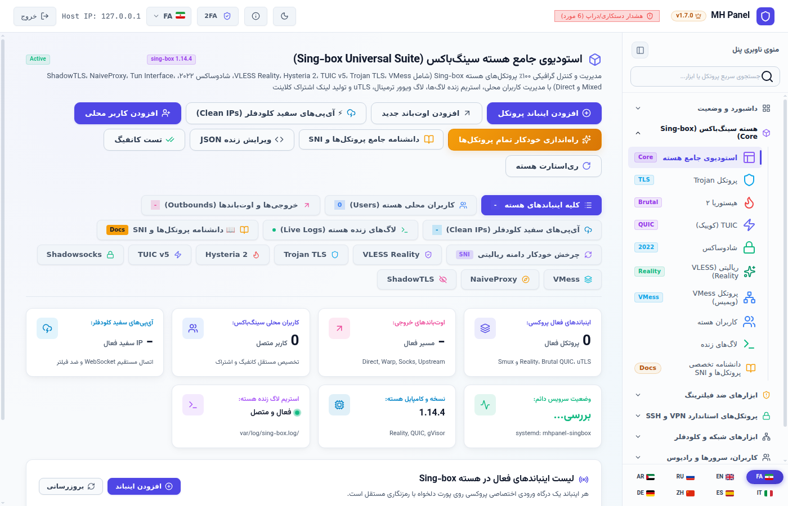
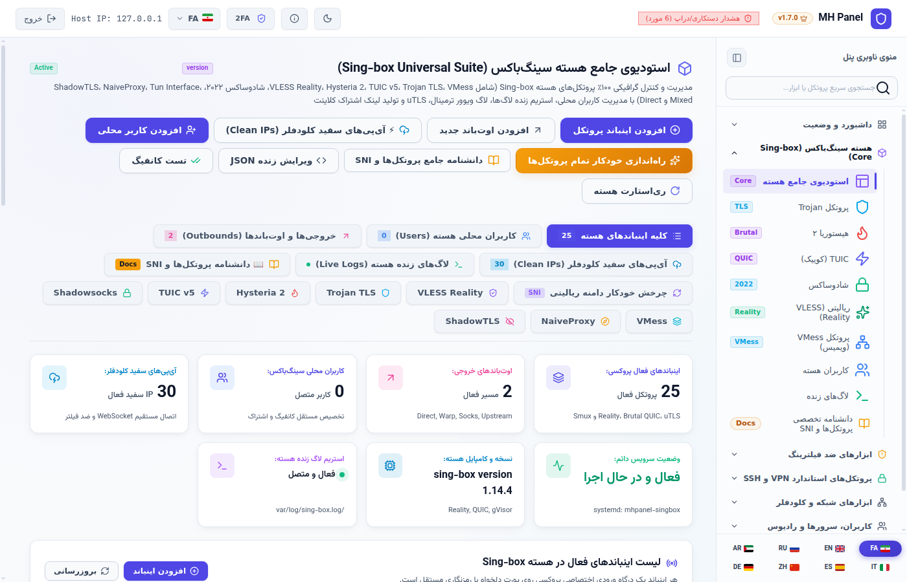

# 🚀 لوحة MH Panel - المركز الشامل لإدارة بروتوكولات VPN، أنفاق مكافحة الحجب، نواة Sing-box وMikroTik

<p align="center">
  <a href="README.md"><b>🇬🇧 English</b></a> |
  <a href="README_FA.md"><b>🇮🇷 فارسی</b></a> |
  <a href="README_RU.md"><b>🇷🇺 Русский</b></a> |
  <a href="README_AR.md"><b>🇸🇦 العربية</b></a> |
  <a href="README_IT.md"><b>🇮🇹 Italiano</b></a> |
  <a href="README_ES.md"><b>🇪🇸 Español</b></a> |
  <a href="README_ZH.md"><b>🇨🇳 简体中文</b></a> |
  <a href="README_DE.md"><b>🇩🇪 Deutsch</b></a>
</p>

<p align="center">
  
  
  
  
  
  
  <a href="https://donito.me/ME_Script" target="_blank"></a>
  
</p>

---

## ⚡ التثبيت السريع بأمر واحد (Quick Start)

قم بتثبيت **MH Panel** بالكامل في أقل من 60 ثانية مع الإعداد التلقائي لكافة التبعيات، وحدات النواة، شهادات SSL وخدمات systemd:

```bash
bash <(curl -fsSL https://raw.githubusercontent.com/t-51/MHPanel/main/install.sh)
```

> [!TIP]
> **متطلبات النظام الموصى بها:**
> - **أنظمة التشغيل:** Ubuntu 24.04 LTS, Ubuntu 22.04 LTS, Ubuntu 20.04 LTS, Debian 12 (Bookworm), Debian 11 (Bullseye)
> - **العتاد الأدنى:** معالج 1 vCPU، ذاكرة 1 جيجابايت RAM، قرص 10 جيجابايت
> - **الصلاحيات:** صلاحيات الجذر الكاملة (`root`)

<details>
<summary><b>📦 الخيار البديل: التثبيت اليدوي عبر Git Clone</b></summary>

```bash
# استنساخ المستودع
git clone https://github.com/t-51/MHPanel.git /www/wwwroot/mhpanel

# الدخول إلى المجلد وتشغيل برنامج التثبيت
cd /www/wwwroot/mhpanel
sudo bash install.sh
```

عند اكتمال التثبيت، ستظهر على شاشتك بيانات الدخول، الرابط، المنفذ ومفتاح API.
</details>

---

## 📡 محرك الاشتراكات الذكي الشامل (كافة الـ 23 تكويناً في رابط واحد)

تتميز **MH Panel** بنظام اشتراك ذكي يجمع كافة تكوينات **نواة Sing-box الـ 23** بالإضافة إلى أنفاق SSH في **رابط اشتراك موحد**:

### 🎯 دعم كامل لكافة التطبيقات والعملاء:
- **SlipNet** (استيراد تلقائي شامل، فاحص DoH، ومسح رموز QR لجسور Tor)
- **v2rayNG** و **v2rayN** (دعم Base64 مع التحديث التلقائي الدوري `profile-update-interval=24`)
- **Hiddify** و **NekoBox** (دعم أصيل لنواة Sing-box وبروتوكولات Reality وQUIC)
- **Streisand** و **Shadowrocket** و **Clash Meta**

### 🔗 أنواع الروابط ونقاط النهاية:
| نوع الرابط | مسار الرابط (URL Endpoint) | الوصف والاستخدام |
|---|---|---|
| **Base64 الموحد** | `https://<DOMAIN>:<PORT>/sub/<TOKEN>/b64` | رابط Base64 يضم جميع الـ 23 بروتوكولاً مع زر نسخ مباشر بنقرة واحدة في اللوحة. |
| **ملف Sing-box JSON** | `https://<DOMAIN>:<PORT>/sub/<TOKEN>/singbox.json` | ملف تكوين JSON قياسي لتطبيقات Sing-box مع توجيه ذكي للحزم. |
| **تكوينات Fragment السحابية**| `https://<DOMAIN>:<PORT>/sub/<TOKEN>/singbox-fragment.json` | تكوينات مزودة بتقنية تجزئة حزم TLS SNI لتخطي الفحص العميق DPI. |
| **بوابة الويب للمشترك** | `https://<DOMAIN>:<PORT>/sub/<TOKEN>` | صفحة ويب تفاعلية بالسمة الفاتحة والداكنة تعرض الرصيد المستهلك ورمز QR الموحد. |

---

## 📑 جدول المحتويات

- [⚡ التثبيت السريع بأمر واحد](#-التثبيت-السريع-بأمر-واحد-quick-start)
- [📡 محرك الاشتراكات الذكي الشامل](#-محرك-الاشتراكات-الذكي-الشامل-كافة-الـ-23-تکویناً-في-رابط-واحد)
- [🌟 ميزات الإصدار الجديد 1.7.0](#-ميزات-الإصدار-الجديد-170)
- [📸 جولة بصرية بالسمة الفاتحة](#-جولة-بصرية-بالسمة-الفاتحة-light-theme-gallery)
- [📐 المخططات المعمارية وتدفق البيانات](#-المخططات-المعمارية-وتدفق-البيانات)
- [📚 مصفوفة البروتوكولات المدعومة](#-مصفوفة-البروتوكولات-المدعومة)
- [🧭 وحدة التحكم التفاعلية للطرفية (`mhpanel`)](#-وحدة-التحكم-التفاعلية-للطرفية-mhpanel)
- [🤝 التقدير والمشاريع مفتوحة المصدر المستفاد منها](#-التقدير-والمشاريع-مفتوحة-المصدر-المستفاد-منها-upstream-projects)
- [📢 القناة الرسمية والمجتمع](#-القناة-الرسمية-والمجتمع)
- [📄 الترخيص](#-الترخيص)

---

## 🌟 ميزات الإصدار الجديد 1.7.0

يمثل الإصدار **1.7.0** قفزة نوعية في مكافحة الحجب، وتكامل نواة Sing-box العالمية، والتصميم الإرجونومي مع السمة الفاتحة والداكنة:

1. ⚡ **حزمة الـ 23 بروتوكولاً لنواة Sing-box:**
   - نشر تلقائي لكافة الوسائط الحديثة: **VLESS Reality**، **VLESS TLS**، **VMess**، **Trojan**، **Hysteria 2**، **TUIC v5**، **Shadowsocks 2022**، **NaiveProxy** و **ShadowTLS v3**.
2. 📡 **محرك الاشتراك الموحد لكافة التطبيقات:**
   - رابط Base64 ذكي بنقرة واحدة متوافق 100% مع SlipNet وHiddify وv2rayNG.
3. 🎛️ **واجهة سطرية مدمجة ونافذة منبثقة لإدارة المنافذ:**
   - تحويل المنافذ إلى زر أنيق `[ ⚙️ 23 Inbounds Active (Manage ⚙️) ]` مع نافذة منبثقة تتيح تفعيل وإلغاء البروتوكولات لكل مستخدم على حدة.
4. 🛡️ **استوديو تشويش DNS (Noise DNS) وخادم DoH:**
   - حقن ضوضاء عشوائية في حزم DNS وخادم DoH جاهز للفحص المباشر في SlipNet.
5. 🧅 **جسور شبكة تور ورليهات Snowflake:**
   - توليد جسور تور مع استخراج البصمة وعرض رموز QR كبيرة الحجم 220px.
6. 🎨 **نظام السمة الفاتحة الأنيقة (Light Elegance):**
   - إعادة تصميم اللوحة بسمة بيضاء ناصعة وعالية الوضوح إلى جانب السمة الداكنة.

---

## 📸 جولة بصرية بالسمة الفاتحة (Light Theme Gallery)

### 1. 🖥️ لوحة التحكم الرئيسية (Master Dashboard)


### 2. ⚡ استوديو بروتوكولات Sing-box (23 Inbounds)


### 3. 👥 إدارة المستخدمين وروابط الاشتراك الذكية


### 4. 🎛️ النافذة التفاعلية لإدارة بروتوكولات المشترك


### 5. 🛡️ استوديو أنفاق DNS والتشويش


### 6. 🧅 جسور شبكة تور وSnowflake


### 7. 🌐 أنفاق النواة وتخطي الحجب L2/L3


### 8. 🚀 نفق AmneziaWG وWireGuard متعدد المنافذ


### 9. 📱 بوابة الويب للمشترك


---

## 📐 المخططات المعمارية وتدفق البيانات

### مشاركة المنفذ 443 لكافة البروتوكولات (Port 443 Multiplexer)

```text
┌────────────────────────────────────────────────────────────────────────────────────────┐
│                        📱 الأجهزة والعملاء حول العالم (SlipNet, v2rayNG, Hiddify)       │
└───────────────────────────────────────────┬────────────────────────────────────────────┘
                                            │ اتصال HTTPS آمن على المنفذ 443
                                            ▼
┌────────────────────────────────────────────────────────────────────────────────────────┐
│              🔀 موزع SNI ومضاعف المنفذ 443 (Universal Port Multiplexer)                │
└───────┬─────────────────┬─────────────────┬─────────────────┬─────────────────┬────────┘
        │                 │                 │                 │                 │
  [sni: panel.*]    [sni: vless.*]    [sni: trojan.*]   [sni: cisco.*]    [فحص غير معتمد/DPI]
        │                 │                 │                 │                 │
        ▼                 ▼                 ▼                 ▼                 ▼
 ┌──────────────┐  ┌──────────────┐  ┌──────────────┐  ┌──────────────┐  ┌──────────────┐
 │ لوحة التحكم  │  │ VLESS        │  │ Trojan       │  │ Cisco        │  │ موقع التمويه │
 │ عبر الويب    │  │ Reality      │  │ TLS          │  │ AnyConnect   │  │ ووردبريس     │
 │ (منفذ 9090)  │  │ (Sing-box)   │  │ (Sing-box)   │  │ (OCServ)     │  │ (Anti-DPI)   │
 └──────────────┘  └──────────────┘  └──────────────┘  └──────────────┘  └──────────────┘
```

---

## 📚 مصفوفة البروتوكولات المدعومة

| # | البروتوكول | النواة الأساسية | المنفذ | الميزات الأمنية وتخطي الحجب |
|:---:|---|---|:---:|---|
| 1 | **VLESS Reality** | Sing-box | 443 | انتحال هوية مواقع TLS عالمية موثوقة دون الحاجة لشهادة SSL، تخفي 100%. |
| 2 | **Trojan TLS** | Sing-box | 8443 (443) | تمويه الحركة كأنها تصفح ويب عادي مع تشفير TLS 1.3 معتمد. |
| 3 | **Hysteria 2** | Sing-box | 7443 UDP | مبني على QUIC مخصص مع خوارزمية Brutal؛ أداء فائق في الشبكات الضعيفة. |
| 4 | **TUIC v5** | Sing-box | 8448 UDP | بروتوكول QUIC HTTP/3 مع مصافحة 0-RTT وتوفير كبير لبطارية الهاتف. |
| 5 | **Shadowsocks 2022**| Sing-box / Rust | 8388 | خوارزميات AEAD 2022 الحديثة مع سرعة فائقة وحماية من الفحص النشط. |
| 6 | **NaiveProxy** | Sing-box | 8080 | محاكاة كاملة لحزمة شبكة متصفح Google Chrome لا يمكن تمييزها عن التصفح. |
| 7 | **Google Apps Script**| Node / V8 | Google Webhook | تمرير البيانات عبر شبكة حافة جوجل السحابية المنيعة ضد الحظر الإقليمي. |
| 8 | **موقع التمويه ووردبريس**| Nginx + WP | 80, 443 | موقع متكامل للرد بـ 200 OK على ماسحات جدار الحماية الرقابي. |
| 9 | **AmneziaWG (AWG)** | درايفر النواة | 51820 UDP | وايرجارد مموه بحزم عشوائية (`Jc`, `Jmin`, `Jmax`) لتجاوز فلاتر DPI. |
| 10 | **WireGuard القياسي**| درايفر النواة | 51821 UDP | نفق خفيف وسريع على مستوى النواة مع دعم كامل لـ IPv4 وIPv6. |
| 11 | **Cisco AnyConnect**| OCServ | 10443 (443) | متوافق مع تطبيقات سيسكو الرسمية على أندرويد وiOS وويندوز. |
| 12 | **Windows SSTP** | sstpd | 4443 (443) | مدعوم بشكل أصيل داخل نظام ويندوز دون الحاجة لبرامج خارجية. |
| 13 | **SlowDNS / DNSTT**| DNSTT Suite | 53 UDP | تخطي الحجب أثناء الانقطاع الشامل للإنترنت عبر استعلامات DNS. |
| 14 | **جسور Tor** | Tor Core | 9050, 9051 | جسور Snowflake وobfs4 لتخطي الرقابة الحكومية. |

---

## 🧭 وحدة التحكم التفاعلية للطرفية (`mhpanel`)

يمكنك في أي وقت فتح لوحة إدارة الخادم مباشرة من الطرفية:

```bash
mhpanel
```

```text
  ========================================================================
     🚀 لوحة التحكم التفاعلية للمخدم MH PANEL (الإصدار 1.7.0)
  ========================================================================
  حالة اللوحة: Online (IP:PORT/PATH) | الأمر السريع: mhpanel
  ------------------------------------------------------------------------
  [1]  التثبيت التلقائي الشامل لجميع المكونات والبروتوكولات
  [2]  معالج التثبيت المخصص خطوة بخطوة (Custom Wizard)
  [3]  تثبيت واجهة الويب الخفيفة فقط (Web UI Only)
  ------------------------------------------------------------------------
  [4]  عرض رابط دخول اللوحة، بيانات الأدمن ومفتاح API
  [5]  تغيير اسم مستخدم وكلمة مرور مدير اللوحة
  [6]  تغيير المنفذ، العنوان والمسار السري لرابط اللوحة
  [7]  تقرير الفحص والتشخيص الحي للنظام والخدمات
  [8]  إدارة، تثبيت، حذف وضبط منافذ بروتوكولات VPN
  [9]  مركز أنفاق مكافحة الحجب وجسور روترات ميكروتيك (RouterOS)
  [10] دمج خادم الويب واستوديو موقع التمويه ووردبريس
  [11] إشعارات بوت تيليجرام ومركز النسخ الاحتياطي التلقائي
  [12] إعدادات لوحة الويب (السجلات، إعادة التشغيل، 2FA ومفتاح API)
  [13] إدارة شهادات SSL (Let's Encrypt وشهادة IP SAN لمدة 10 سنوات)
  [14] تحسين النواة والشبكة (تفعيل BBR وتمرير حزم IPv4/IPv6)
  [15] النسخ الاحتياطي واستعادة تكوينات اللوحة (Backup & Restore)
  [16] دليل الأوامر السريعة والاختصارات للطرفية
  [17] فحص وتحديث اللوحة إلى أحدث إصدار من GitHub
  [18] إلغاء تثبيت MH Panel بالكامل من الخادم (Uninstall)
  [0]  خروج
  ========================================================================
```

### ⚡ اختصارات الأوامر المباشرة للطرفية (CLI Shortcuts):

| الأمر المباشر | الوصف والاستخدام |
|---|---|
| `mhpanel` | فتح القائمة التفاعلية الرئيسية. |
| `mhpanel --status` | تقرير تشخيصي فوري عن الموارد والمنافذ والخدمات. |
| `mhpanel --info` | طباعة رابط الدخول، بيانات المشرف ومفتاح API. |
| `mhpanel --user <اسم_جديد>` | تغيير اسم مستخدم الأدمن مباشرة. |
| `mhpanel --pass <رمز_جديد>` | تغيير كلمة مرور الأدمن مباشرة. |
| `mhpanel --credentials <مستخدم> <رمز>` | تغيير اسم المستخدم وكلمة المرور في أمر واحد. |
| `mhpanel --port <منفذ>` | تغيير منفذ لوحة الويب (مثال: `mhpanel --port 9443`). |
| `mhpanel --path <مسار_سري>` | تعيين مسار سري للوحة (مثال: `mhpanel --path /secure`). |
| `mhpanel --address <منفذ> <مسار>` | تغيير المنفذ والمسار في أمر واحد. |
| `mhpanel --wp` | معالج استقرار موقع التمويه ووردبريس. |
| `mhpanel --tg` | إعدادات بوت تيليجرام وفحص إرسال الإشعارات. |
| `mhpanel --tunnels` | قائمة الأنفاق وربط روتر ميكروتیک. |
| `mhpanel protocol <اسم> <أمر>` | التحكم ببروتوكول محدد (مثال: `mhpanel protocol singbox restart`). |
| `mhpanel restart` | إعادة تشغيل فورية للوحة عبر systemd. |
| `mhpanel start` / `mhpanel stop` | تشغيل أو إيقاف خدمة اللوحة. |
| `mhpanel update` | سحب آخر التحديثات مباشرة من GitHub. |
| `mhpanel --uninstall` | حذف وإزالة اللوحة وكافة ملفاتها بالكامل. |
| `mhpanel --help` | عرض دليل المساعدة لأوامر الطرفية. |

---

## 🤝 التقدير والمشاريع مفتوحة المصدر المستفاد منها (Upstream Projects)

بنيت **MH Panel** بفضل جهود نخبة من مطوري البرمجيات الحرة في العالم، ونتقدم بالشكر والتقدير للمشاريع التالية:
- **[Sing-box (SagerNet)](https://github.com/SagerNet/sing-box)**: منصة البروكسي الشاملة التي تمثل جوهر وسائط النواة.
- **[Hysteria 2 (AperNet)](https://github.com/apernet/hysteria)**: بروتوكول QUIC الفائق السرعة مع Brutal CC.
- **[TUIC (EAimTY)](https://github.com/EAimTY/tuic)**: بروتوكول 0-RTT QUIC HTTP/3 الموفر للطاقة.
- **[Shadowsocks-rust](https://github.com/shadowsocks/shadowsocks-rust)**: تطبيق شادوساكس عالي الأداء بلغة Rust.
- **[AmneziaWG](https://github.com/amnezia-vpn/amnezia-wg)** و **[wiresock/amneziawg-install](https://github.com/wiresock/amneziawg-install)**: وايرجارد المموه بحزم عشوائية.
- **[OpenConnect (ocserv)](https://gitlab.com/openconnect/ocserv)**: خادم SSL VPN لعملاء سيسكو.
- **[Backhaul](https://github.com/Musixal/Backhaul)** و **[Rathole](https://github.com/rapiz1/rathole)** و **[Chisel](https://github.com/jpillora/chisel)**: أنفاق معكوسة لتخطي قيود جدران الحماية.
- **[Marzban (Gozargah)](https://github.com/Gozargah/Marzban)** و **[3X-UI](https://github.com/MHSanaei/3x-ui)** و **[Hiddify Manager](https://github.com/hiddify/hiddify-manager)**: أفكار إدارية وواجهات واشتراكات موحدة رائدة.

---

## 💖 دعم المشروع والتبرعات (Donate & Support)

يتطلب التطوير المستمر لـ **MH Panel** واستئجار خوادم الاختبار في مختلف مراكز البيانات حول العالم دعماً مستمراً. إذا كان هذا المشروع مفيداً لك وساعدك في الحفاظ على حرية الإنترنت، يمكنك دعمنا عبر منصة Donito:

<p align="center">
  <a href="https://donito.me/ME_Script" target="_blank">
    
  </a>
</p>

<p align="center">
  ☕ <b>رابط الدعم المباشر:</b> <a href="https://donito.me/ME_Script" target="_blank"><b>https://donito.me/ME_Script</b></a>
</p>

---

## 📢 القناة الرسمية والمجتمع

- 📢 **القناة الرسمية على تيليجرام:** [@kigaping_fa](https://t.me/kigaping_fa)

---

## 📄 الترخيص

المشروع مرخص تحت رخصة البرمجيات الحرة [MIT License](LICENSE).
