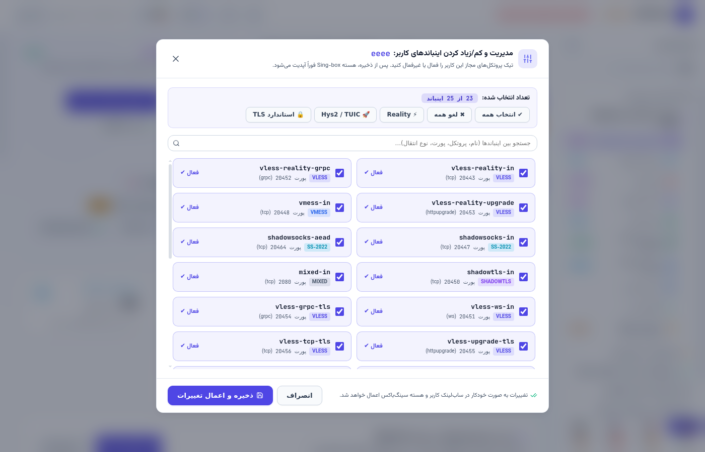

# 🚀 MH Panel - Panel Empresarial Unificado de VPN, Túneles Anti-Censura, Sing-box Suite y MikroTik RouterOS

<p align="center">
  <a href="README.md"><b>🇬🇧 English</b></a> |
  <a href="README_FA.md"><b>🇮🇷 فارسی</b></a> |
  <a href="README_RU.md"><b>🇷🇺 Русский</b></a> |
  <a href="README_AR.md"><b>🇸🇦 العربية</b></a> |
  <a href="README_IT.md"><b>🇮🇹 Italiano</b></a> |
  <a href="README_ES.md"><b>🇪🇸 Español</b></a> |
  <a href="README_ZH.md"><b>🇨🇳 简体中文</b></a> |
  <a href="README_DE.md"><b>🇩🇪 Deutsch</b></a>
</p>

<p align="center">
  
  
  
  
  
  
  <a href="https://donito.me/ME_Script" target="_blank"></a>
  
</p>

---

## ⚡ Instalación Rápida en 1 Línea (Quick Start)

Despliegue **MH Panel** en menos de 60 segundos con gestión automatizada de dependencias, módulos del kernel, aprovisionamiento SSL y servicios systemd:

```bash
bash <(curl -fsSL https://raw.githubusercontent.com/t-51/MHPanel/main/install.sh)
```

> [!TIP]
> **Requisitos del Sistema:**
> - **Sistemas Operativos:** Ubuntu 24.04 LTS, Ubuntu 22.04 LTS, Ubuntu 20.04 LTS, Debian 12 (Bookworm), Debian 11 (Bullseye)
> - **Especificaciones Mínimas:** 1 vCPU, 1 GB RAM, 10 GB de disco
> - **Permisos:** Acceso de superusuario (`root`)

<details>
<summary><b>📦 Método Alternativo: Instalación Manual mediante Git Clone</b></summary>

```bash
# Clonar el repositorio
git clone https://github.com/t-51/MHPanel.git /www/wwwroot/mhpanel

# Entrar al directorio y ejecutar instalador
cd /www/wwwroot/mhpanel
sudo bash install.sh
```

Al finalizar, su terminal mostrará la URL de acceso web, credenciales de administrador, puerto y clave API.
</details>

---

## 📡 Motor Universal de Suscripciones Inteligentes (Las 23 Configs en 1 Enlace)

MH Panel incorpora un motor de suscripción inteligente que entrega todas las **23 configuraciones del núcleo Sing-box** junto con credenciales SSH en un **enlace único y unificado**:

### 🎯 Optimizado para Todos los Clientes Modernos:
- **SlipNet** (Importación automática completa, escáner DoH y lectura de códigos QR de puentes Tor)
- **v2rayNG** / **v2rayN** (Base64 estándar con actualización periódica `profile-update-interval=24`)
- **Hiddify** / **NekoBox** (Compatibilidad nativa con Sing-box, Reality, QUIC y Fragment)
- **Streisand** / **Shadowrocket** / **Clash Meta**

### 🔗 Formatos de Suscripción y Endpoints:
| Tipo de Enlace | Endpoint URL | Descripción |
|---|---|---|
| **Base64 Universal** | `https://<DOMAIN>:<PORT>/sub/<TOKEN>/b64` | Entrega todas las 23 configuraciones activas con botón de copia rápida a 1 clic en el panel. |
| **Perfil Sing-box JSON** | `https://<DOMAIN>:<PORT>/sub/<TOKEN>/singbox.json` | Perfil JSON nativo para clientes oficiales de Sing-box con enrutamiento inteligente. |
| **Fragment / Cloud IP** | `https://<DOMAIN>:<PORT>/sub/<TOKEN>/singbox-fragment.json` | Configuraciones con fragmentación TLS SNI para superar bloqueos estrictos de DPI. |
| **Portal Web del Usuario** | `https://<DOMAIN>:<PORT>/sub/<TOKEN>` | Portal web interactivo con modo claro y oscuro, consumo de datos y código QR todo-en-uno. |

---

## 📑 Tabla de Contenidos

- [⚡ Instalación Rápida en 1 Línea](#-instalación-rápida-en-1-línea-quick-start)
- [📡 Motor Universal de Suscripciones Inteligentes](#-motor-universal-de-suscripciones-inteligentes-las-23-configs-en-1-enlace)
- [🌟 Novedades de la Versión 1.8.0](#-novedades-de-la-versión-170)
- [📸 Galería Visual con Tema Claro](#-galería-visual-con-tema-claro-light-theme-gallery)
- [📐 Arquitectura y Flujos de Red](#-arquitectura-y-flujos-de-red)
- [📚 Matriz de Protocolos Soportados](#-matriz-de-protocolos-soportados)
- [🧭 Consola Interactiva CLI (`mhpanel`)](#-consola-interactiva-cli-mhpanel)
- [🤝 Agradecimientos y Proyectos Upstream](#-agradecimientos-y-proyectos-upstream-upstream-projects)
- [📢 Comunidad y Canal Oficial](#-comunidad-y-canal-oficial)
- [📄 Licencia](#-licencia)

---

## 🌟 Novedades de la Versión 1.8.0

La versión **1.8.0** ofrece la máxima resistencia contra censura, integración completa con Sing-box, diseño ergonómico con soporte de tema claro y oscuro, y suscripción unificada:

1. ⚡ **Suite de 23 Modos de Sing-box:**
   - Despliegue automatizado de: **VLESS Reality** (Vision, TCP, gRPC, HTTPUpgrade), **VLESS TLS**, **VMess**, **Trojan**, **Hysteria 2** (Salamander & Brutal QUIC), **TUIC v5** (0-RTT), **Shadowsocks 2022**, **NaiveProxy** (Chrome Stack) y **ShadowTLS v3**.
2. 📡 **Motor de Suscripción Universal (SlipNet, V2Ray, Sing-box y Hiddify):**
   - Generación en 1 clic de enlaces Base64 con enrutamiento inteligente de dominios válidos con SSL.
3. 🎛️ **Interfaz Compacta de Inbounds y Modal Interactivo:**
   - Visualización en una sola línea `[ ⚙️ 23 Inbounds Active (Manage ⚙️) ]` con ventana modal para habilitar/deshabilitar protocolos para cada usuario.
4. 🛡️ **Noise DNS y Estudio DoH:**
   - Inyección de ruido aleatorio en paquetes DNS y servidor DoH listo para escanear en SlipNet.
5. 🧅 **Puentes Tor y Snowflake:**
   - Despliegue de Snowflake y puentes obfs4 con códigos QR ampliados a 220px de alto contraste.
6. 🎨 **Tema Claro Elegante (Light Elegance):**
   - Rediseño integral con una interfaz blanca de alta visibilidad junto con el modo oscuro.

---

## 📸 Galería Visual con Tema Claro (Light Theme Gallery)

### 1. 🖥️ Panel Principal (Master Dashboard)


### 2. ⚡ Estudio de Protocolos Sing-box (23 Inbounds)


### 3. 👥 Gestión de Usuarios y Copia Rápida de Suscripción


### 4. 🎛️ Modal Interactivo para Inbounds de Usuario


### 5. 🛡️ Estudio de Túneles DNS y Noise DNS


### 6. 🧅 Puentes Tor Snowflake y obfs4


### 7. 🌐 Túneles Kernel L2/L3 y Escudo Anti-DPI


### 8. 🚀 Multipuerto AmneziaWG y WireGuard


### 9. 📱 Portal Web de Suscripción de Clientes


---

## 📐 Arquitectura y Flujos de Red

### Compartición del Puerto 443 entre Todos los Protocolos (Port Multiplexer)

```text
┌────────────────────────────────────────────────────────────────────────────────────────┐
│                        📱 Clientes Globales (v2rayNG, SlipNet, Hiddify, AnyConnect)    │
└───────────────────────────────────────────┬────────────────────────────────────────────┘
                                            │ Conexión entrante segura HTTPS en puerto 443
                                            ▼
┌────────────────────────────────────────────────────────────────────────────────────────┐
│              🔀 Multiplexor de Puerto 443 y Enrutador SNI (Universal Port Multiplexer) │
└───────┬─────────────────┬─────────────────┬─────────────────┬─────────────────┬────────┘
        │                 │                 │                 │                 │
  [sni: panel.*]    [sni: vless.*]    [sni: trojan.*]   [sni: cisco.*]    [No Confiable/DPI]
        │                 │                 │                 │                 │
        ▼                 ▼                 ▼                 ▼                 ▼
 ┌──────────────┐  ┌──────────────┐  ┌──────────────┐  ┌──────────────┐  ┌──────────────┐
 │ Panel Web    │  │ VLESS        │  │ Trojan       │  │ Cisco        │  │ Sitio Señuelo│
 │ Admin        │  │ Reality      │  │ TLS          │  │ AnyConnect   │  │ WordPress    │
 │ (Puerto 9090)│  │ (Sing-box)   │  │ (Sing-box)   │  │ (OCServ)     │  │ (Anti-DPI)   │
 └──────────────┘  └──────────────┘  └──────────────┘  └──────────────┘  └──────────────┘
```

---

## 📚 Matriz de Protocolos Soportados

| # | Protocolo | Núcleo | Puerto Default | Características de Seguridad |
|:---:|---|---|:---:|---|
| 1 | **VLESS Reality** | Sing-box | 443 | Suplantación de sitios TLS extranjeros sin certificados locales, 100% indetectable por DPI. |
| 2 | **Trojan TLS** | Sing-box | 8443 (443) | Disfraza el tráfico como navegación HTTPS legítima con TLS 1.3 válido. |
| 3 | **Hysteria 2** | Sing-box | 7443 UDP | QUIC personalizado con Brutal CC; máximo rendimiento en redes con alta pérdida de paquetes. |
| 4 | **TUIC v5** | Sing-box | 8448 UDP | Protocolo QUIC HTTP/3 con handshake 0-RTT y mínimo consumo de batería en móviles. |
| 5 | **Shadowsocks 2022**| Sing-box / Rust | 8388 | Cifrados modernos AEAD 2022 con protección contra escaneo activo. |
| 6 | **NaiveProxy** | Sing-box | 8080 | Emula el stack de red de Chrome; totalmente indistinguible del tráfico web normal. |
| 7 | **Google Apps Script**| Node / V8 | Webhook Google | Enrutamiento a través de IPs de Google Edge CDN; inmune a bloqueos regionales. |
| 8 | **Sitio Señuelo WordPress**| Nginx + WP | 80, 443 | Blog real en WordPress para engañar a los escáneres censuradores con respuestas 200 OK. |
| 9 | **AmneziaWG (AWG)** | Driver Kernel | 51820 UDP | WireGuard ofuscado con paquetes basura (`Jc`, `Jmin`, `Jmax`) para eludir DPI. |
| 10 | **WireGuard Estándar**| Driver Kernel | 51821 UDP | Túnel ligero a nivel de kernel con soporte dual-stack IPv4/IPv6. |
| 11 | **Cisco AnyConnect**| OCServ | 10443 (443) | Compatible con clientes oficiales de Cisco en iOS, Android y Windows. |
| 12 | **Windows SSTP** | sstpd | 4443 (443) | Soporte nativo en Windows sin requerir instalación de software adicional. |
| 13 | **SlowDNS / DNSTT**| DNSTT Suite | 53 UDP | Funciona durante apagones internacionales de internet mediante consultas DNS. |
| 14 | **Puentes Tor** | Tor Core | 9050, 9051 | Puentes oficiales Snowflake y obfs4 para eludir la censura. |

---

## 🧭 Consola Interactiva CLI (`mhpanel`)

Abra la consola de administración del servidor en cualquier momento desde su terminal:

```bash
mhpanel
```

```text
  ========================================================================
     🚀 MH PANEL Enterprise Master CLI Console (Versión 1.8.0)
  ========================================================================
  Estado del Panel: Online (IP:PUERTO/RUTA) | Comando Rápido: mhpanel
  ------------------------------------------------------------------------
  [1]  Instalación Completa Automatizada (Instala Todos los Componentes)
  [2]  Asistente de Instalación Personalizada Paso a Paso (Custom Wizard)
  [3]  Instalación Solo de Interfaz Web Ligera (Web UI Only)
  ------------------------------------------------------------------------
  [4]  Ver URL de Acceso, Credenciales y Clave API del Panel
  [5]  Cambiar Nombre de Usuario y Contraseña de Administrador
  [6]  Cambiar Puerto, Dirección y Ruta Secreta URL del Panel
  [7]  Informe de Diagnóstico en Tiempo Real de Sistema y Servicios
  [8]  Administrar, Instalar, Desinstalar y Configurar Puertos VPN
  [9]  Centro de Túneles Anti-Censura y Puente MikroTik RouterOS
  [10] Integración de Servidor Web y Sitio Señuelo WordPress
  [11] Notificaciones del Bot de Telegram y Copias Automáticas
  [12] Ajustes del Panel Web (Logs, Reinicio, 2FA y Clave API)
  [13] Gestión de Certificados SSL (Let's Encrypt e IP SAN a 10 Años)
  [14] Optimización de Red y Kernel (BBR, Reenvío IPv4/IPv6)
  [15] Copia de Seguridad y Restauración de Ajustes del Panel
  [16] Guía de Comandos Rápidos y Atajos de Terminal
  [17] Comprobar y Actualizar MH Panel desde GitHub
  [18] Desinstalar Completamente MH Panel del Servidor (Uninstall)
  [0]  Salir
  ========================================================================
```

### ⚡ Atajos de Comandos Directos por Terminal (CLI Shortcuts):

| Comando Directo | Acción Realizada |
|---|---|
| `mhpanel` | Abrir el menú interactivo principal. |
| `mhpanel --status` | Informe de diagnóstico rápido sobre recursos, puertos y servicios. |
| `mhpanel --info` | Imprimir URL de acceso, credenciales y clave API. |
| `mhpanel --user <nuevo_usuario>` | Cambiar nombre de usuario del administrador. |
| `mhpanel --pass <nueva_clave>` | Cambiar contraseña del administrador. |
| `mhpanel --credentials <user> <pass>` | Cambiar usuario y contraseña en un solo comando. |
| `mhpanel --port <puerto>` | Cambiar el puerto del panel web (ej: `mhpanel --port 9443`). |
| `mhpanel --path <ruta>` | Configurar ruta secreta para acceso seguro (ej: `mhpanel --path /seguro`). |
| `mhpanel --address <puerto> <ruta>` | Cambiar puerto y ruta simultáneamente. |
| `mhpanel --wp` | Asistente de configuración del sitio señuelo WordPress. |
| `mhpanel --tg` | Ajustes de bot de Telegram y prueba de alertas. |
| `mhpanel --tunnels` | Menú de túneles y scripts de MikroTik RouterOS. |
| `mhpanel protocol <nombre> <acción>` | Controlar protocolo específico (ej: `mhpanel protocol singbox restart`). |
| `mhpanel restart` | Reiniciar el servicio web del panel (`systemctl restart mhpanel`). |
| `mhpanel start` / `mhpanel stop` | Iniciar o detener el servicio del panel. |
| `mhpanel update` | Descargar y aplicar actualizaciones desde GitHub. |
| `mhpanel --uninstall` | Desinstalación limpia y completa de MH Panel. |
| `mhpanel --help` | Mostrar la guía de ayuda de comandos CLI. |

---

## 🤝 Agradecimientos y Proyectos Upstream (Upstream Projects)

MH Panel se construyó gracias a los esfuerzos de la comunidad de software libre:
- **[Sing-box (SagerNet)](https://github.com/SagerNet/sing-box)**: Núcleo de proxy universal.
- **[Hysteria 2 (AperNet)](https://github.com/apernet/hysteria)**: Protocolo de alta velocidad sobre QUIC con Brutal CC.
- **[TUIC (EAimTY)](https://github.com/EAimTY/tuic)**: Protocolo proxy 0-RTT sobre QUIC.
- **[Shadowsocks-rust](https://github.com/shadowsocks/shadowsocks-rust)**: Implementación de Shadowsocks en Rust.
- **[AmneziaWG](https://github.com/amnezia-vpn/amnezia-wg)** & **[wiresock/amneziawg-install](https://github.com/wiresock/amneziawg-install)**: WireGuard con ofuscación DPI.
- **[OpenConnect (ocserv)](https://gitlab.com/openconnect/ocserv)**: Servidor SSL VPN para clientes Cisco.
- **[Backhaul](https://github.com/Musixal/Backhaul)**, **[Rathole](https://github.com/rapiz1/rathole)**, **[Chisel](https://github.com/jpillora/chisel)**: Túneles inversos y reenvío de puertos.
- **[Marzban (Gozargah)](https://github.com/Gozargah/Marzban)**, **[3X-UI (MHSanaei)](https://github.com/MHSanaei/3x-ui)**, **[Hiddify Manager](https://github.com/hiddify/hiddify-manager)**: Ideas pioneras de paneles web y suscripción universal.

---

## 💖 Apoyo y Donaciones (Donate & Support)

El mantenimiento continuo de **MH Panel** y la prueba de servidores internacionales requiere tiempo y recursos. Si este proyecto le ha sido de utilidad para mantener el acceso libre a internet, considere apoyarnos con una donación:

<p align="center">
  <a href="https://donito.me/ME_Script" target="_blank">
    
  </a>
</p>

<p align="center">
  ☕ <b>Enlace Oficial para Donaciones:</b> <a href="https://donito.me/ME_Script" target="_blank"><b>https://donito.me/ME_Script</b></a>
</p>

---

## 📢 Comunidad y Canal Oficial

- 📢 **Canal Oficial de Telegram:** [@kigaping_fa](https://t.me/kigaping_fa)

---

## 📄 Licencia

Este proyecto está bajo la licencia [MIT License](LICENSE).
