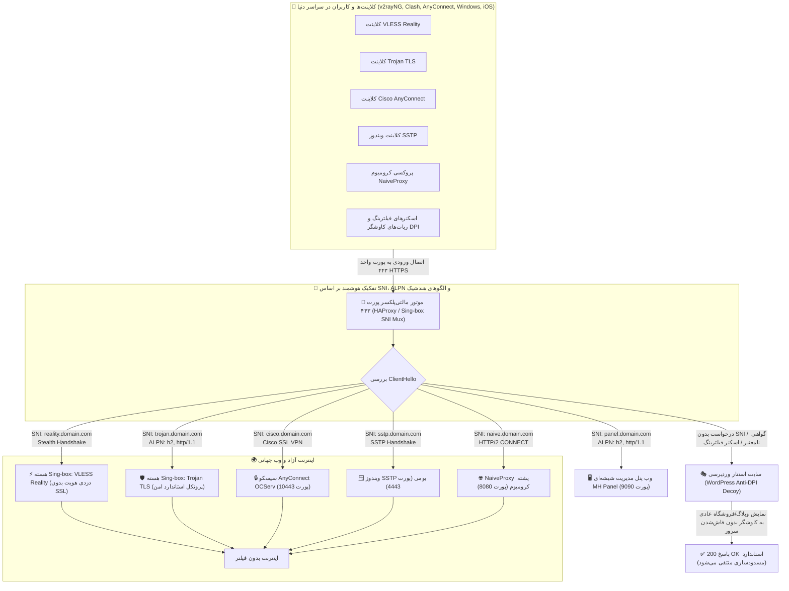
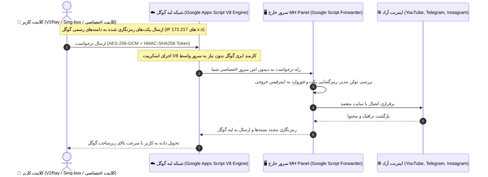
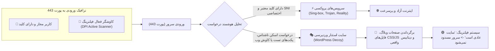
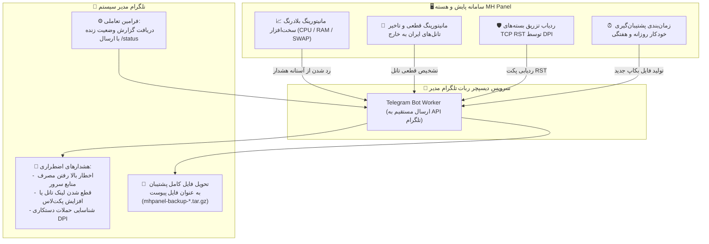
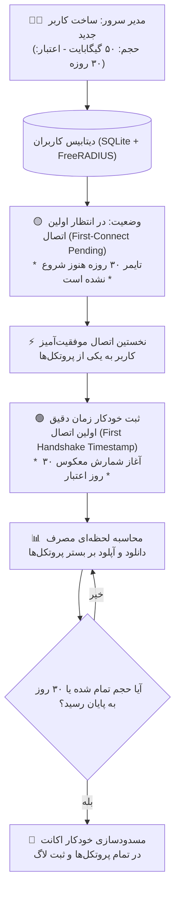

# 🚀 پنل جامع MH Panel - مرکز سازمانی مدیریت پروتکل‌های VPN، تانل‌های ضد فیلترینگ، هسته Sing-box و میکروتیک

<p align="center">
  <a href="README.md"><b>🇬🇧 English Documentation</b></a> |
  <a href="README_FA.md"><b>🇮🇷 مستندات فارسی (جامع)</b></a> |
  <a href="README_RU.md"><b>🇷🇺 Документация на русском</b></a>
</p>

<p align="center">
  
  
  
  
  
</p>

---

## 🌟 قابلیت‌های جدید در نسخه ۱.۶.۰ (What's New in v1.6.0)

نسخه **1.6.0** جامع‌ترین و تکامل‌یافته‌ترین نگارش سامانه **MH Panel** است که پیشرفته‌ترین ابزارهای دورزدن فیلترینگ شدید، استتار در برابر کاوشگرهای DPI، اتوماسیون تانل، پشتیبان‌گیری خودکار و هوش پایش تلگرام را در یک پلتفرم یکپارچه گردهم آورده است:

1. ☁️ **پروکسی فول‌تانل با گوگل اسکریپت (Google Apps Script Full-Tunnel Proxy Engine):**
   - عبور ترافیک از بستر شبکه لبه (Edge Network) و آی‌پی‌های دست‌نیافتنی گوگل (`172.217.x.x` و `142.250.x.x`).
   - استقرار خودکار یا دستی بر بستر Google Apps Script V8 بدون هزینه سرور واسط.
   - فورواردر اختصاصی سمت سرور با احراز هویت توکن رمزنگاری‌شده HMAC و سایفر قدرتمند AES-256-GCM.
   - استودیوی مدیریت اختصاصی در پنل با امکان تولید لینک، اشتراک کلاینت و بررسی لحظه‌ای سلامت ارتباط.

2. 🎭 **سایت استتار وردپرسی برای فریب بازرسی عمیق بسته (Anti-DPI WordPress Decoy Site):**
   - نصب خودکار یک وبلاگ یا فروشگاه واقعی وردپرس روی دامنه دلخواه یا به عنوان فالبک پورت ۴۴۳.
   - فریب قطعی اسکنرهای فعال (Active Probers) فایروال مخابرات؛ در صورت ارسال درخواست‌های مشکوک یا نامعتبر، سرور محتوای استاندارد وردپرس با هدرهای معتبر وب بازمی‌گرداند و ماهیت فیلترشکن را به طور کامل پنهان می‌کند.

3. 🤖 **ربات تلگرام مدیر سیستم، هشدار بلادرنگ و ارسال خودکار بکاپ (Telegram Bot Alerts & Backup Hub):**
   - اتصال مستقیم به ربات تلگرام مدیر بدون نیاز به پروکسی جانبی.
   - هشدارهای فوری پایش منابع سرور (فشار بیش از حد به CPU، پر شدن RAM یا فضای دیسک).
   - ردیابی دستکاری پکت‌های شبکه توسط فیلترینگ (تزریق پکت‌های TCP RST) و اعلان بلادرنگ در چت تلگرام.
   - ارسال خودکار فایل کامل بکاپ پنل و دیتابیس کاربران به چت مدیر در تلگرام طبق برنامه زمان‌بندی روزانه/هفتگی.

4. 💾 **مرکز جامع پشتیبان‌گیری و بازگردانی سریع (Full Backup & Restore Suite):**
   - پشتیبان‌گیری کامل با ۱ کلیک از تمامی کانفیگ‌های پنل، هسته Sing-box، دیتابیس کاربران FreeRADIUS، گواهینامه‌های SSL و تعاریف تانل‌ها.
   - بازگردانی فوری با بررسی یکپارچگی فایل فشرده (`.tar.gz`) و بارگذاری مجدد خودکار تمامی سرویس‌ها.

5. ⏱️ **محاسبه هوشمند ترافیک و اعتبار پس از اولین اتصال (Sing-box First-Connect Trigger):**
   - برای کاربران هسته Sing-box، تایمر انقضای اکانت (مثلاً ۳۰ روزه) به جای زمان ساخت اکانت، دقیقاً از **لحظهٔ برقراری نخستین هندشیک فعال کاربر** شروع به شمارش معکوس می‌کند.

6. 🔀 **معماری پیشرفته مالتی‌پروتکل روی پورت واحد ۴۴۳ (Single Port 443 Multi-Protocol Multiplexer):**
   - اشتراک‌گذاری پورت ۴۴۳ میان بیش از ۲۶ پروتکل (VLESS Reality، Trojan، Hysteria 2، TUIC v5، NaiveProxy، AnyConnect، SSTP و پنل وب) با تفکیک هوشمند بر پایه SNI و ALPN Routing بدون تداخل.

7. 🌍 **بومی‌سازی استاندارد و دقیق به ۸ زبان زنده دنیا (8-Language Engine):**
   - ترجمه ۱۰۰٪ اختصاصی و استاندارد برای زبان‌های: **فارسی (FA)**، **انگلیسی (EN)**، **روسی (RU)**، **عربی (AR)**، **ایتالیایی (IT)**، **اسپانیایی (ES)**، **چینی ساده (ZH)** و **آلمانی (DE)**.
   - چیدمان هوشمند معکوس اسکرول‌بار: در حالت RTL اسکرول صفحه در منتهی‌الیه سمت چپ و اسکرول سایدبار در منتهی‌الیه سمت راست؛ در حالت LTR به صورت خودکار برعکس.

8. 📱 **رابط کاربری واکنش‌گرا و مدرن (Responsive UI 2.0):**
   - کادر جستجوی یکپارچه و سریع در سایدبار برای پیدا کردن آنی پروتکل‌ها و ابزارها.
   - ارتفاع کامل و داک‌شده سایدبار (عدم معلق ماندن هنگام اسکرول) با هدر و فوتر پین‌شده ثابت.
   - نوار ابزار کپسولی لمسی در پایین نسخه موبایل با آواتارهای ۳۸ پیکسلی Squircle.

---

## 📐 ۱. نمودارهای معماری و جریان ترافیک (Visual Architecture Diagrams)

### دیاگرام ۱: معماری مالتی‌پروتکل و اشتراک پورت ۴۴۳ (Single Port 443 Sharing)

این قابلیت حیاتی به مدیر سرور اجازه می‌دهد تنها با باز کردن پورت **۴۴۳**، تمامی پروتکل‌های روز دنیا را همزمان با وب‌سایت فریب و پنل وب بدون کوچک‌ترین تداخل اجرا کند:



---

### دیاگرام ۲: پروکسی فول‌تانل با گوگل اسکریپت (Google Apps Script Proxy Pipeline)

روشی نفوذناپذیر در برابر DPI اپراتورها؛ به دلیل میزبانی اسکریپت روی دامنه‌های رسمی `script.google.com`، فیلترینگ امکان مسدودسازی آی‌پی گوگل را بدون از کار انداختن خدمات حیاتی گوگل نخواهد داشت:



---

### دیاگرام ۳: سایت استتار وردپرس در برابر اسکنرهای فعال (Decoy vs Active Probing)



---

### دیاگرام ۴: ربات تلگرام مدیر و چرخه خودکار اعلان‌ها و بکاپ



---

### دیاگرام ۵: چرخه عمر کاربر و محاسبه حجم پس از اولین اتصال (First-Connect Trigger)



---

## 📚 ۲. جدول جامع پروتکل‌های پشتیبانی‌شده در MH Panel

سامانه MH Panel کامل‌ترین مجموعه پروتکل‌ها و تانل‌ها را در دنیای نرم‌افزارهای مدیریت سرور ارائه می‌دهد:

| ردیف | نام پروتکل | هسته اجرایی | پورت پیش‌فرض | مکانیزم امنیتی و ویژگی رقابتی |
|:---:|---|---|:---:|---|
| ۱ | **VLESS Reality** | Sing-box Core Suite | ۴۴۳ | مدرن‌ترین پروتکل دنیا؛ سرقت هویت سایت‌های معتبر خارجی، بدون نیاز به گواهی SSL، کاملاً ناشناس در برابر DPI. |
| ۲ | **Trojan TLS** | Sing-box Core Suite | ۸۴۴۳ (یا ۴۴۳ اشتراکی) | پنهان‌سازی کامل ترافیک در قالب بسته‌های استاندارد HTTPS با رمزنگاری TLS 1.3 معتبر. |
| ۳ | **Hysteria 2** | Sing-box Core Suite | ۷۴۴۳ (UDP) | مبتنی بر پروتکل QUIC سفارشی با الگوریتم کنترل ازدحام Brutal؛ عبور فوق‌العاده از شبکه‌های دارای پکت‌لاس شدید. |
| ۴ | **TUIC v5** | Sing-box Core Suite | ۸۴۴۸ (UDP) | پروتکل مبتنی بر بستر QUIC (HTTP/3) با هندشیک 0-RTT، مصرف بهینه باتری موبایل و پایداری بالا. |
| ۵ | **Shadowsocks 2022** | Sing-box / Rust | ۸۳۸۸ | سایفرهای نسل جدید AEAD 2022 با سرعت بی‌نظیر و ایمنی کامل در برابر کاوشگرهای فعال شبکه. |
| ۶ | **NaiveProxy** | Sing-box / Chromium | ۸۰۸۰ | استفاده از پشته شبکه مرورگر Google Chrome؛ ترافیک آن از وبگردی عادی کاربران با کروم غیرقابل تفکیک است. |
| ۷ | **Google Apps Script Proxy** | Google V8 + Node.js | وب‌هوک گوگل | عبور ترافیک از بستر شبکه لبه گوگل؛ فیلترینگ قادر به فیلتر کردن رنج آی‌پی‌های گوگل نخواهد بود. |
| ۸ | **سایت استتار وردپرس (Decoy)** | Nginx + PHP/WP | ۸۰, ۴۴۳ فالبک | وب‌سایت واقعی وردپرس جهت گمراه‌سازی اسکنرهای فعال فایروال مخابرات در صورت ارسال درخواست‌های متفرقه. |
| ۹ | **AmneziaWG (AWG)** | درایور کرنل لینوکس | ۵۱۸۲۰ (UDP) | وایرگارد ارتقایافته با تزریق بسته‌های تصادفی زباله (`Jc`, `Jmin`, `Jmax`) و تغییر هدر دست‌دهی (`S1`, `S2`, `H1-H4`). |
| ۱۰ | **WireGuard استاندارد** | درایور کرنل لینوکس | ۵۱۸۲۱ (UDP) | سبک‌ترین پروتکل VPN لایه هسته سیستم‌عامل با پشتیبانی همزمان از ساب‌نت‌های دوگانه IPv4 و IPv6. |
| ۱۱ | **Cisco AnyConnect** | OCServ | ۱۰۴۴۳ (یا ۴۴۳) | پایداری فوق‌العاده روی تمامی اپراتورهای همراه اول و ایرانسل، سازگار با کلاینت رسمی سیسکو روی تمام دیوایس‌ها. |
| ۱۲ | **ویندوز SSTP** | sstpd | ۴۴۴۳ (یا ۴۴۳) | اتصال بومی در تمام نسخه‌های ویندوز بدون نیاز به نصب حتی یک برنامه جانبی بر بستر SSL. |
| ۱۳ | **IKEv2 / IPsec** | StrongSwan | ۵۰۰, ۴۵۰۰ (UDP) | اتصال مستقیم در آیفون، مک و ویندوز همراه با قابلیت سوییچ سریع شبکه هنگام جابجایی دکل‌های موبایل (MOBIKE). |
| ۱۴ | **L2TP / IPsec** | xl2tpd + Libreswan | ۱۷۰۱, ۵۰۰ (UDP) | پروتکل سنتی با رمزنگاری پیشرفته سخت‌افزاری، سازگار با تمامی روترها و کنسول‌های بازی. |
| ۱۵ | **OpenVPN (TCP / UDP)** | OpenVPN Community | ۱۱۹۴ | پشتیبانی از نسخه‌های استاندارد ۲.۶، الگوریتم‌های Scramble XOR و شتاب‌دهنده UDPspeeder. |
| ۱۶ | **SSH WebSocket (WSS)** | OpenSSH + Python WS | ۲۲, ۴۴۴۴ | تونل مستقیم SSH همراه با پروکسی وب‌سوکت معکوس و سرویس BadVPN (پورت ۷۳۰۰) جهت کاهش پینگ بازی‌ها. |
| ۱۷ | **ShadowTLS v3** | Sing-box Core | ۸۴۴۴ | پوشش ترافیک شادوساکس در پوسته TLS معتبر بدون نیاز به ارائه کلید خصوصی وب‌سایت هدف. |
| ۱۸ | **SlowDNS / DNSTT** | DNSTT Suite | ۵۳ (UDP) | عبور تضمینی در زمان ملی‌شدن یا قطعی کامل اینترنت بین‌الملل در قالب پرس‌وجوهای DNS معتبر. |
| ۱۹ | **VayDNS & Slipstream** | DNS Suite | ۵۳۵۳ (UDP) | تونل‌های مدرن DNS نسل جدید با الگوریتم متراکم‌سازی و رمزنگاری پکت‌های تبادلی. |
| ۲۰ | **پل‌های ارتباطی Tor (Bridges)** | Tor Core | ۹۰۵۰, ۹۰۵۱ | پل‌های رسمی Snowflake، obfs4 و WebTunnel برای اتصال غیرقابل شناسایی به شبکه امن تور. |
| ۲۱ | **MTProto Proxy** | Python / Rust | ۸۴۴۵ | پروکسی رسمی و اختصاصی تلگرام با پشتیبانی از سکرت‌های فیک TLS برای جلوگیری از فیلترینگ تلگرام. |
| ۲۲ | **WSTunnel (WebSocket TLS)** | WSTunnel Core | ۸۰۸۸ | انتقال ترافیک بر بستر استاندارد وب‌سوکت دوطرفه همراه با پوشش کامل TLS. |
| ۲۳ | **Rathole (High-Speed Rust)** | Rathole Engine | ۸۰۸۹ | سریع‌ترین تانل سبک نوشته‌شده به زبان راست با حداقل مصرف پردازنده و رم برای اتصال سرور ایران به خارج. |
| ۲۴ | **Chisel Tunnel** | Chisel Go | ۸۰۹۰ | تانل کلاینت-سرور مبتنی بر بستر امن HTTP/WebSocket با قابلیت مالتی‌پلکس همزمان کانکشن‌ها. |
| ۲۵ | **GOST v3 Relay** | GOST Multi-Node | ۸۰۹۱ | قابلیت رله چندنقطه‌ای (Mesh Chaining) ترافیک از سرورهای میانی به سمت مقصد. |
| ۲۶ | **تونل‌های لایه ۲ و ۳ لینوکس** | درایورهای کرنل لینوکس | متغیر | شامل پروتکل‌های IPIP، SIT (6in4)، GRE، GRETAP، IP6GRE، IP6GRETAP، VXLAN و GENEVE. |

---

## ⚡ ۳. راهنمای نصب سریع و آسان (Installation)

### پیش‌نیازهای سیستمی:
- **سیستم‌عامل‌های سازگار:**
  - Ubuntu 24.04 LTS (Noble Numbat)
  - Ubuntu 22.04 LTS (Jammy Jellyfish)
  - Ubuntu 20.04 LTS (Focal Fossa)
  - Debian 12 (Bookworm) / Debian 11 (Bullseye)
- **سخت‌افزار حداقلی:** ۱ هسته پردازنده، ۱ گیگابایت رم، ۱۰ گیگابایت فضای دیسک.
- **دسترسی کاربری:** دسترسی کامل کاربری ریشه (`root`).

### روش ۱: نصب تک‌خطی خودکار (پیشنهادی):

کافیست دستور زیر را مستقیماً در محیط ترمینال سرور خود کپی و اجرا نمایید:

```bash
bash <(curl -fsSL https://raw.githubusercontent.com/t-51/MHPanel/main/install.sh)
```

### روش ۲: نصب دستی با استفاده از مخزن گیت‌هاب:

```bash
# کلون کردن مخزن
git clone https://github.com/t-51/MHPanel.git /www/wwwroot/mhpanel

# ورود به دایرکتوری و اجرای نصاب
cd /www/wwwroot/mhpanel
sudo bash install.sh
```

پس از پایان فرآیند نصب، اطلاعات ورود به پنل شامل آدرس وب، پورت اختصاصی، نام کاربری و رمز عبور پیش‌فرض به همراه کلید API در خروجی ترمینال برای شما چاپ خواهد شد.

---

## 🧭 ۴. منوی تعاملی خط فرمان سرور (`mhpanel`)

علاوه بر داشبورد وب، سامانه دارای یک کنسول ترمینال بسیار سریع و قدرتمند است. در هر زمان تنها با تایپ دستور زیر در خط فرمان به این منو دسترسی خواهید داشت:

```bash
mhpanel
```

```text
  ======================================================================
     🚀 مرکز مدیریت خط فرمان پنل جامع MH PANEL (نسخه ۱.۶.۰)
  ======================================================================
  [1]  اجرای نصب خودکار و کامل (نصب تمام پروتکل‌ها و وابستگی‌ها)
  [2]  ویزارد نصب مرحله‌به‌مرحله و سفارشی
  [3]  نصب سبک پنل وب به تنهایی
  ----------------------------------------------------------------------
  [4]  گزارش زنده عیب‌یابی سرور و سرویس‌ها (Diagnostic Report)
  [5]  مدیریت، نصب، حذف و تغییر پورت پروتکل‌های VPN
  [6]  مرکز تانل‌های ضد فیلترینگ و پل ارتباطی میکروتیک (RouterOS)
  [7]  تنظیمات پنل وب (تغییر کاربر، پسورد، پورت و ری‌استارت سرویس)
  [8]  مدیریت گواهینامه‌های SSL (Let's Encrypt و گواهی ۱۰ ساله IP SAN)
  [9]  بهینه‌سازی شبکه و هسته لینوکس (فعالسازی BBR، فورواردینگ پکت‌ها)
  [10] پشتیبان‌گیری و بازیابی اطلاعات پنل (Backup & Restore Hub)
  [11] استودیوی سایت استتار وردپرسی (Anti-DPI WordPress Decoy)
  [12] تنظیمات و تست ربات تلگرام مدیر سیستم (Telegram Bot Alerts)
  [13] بررسی و دریافت آخرین آپدیت‌های رسمی پنل از گیت‌هاب
  [0]  خروج از منو
  ======================================================================
```

---

## 🎛️ ۵. معماری اتصال تانل‌ها و اسکریپت‌ساز روتر میکروتیک (MikroTik RouterOS Hub)

پنل به طور کامل از پل‌های ارتباطی دوطرفه میان سرورهای لینوکس و تجهیزات روتربورد میکروتیک پشتیبانی می‌کند:

1. **سازگاری با هر دو نگارش میکروتیک (RouterOS v6 و RouterOS v7):**
   - تولید دستورات بهینه‌شده به زبان اسکریپت ترمینال میکروتیک با ساخت کامل اینترفیس‌های WireGuard، GRE، IPIP یا SSTP.
   - تخصیص خودکار آدرس‌های IP داخلی تونل بر بستر ساب‌نت‌های خلوت (`10.x.x.x/30`).
   - ایجاد رول‌های بهینه NAT Masquerade برای عبور بدون وقفه اینترنت.
   - تنظیم بهینه TCP MSS Clamping (`change-mss`) برای رفع مشکل باز نشدن برخی وب‌سایت‌ها روی موبایل.
2. **اتصال Full Mesh با یک کلیک:**
   - اگر دو سرور در اختیار دارید (سرور ایران و سرور خارج)، نیازی به تنظیم تک‌تک تانل‌ها نیست؛ با زدن دکمه Full Mesh Deployer تمامی تانل‌های پشتیبانی‌شده همزمان میان دو سرور راه‌اندازی و تست پینگ بلادرنگ می‌شوند.

---

## 🔒 ۶. احراز هویت متمرکز و اکانتینگ FreeRADIUS + SQLite

سیستم حسابداری کاربران پنل با معماری هیبریدی طراحی شده است:
- **سرعت بالا و استقلال کامل:** اطلاعات کاربران، حجم مجاز، تاریخ انقضا و وضعیت فعالیت در دیتابیس بومی ذخیره می‌شود.
- **همگام‌سازی بلادرنگ با FreeRADIUS:** در صورت فعال‌سازی، یوزرها بلافاصله با جداول استاندارد `radcheck` و `radreply` و User Manager میکروتیک هماهنگ می‌شوند.
- **پشتیبانی از پروتکل‌های چندگانه:** یک اکانت واحد می‌تواند همزمان یا به صورت تفکیک‌شده روی Shadowsocks، TUIC v5، Hysteria 2، Trojan و StunTLS معتبر باشد.
- **آغاز اعتبار پس از اولین اتصال (First-Connect Trigger):** جلوگیری از سوختن روزهای اشتراک خریداران تا زمان اولین اتصال واقعی.

---

## 🛡️ ۷. امنیت و ضد فیلترینگ هوشمند (Anti-Censorship & DPI Shield)

- **سپر ردیابی دستکاری پکت‌ها:** رصد بلادرنگ خطاهای سخت‌افزاری اینترفیس‌ها و تزریق پکت‌های مخرب فایروال DPI.
- **استتار وردپرسی:** سایت فریب مستقل برای جلوگیری از لو رفتن هویت سرور در اسکن‌های دوره‌ای اپراتورها.
- **رمزنگاری انتها به انتها با توکن HMAC:** تونل گوگل اسکریپت با کلیدهای چرخشی ۲۵۶ بیتی مانع از شناسایی الگوی ترافیک توسط سیستم‌های بازرسی عمیق بسته می‌شود.
- **مسدودسازی ترافیک مخرب و اسکنرهای وب:** مجهز به سیستم دفاعی ضد حملات بروت‌فورس روی درگاه‌های مدیریت و ورودی پروتکل‌ها.

---

## 📄 لایسنس و حقوق نشر

این پروژه تحت مجوز متن‌باز [MIT License](LICENSE) با افتخار برای آزادی اینترنت و پایداری ارتباطات منتشر شده است.
حق توسعه و بهره‌برداری آزاد است.
