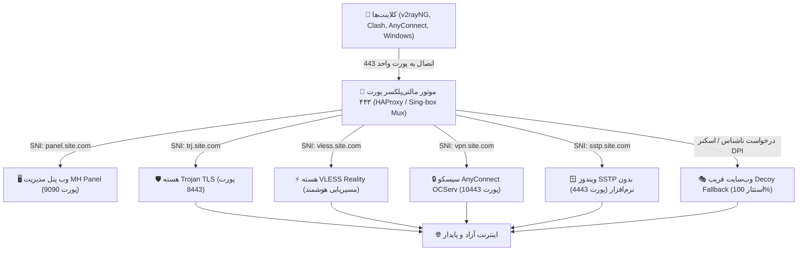
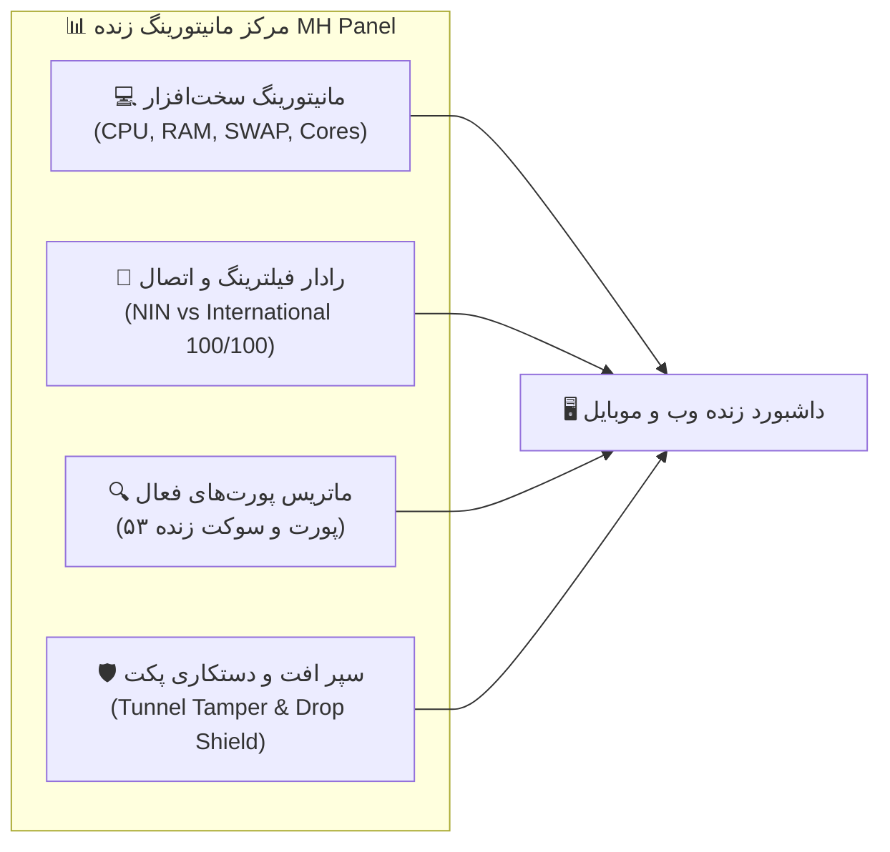
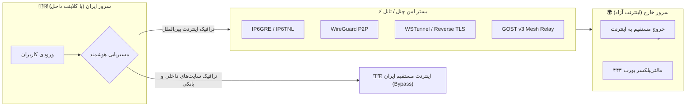

# 🚀 پنل جامع MH Panel - مرکز پیشرفته مدیریت پروتکل‌های VPN، تانل‌های ضد فیلترینگ و میکروتیک

<p align="center">
  <a href="README.md"><b>🇬🇧 English</b></a> |
  <a href="README_FA.md"><b>🇮🇷 فارسی</b></a> |
  <a href="README_RU.md"><b>🇷🇺 Русский</b></a>
</p>

<p align="center">
  
  
  
  
  
</p>

---

### 🌟 امکانات جدید در نسخه ۱.۵.۰ (New in v1.5.0)
- 🔀 **معماری جامع مالتی‌پروتکل و اشتراک پورت ۴۴۳ (Universal Multi-Protocol Port Multiplexer):** اجرای همزمان بیش از ۲۶ پروتکل فیلترشکن و شبکه بر بستر پورت‌های اشتراکی ۴۴۳، ۸۰ و ۸۴۴۳ از طریق تفکیک هوشمند SNI Routing و فالبک‌های پیشرفته بدون کوچک‌ترین تداخل پورت.
- 📱 **بازطراحی لوکس و ارگونومیک نسخه موبایل (Mobile UX 2.0 Overhaul):** نوار ناوبری کپسولی پایین گوشی با اولویت ۷۰ درصدی آیکون‌ها، ۵ تب استراتژیک («داشبورد»، «پروتکل‌ها»، «رادار»، «تونل‌ها»، «منو»)، آواتارهای Squircle لمسی ۳۸×۳۸ پیکسلی برای تمام ۳۵ آیتم دراور، و موتور جستجوی سریع لحظه‌ای در منوی موبایل.
- 📡 **رادار ماتریس پورت‌های فعال پروتکل‌ها (Dynamic Ports & Radar Matrix):** پایش بلادرنگ تمامی سوکت‌های در حال شنود (TCP & UDP)، فیلتر خودکار پورت‌های موقت خروجی، تفکیک وضعیت اتصال به شبکه ملی اطلاعات (NIN) در برابر اینترنت بین‌الملل و محاسبه ضریب سلامت ۱۰۰/۱۰۰ سرور.
- 📦 **یکپارچه‌سازی هسته جهانی Sing-box Core Suite:** پشتیبانی همزمان از VLESS Reality، تروجان (Trojan TLS)، Hysteria 2 (QUIC/Brutal)، TUIC v5، شادوساکس ۲۰۲۲، NaiveProxy کرومیوم، VMess و ShadowTLS v3 با کنترل حجم و انقضا متمرکز.
- ⚡ **سپر ردیابی دستکاری و افت بسته‌های تونل (Tunnel Packet Tamper & Drop Shield):** پایش مداوم نرخ خطای فیزیکی اینترفیس‌ها، ردیابی بسته‌های تزریقی فایروال DPI و هشدارهای پویا در هدر پنل.

---

### 🌟 امکانات پیشین نسخه‌های ۱.۴.۰ و ۱.۳.۰
- 🌐 **پشتیبانی دوطرفه از IPv6 در تمامی تونل‌ها (IPv6 Dual-Stack Tunnels):** روتینگ با درایورهای کرنل لینوکس (`ip6gre`, `ip6gretap`, `ip6tnl`) و تولید اسکریپت‌های دوگانه برای روترهای میکروتیک.
- 🛠️ **اصلاح اساسی AmneziaWG (AWG S2S & Obfuscation):** پاکسازی خودکار اینترفیس `awg0`، پارامترهای استتار هدر (`Jc`, `Jmin`, `Jmax`, `S1`, `S2`, `H1-H4`) و ساب‌نت دوگانه IPv6.
- ⚡ **استودیوی کامل تونل‌های اختصاصی DNS (SlowDNS / DNSTT Studio):** راه‌اندازی گرافیکی تونل‌های DNSTT، کلیدهای مدرن Noise Curve25519 و پایش سرویس‌های Systemd.
- 🔐 **اکانتینگ متمرکز پروتکل‌ها با FreeRADIUS و SQLite:** احراز هویت هیبریدی کاربران، کنترل سهمیه حجم و انقضا، همگام‌سازی لحظه‌ای با User Manager میکروتیک.
- 💾 **استودیوی مدیریت و مانیتورینگ زنده حافظه اسواپ (SWAP Studio):** تغییر آنی حجم اسواپ، تنظیم Swappiness لینوکس و تخلیه فوری کش رم.

---

## 📖 معرفی سامانه

**MH Panel** یک سامانه سازمانی، ماژولار و فوق‌العاده قدرتمند برای مدیریت همه‌جانبه سرورهای لینوکس (اوبونتو ۲۰.۰۴، ۲۲.۰۴، ۲۴.۰۴ و دبیان ۱۱ و ۱۲) است. این سامانه با ترکیب **محیط کاربری تحت وب فوق‌پیشرفته شیشه‌ای (Glassmorphism)** با تم تاریک/روشن و یک **کنسول خط فرمان تعاملی جامع (`mhpanel`)**، به شما اجازه می‌دهد بیش از ۲۶ پروتکل مدرن VPN، تانل‌های شبکه ایران به خارج، مالتی‌پلکسر پورت ۴۴۳ و اسکریپت‌های روتربورد میکروتیک (RouterOS نسخه ۶ و ۷) را با چند کلیک راه‌اندازی و مانیتور کنید.

---

## ⚡ نصب سریع و تک‌خطی (One-Line Installer)

کافیست دستور زیر را با دسترسی کاربری `root` روی سرور اوبونتو یا دبیان خود اجرا نمایید:

```bash
bash <(curl -fsSL https://raw.githubusercontent.com/t-51/MHPanel/main/install.sh)
```

### روش جایگزین با استفاده از Git Clone:

```bash
git clone https://github.com/t-51/MHPanel.git /www/wwwroot/mhpanel
cd /www/wwwroot/mhpanel
sudo bash install.sh
```

---

## 🔀 ۱. معماری مولتی‌پروتکل و اشتراک همزمان روی یک پورت واحد

یکی از بزرگ‌ترین چالش‌های مدیران سرور، مسدودسازی پورت‌های غیراستاندارد توسط فایروال‌های DPI اپراتورهاست. در حالت سنتی، هر پروتکل نیازمند یک پورت مجزا است (مثلاً تروجان روی ۸۴۴۳، نایوپروکسی روی ۴۴۳، سیسکو روی ۱۰۴۴۳ و...). این مسئله باعث شناسایی آسان و فیلتر شدن سرور می‌شود.

سامانه **MH Panel** مجهز به موتور **مالتی‌پلکسر پیشرفته لایه ۴/۷ (Port Multiplexer & SNI Dispatcher)** است که به شما امکان می‌دهد **چندین پروتکل کاملاً متفاوت را همزمان روی یک پورت عمومی واحد (مانند پورت ۴۴۳ یا ۸۴۴۳)** بدون کوچک‌ترین تداخل اجرا کنید.

### 📐 نمودار مفهومی جریان بسته‌ها (Packet Flow Pipeline):

```
                                  ┌───────────────────────────────────────────────┐
                                  │      کاربران و کلاینت‌ها در سراسر جهان        │
                                  │   (موبایل، ویندوز، مک، لینوکس، روتر میکروتیک) │
                                  └───────────────────────┬───────────────────────┘
                                                          │
                                                          │ اتصال امن به پورت واحد ۴۴۳
                                                          ▼
                                  ┌───────────────────────────────────────────────┐
                                  │       موتور مالتی‌پلکسر پورت ۴۴۳ (Port Mux)    │
                                  │        HAProxy / Sing-box SNI Dispatcher      │
                                  └───────────────────────┬───────────────────────┘
                                                          │
                            ┌─────────────────────────────┼─────────────────────────────┐
                            │ بررسی TLS ClientHello       │ تحلیل فیلد SNI و ALPN       │ فالبک شفاف
                            ▼                             ▼                             ▼
                  [sni: panel.domain]           [sni: trojan.domain]          [sni: vless.domain]
                            │                             │                             │
                            ▼                             ▼                             ▼
                 ┌────────────────────┐        ┌────────────────────┐        ┌────────────────────┐
                 │    وب پنل مدیریت   │        │     Trojan TLS     │        │    VLESS Reality   │
                 │    (پورت ۹۰۹۰)     │        │    (پورت ۸۴۴۳)     │        │   (Stealth Core)   │
                 └────────────────────┘        └────────────────────┘        └────────────────────┘
                            │                             │                             │
                            ├─────────────────────────────┼─────────────────────────────┤
                            │                             │                             │
                  [sni: vpn.domain]             [sni: sstp.domain]            [سایر بسته‌ها / فریب]
                            │                             │                             │
                            ▼                             ▼                             ▼
                 ┌────────────────────┐        ┌────────────────────┐        ┌────────────────────┐
                 │ سیسکو AnyConnect   │        │     ویندوز SSTP    │        │  وب‌سایت فریب معتبر │
                 │    (پورت ۱۰۴۴۳)    │        │    (پورت ۴۴۴۳)     │        │ (Decoy / Fallback) │
                 └────────────────────┘        └────────────────────┘        └────────────────────┘
                                                          │
                                                          ▼
                                  ┌───────────────────────────────────────────────┐
                                  │     خروجی ترافیک به اینترنت آزاد و پرسرعت     │
                                  └───────────────────────────────────────────────┘
```

### 🧬 نمودار تعاملی جریان داده (Mermaid Flowchart):



### 🔑 ویژگی‌های برجسته سیستم اشتراک پورت:
1. **یک پورت، تمام پروتکل‌ها:** همزمان وب پنل، پروتکل Trojan TLS، پروتکل VLESS Reality، سیسکو AnyConnect، پروکسی NaiveProxy و ویندوز SSTP روی پورت **۴۴۳** کار می‌کنند.
2. **استتار صددرصدی در برابر کاوشگرهای فعال (Active Probing Resistance):** اگر ربات‌های فیلترینگ یا کاوشگرهای شبکه بدون داشتن دامنه یا کلید معتبر به سرور متصل شوند، به صورت خودکار به وب‌سایت فریب معتبر با گواهی رسمی هدایت می‌شوند.
3. **پشتیبانی از پروتکل‌های UDP با پورت هاپینگ و مالتی‌پورت:** برای پروتکل‌های پرسرعت بر پایه UDP نظیر Hysteria 2 و WireGuard، پنل قابلیت شنود همزمان روی بازه‌های دلخواه پورت (مانند `20000-50000`) را فراهم می‌کند تا پکت‌های UDP در یک رنج مشخص مدام تغییر مسیر دهند و فایروال نتواند آن را مسدود کند.

---

## 📡 ۲. مرکز مانیتورینگ زنده و رادار پایش شبکه

داشبورد MH Panel تنها یک پنل پیکربندی نیست، بلکه یک **مرکز عملیات امنیت و پایش زنده سرور (NOC / SOC)** است:



1. **مانیتورینگ منابع سخت‌افزاری با بروزرسانی ۱.۵ ثانیه‌ای:**
   * نمودار زنده نوسانات CPU و RAM در طول زمان.
   * گیج‌های پیشرفته نمایش مصرف رم فیزیکی، حافظه مجازی اسواپ (SWAP) و دیسک.
   * نمودار تفکیکی بار پردازشی تک‌تک هسته‌های پردازنده (Cores Workload Grid).
2. **رادار پورت‌های فعال پروتکل‌ها (VPN Protocols Port Matrix):**
   * شناسایی خودکار و پویا از میان ۵۳ سوکت در حال شنود سرور.
   * تشخیص دقیق پروتکل متصل به پورت (مثلاً SSH روی ۲۲، تروجان روی ۸۴۴۳، هیستوریا روی ۷۴۴۳ و...).
   * فیلتر هوشمند پورت‌های موقت خروجی (Ephemeral Outbound UDP) برای جلوگیری از نمایش داده‌های کاذب.
3. **رادار ضد فیلترینگ و اتصال شبکه ملی در برابر بین‌الملل (NIN vs World):**
   * پایش بلادرنگ پکت‌لاس، تاخیر (Latency) و سلامت مسیر با سرورهای مخابرات، همراه اول، ایرانسل و اینترنت جهانی (Cloudflare / Google DNS).
   * محاسبه دقیق ضریب پایداری شبکه با نمره ۱۰۰/۱۰۰ بدون کسر نمره کاذب به دلیل بسته‌بودن پکت‌های ICMP.
4. **سپر ردیابی دستکاری و دراپ پکت‌های تانل (Tunnel Tamper & Drop Shield):**
   * رصد لحظه‌ای بسته‌های تزریق شده با پرچم TCP RST توسط سیستم‌های فیلترینگ.
   * نمایش هشدار فوری در نوار بالای پنل در صورت بروز نوسان یا دستکاری پکت‌ها.

---

## 🌐 ۳. مرکز چنل‌ها، تانل‌های شبکه (ایران ↔ خارج) و مسیریابی هوشمند

سامانه MH Panel کامل‌ترین هاب ارتباطی و رله ترافیک میان سرورهای داخل کشور و سرورهای خارج را در اختیار شما می‌گذارد:



### قابلیت‌های مسیریابی هوشمند (Smart Routing & Channels):
* **تفکیک ترافیک داخلی و خارجی (Split Tunneling):** ترافیک وب‌سایت‌های ایرانی، درگاه‌های پرداخت شتاب و سامانه‌های دولتی به صورت خودکار از سرور ایران به صورت مستقیم عبور کرده و فیلترشکن را دور می‌زند. این امر مانع از مسدود شدن حساب‌های بانکی کاربران می‌شود.
* **پشتیبانی کامل از دو پشته IPv4 و IPv6 (Dual-Stack):** تمام تانل‌های GRE، SIT و WireGuard از هر دو نسخه آدرس‌دهی اینترنتی پشتیبانی می‌کنند.
* **تولید خودکار کانفیگ و اسکریپت میکروتیک (RouterOS v6 & v7):** با یک کلیک، اسکریپت کامل ترمینال میکروتیک شامل ساخت اینترفیس، آدرس‌دهی، روت‌های استاتیک، رول‌های فایروال NAT Masquerade و بهینه‌سازی MSS Clamping تولید می‌شود.
* **تونل‌های معکوس (Reverse Tunnels):** قابلیت اتصال سرور خارج به سرور ایران از داخل، مناسب برای شرایطی که سرور ایران آی‌پی پابلیک مستقیم ندارد یا پشت فایروال مخابرات قرار دارد.

---

## 📚 فهرست پروتکل‌های پشتیبانی‌شده در MH Panel

| نام پروتکل | هسته اجرایی | پورت پیش‌فرض | ویژگی و مزیت رقابتی |
|---|---|---|---|
| **VLESS Reality** | Sing-box Core | ۴۴۳ | مدرن‌ترین پروتکل فیلترشکن دنیا، بدون نیاز به گواهی SSL، سرقت هویت سایت‌های معتبر. |
| **Trojan TLS** | Sing-box Core | ۸۴۴۳ (یا ۴۴۳ اشتراکی) | شبیه‌سازی دقیق رفتار وب‌سایت HTTPS معتبر با رمزنگاری TLS استاندارد. |
| **Hysteria 2** | Sing-box Core | ۷۴۴۳ (UDP) | سریع‌ترین پروتکل UDP با الگوریتم کنترل ازدحام Brutal برای عبور از پکت‌لاس شدید. |
| **TUIC v5** | Sing-box Core | ۸۴۴۸ (UDP) | پروتکل مبتنی بر بستر QUIC (HTTP/3) با هندشیک 0-RTT و پایداری عالی. |
| **Shadowsocks 2022** | Sing-box / Rust | ۸۳۸۸ | سایفرهای نسل جدید AEAD 2022 با سرعت بالا و امنیت کامل در برابر ردپایابی. |
| **NaiveProxy** | Sing-box Core | ۸۰۸۰ | شبیه‌سازی کامل رفتار پشته مرورگر Google Chrome و عبور از عمیق‌ترین فایروال‌ها. |
| **AmneziaWG (AWG)** | کرنل لینوکس | ۵۱۸۲۰ (UDP) | وایرگارد ارتقایافته با تزریق بسته‌های تصادفی زباله و تغییر هدر دست‌دهی. |
| **WireGuard استاندارد** | کرنل لینوکس | ۵۱۸۲۱ (UDP) | سبک‌ترین پروتکل VPN لایه کرنل با تخصیص همزمان IPv4 و IPv6. |
| **Cisco AnyConnect** | OCServ | ۱۰۴۴۳ (یا ۴۴۳) | پایداری فوق‌العاده روی اینترنت موبایل و سازگار با تمام دستگاه‌های اداری و سازمانی. |
| **ویندوز SSTP** | sstpd | ۴۴۴۳ (یا ۴۴۳) | اتصال بومی در تمام نسخه‌های ویندوز بدون نیاز به نصب هیچ‌گونه نرم‌افزار جانبی. |
| **IKEv2 / IPsec** | StrongSwan | ۵۰۰, ۴۵۰۰ (UDP) | اتصال مستقیم و نیتیو در آیفون، مک و ویندوز با ویژگی سوییچ سریع شبکه (MOBIKE). |
| **OpenVPN Scramble** | OpenVPN Core | ۱۱۹۴ (TCP/UDP) | نسخه پچ‌شده اوپن‌وی‌پی‌ان با الگوریتم XOR Scramble و شتاب‌دهنده UDPspeeder. |
| **SSH WebSocket** | OpenSSH + WSS | ۲۲, ۴۴۴۴ | تونل SSH مستقیم همراه با پروکسی وب‌سوکت و سرویس BadVPN (پورت ۷۳۰۰) برای گیمینگ. |
| **SlowDNS / DNSTT** | DNSTT Suite | ۵۳ (UDP) | عبور تضمینی در زمان ملی‌شدن یا قطعی کامل اینترنت بین‌الملل در قالب پکت‌های DNS. |
| **پل‌های Tor (Bridges)** | Tor Core | ۹۰۵۰, ۹۰۵۱ | پل‌های ارتباطی امن Snowflake و obfs4 برای اتصال نامرئی به شبکه تور. |

---

## 📱 ۴. بازطراحی و تجربه کاربری موبایل (Mobile Experience 2.0)

نسخه موبایل پنل به طور کامل بازنویسی شده است تا تمامی کارهای مانیتورینگ و مدیریت سرور را بتوان با یک دست روی گوشی انجام داد:
* **نوار ابزار کپسولی پایین گوشی:** دسترسی آنی با انگشت شست به داشبورد، پروتکل‌ها، رادار زنده، تونل‌ها و منوی اصلی.
* **آواتارهای Squircle ۳۸×۳۸ پیکسلی:** حذف متن‌های شلوغ و تمرکز بصری روی آیکون‌های شفاف و مدرن.
* **جستجوی بلادرنگ در منوی کشویی:** با نوشتن حتی ۱ حرف پروتکل دلخواه را بیابید.
* **طراحی Responsive ضد زوم:** مناسب برای تمام رزولوشن‌ها از صفحات کوچک ۳۶۰ پیکسل تا تبلت‌ها و دسکتاپ.

---

## 🧭 منوی تعاملی خط فرمان سرور (`mhpanel`)

علاوه بر داشبورد وب، در محیط ترمینال لینوکس نیز می‌توانید تنها با تایپ دستور زیر به مرکز مدیریت سرور دسترسی داشته باشید:

```bash
mhpanel
```

```text
  ======================================================================
     🚀 مرکز مدیریت خط فرمان پنل جامع MH PANEL (نسخه ۱.۵.۰)
  ======================================================================
  [1]  اجرای نصب خودکار و کامل (نصب تمام پروتکل‌ها و وابستگی‌ها)
  [2]  ویزارد نصب مرحله‌به‌مرحله و سفارشی
  [3]  نصب سبک پنل وب به تنهایی
  ----------------------------------------------------------------------
  [4]  گزارش زنده عیب‌یابی سرور و سرویس‌ها (Diagnostic Report)
  [5]  مدیریت، نصب، حذف و تغییر پورت پروتکل‌های VPN
  [6]  مرکز تانل‌های ضد فیلترینگ و پل ارتباطی میکروتیک
  [7]  تنظیمات پنل وب (نام کاربری، کلمه عبور ادمین، پورت، ری‌استارت)
  [8]  مدیریت گواهینامه‌های SSL (Let's Encrypt و IP SAN ده ساله)
  [9]  بهینه‌سازی شبکه و هسته لینوکس (BBR، فورواردینگ IPv4 و IPv6)
  [10] پشتیبان‌گیری و بازیابی اطلاعات پنل (Backup & Restore)
  [11] بررسی و دریافت آخرین آپدیت‌های پنل
  [0]  خروج
```

---

## 📄 لایسنس

این پروژه تحت مجوز متن‌باز [MIT License](LICENSE) منتشر شده است.
