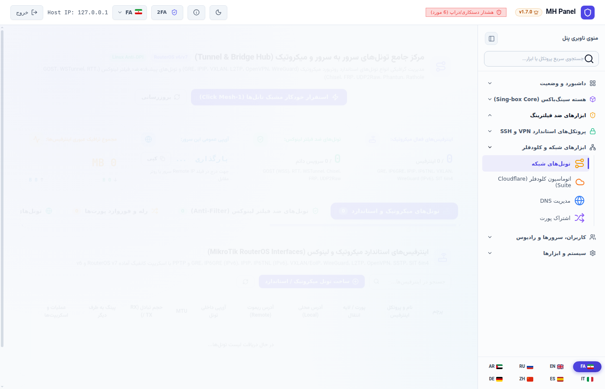
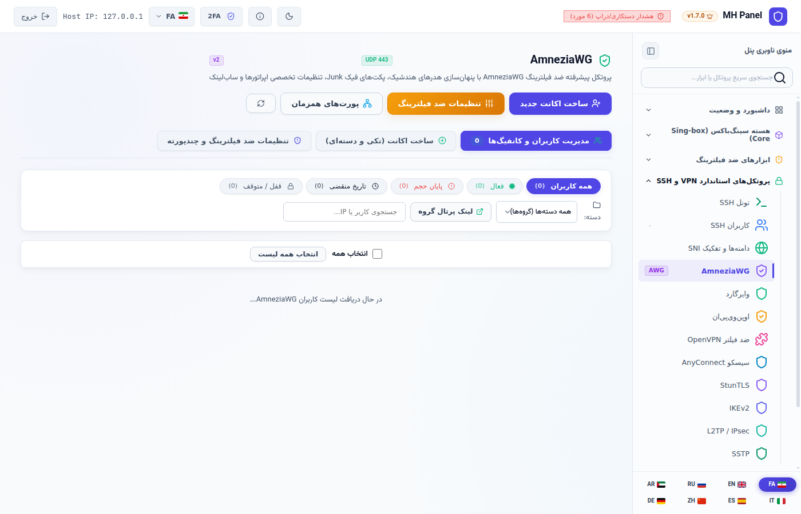

# 🚀 MH Panel - Hub Enterprise per Gestione VPN, Tunnel Anti-Censura, Sing-box Universal Suite e MikroTik RouterOS

<p align="center">
  <a href="README.md"><b>🇬🇧 English</b></a> |
  <a href="README_FA.md"><b>🇮🇷 فارسی</b></a> |
  <a href="README_RU.md"><b>🇷🇺 Русский</b></a> |
  <a href="README_AR.md"><b>🇸🇦 العربية</b></a> |
  <a href="README_IT.md"><b>🇮🇹 Italiano</b></a> |
  <a href="README_ES.md"><b>🇪🇸 Español</b></a> |
  <a href="README_ZH.md"><b>🇨🇳 简体中文</b></a> |
  <a href="README_DE.md"><b>🇩🇪 Deutsch</b></a>
</p>

<p align="center">
  
  
  
  
  
  
  <a href="https://donito.me/ME_Script" target="_blank"></a>
  
</p>

---

## ⚡ Installazione Rapida in 1 Riga (Quick Start)

Installa **MH Panel** in meno di 60 secondi con gestione automatizzata di dipendenze, moduli kernel, certificati SSL e servizi systemd:

```bash
bash <(curl -fsSL https://raw.githubusercontent.com/t-51/MHPanel/main/install.sh)
```

> [!TIP]
> **Requisiti di Sistema:**
> - **Sistemi Operativi:** Ubuntu 24.04 LTS, Ubuntu 22.04 LTS, Ubuntu 20.04 LTS, Debian 12 (Bookworm), Debian 11 (Bullseye)
> - **Risorse Minime:** 1 vCPU, 1 GB RAM, 10 GB spazio disco
> - **Privilegi:** Accesso root (`sudo -i` o `su -`)

<details>
<summary><b>📦 Metodo Alternativo: Installazione Manuale via Git</b></summary>

```bash
# Clona il repository
git clone https://github.com/t-51/MHPanel.git /www/wwwroot/mhpanel

# Entra nella directory ed esegui l'installer
cd /www/wwwroot/mhpanel
sudo bash install.sh
```

Al termine, il terminale mostrerà l'URL del pannello Web, le credenziali di accesso, la porta e la chiave API.
</details>

---

## 📡 Motore di Sottoscrizione Intelligente (Tutte le 23 Config in 1 Link)

MH Panel integra un motore di abbonamento universale in grado di erogare tutte le **23 configurazioni Sing-box** e le credenziali SSH in un **singolo link unificato**:

### 🎯 Ottimizzato per Tutti i Client Moderni:
- **SlipNet** (Importazione automatica completa, scanner DoH e lettura QR Bridge Tor)
- **v2rayNG** / **v2rayN** (Base64 standard con aggiornamento periodico `profile-update-interval=24`)
- **Hiddify** / **NekoBox** (Supporto nativo Sing-box, Reality, QUIC e Fragment)
- **Streisand** / **Shadowrocket** / **Clash Meta**

### 🔗 Formati di Sottoscrizione ed Endpoint:
| Tipo Sottoscrizione | URL Endpoint | Descrizione |
|---|---|---|
| **Base64 Universale** | `https://<DOMAIN>:<PORT>/sub/<TOKEN>/b64` | Stringa Base64 contenente tutte le 23 configurazioni attive con pulsante di copia rapida a 1 click. |
| **Profilo Sing-box JSON** | `https://<DOMAIN>:<PORT>/sub/<TOKEN>/singbox.json` | Profilo JSON nativo con routing intelligente e protezione da DNS leak. |
| **Fragment / Cloud IP** | `https://<DOMAIN>:<PORT>/sub/<TOKEN>/singbox-fragment.json` | Configurazione con frammentazione TLS SNI per aggirare il blocco DPI. |
| **Portale Web Utente** | `https://<DOMAIN>:<PORT>/sub/<TOKEN>` | Pagina Web interattiva con tema chiaro e scuro, consumo traffico, scadenza e QR Code unificato. |

---

## 📑 Indice dei Contenuti

- [⚡ Installazione Rapida in 1 Riga](#-installazione-rapida-in-1-riga-quick-start)
- [📡 Motore di Sottoscrizione Intelligente](#-motore-di-sottoscrizione-intelligente-tutte-le-23-config-in-1-link)
- [🌟 Novità della Versione 1.7.0](#-novità-della-versione-170)
- [📸 Galleria Visiva con Tema Chiaro](#-galleria-visiva-con-tema-chiaro-light-theme-gallery)
- [📐 Architettura e Flussi di Rete](#-architettura-e-flussi-di-rete)
- [📚 Tabella dei Protocolli Supportati](#-tabella-dei-protocolli-supportati)
- [🧭 Console Interattiva CLI (`mhpanel`)](#-console-interattiva-cli-mhpanel)
- [🤝 Ringraziamenti e Progetti Upstream](#-ringraziamenti-e-progetti-upstream-upstream-projects)
- [📢 Canale Ufficiale e Community](#-canale-ufficiale-e-community)
- [📄 Licenza](#-licenza)

---

## 🌟 Novità della Versione 1.7.0

La versione **1.7.0** rappresenta una grande evoluzione nella resilienza anti-censura, integrazione completa Sing-box, doppia interfaccia grafica (Tema Chiaro e Scuro) e abbonamenti client unificati:

1. ⚡ **Suite a 23 Modalità Sing-box:**
   - Deploy automatico di: **VLESS Reality** (Vision, TCP, gRPC, HTTPUpgrade), **VLESS TLS**, **VMess**, **Trojan**, **Hysteria 2** (Salamander & Brutal QUIC), **TUIC v5** (0-RTT), **Shadowsocks 2022**, **NaiveProxy** (Chrome Stack) e **ShadowTLS v3**.
2. 📡 **Motore Abbonamenti Universale (SlipNet, V2Ray, Sing-box & Hiddify):**
   - Creazione istantanea del link Base64 intelligente con routing prioritario SNI dei domini validi SSL.
3. 🎛️ **Interfaccia Inbound Compatta e Modale Interattivo:**
   - Visualizzazione in riga singola `[ ⚙️ 23 Inbounds Active (Manage ⚙️) ]` con finestra modale per attivare/disattivare protocolli per ciascun utente.
4. 🛡️ **Noise DNS e Studio DoH:**
   - Offuscamento delle query DNS tramite iniezione di rumore casuale e server DoH integrato.
5. 🧅 **Tor Bridge e Snowflake:**
   - Relè Snowflake e bridge Tor obfs4 con codici QR ingranditi a 220px ad alto contrasto.
6. 🎨 **Tema Chiaro Professionale (Light Elegance):**
   - Grafica raffinata in tema bianco/luminoso ad alta leggibilità affiancata al tema scuro.

---

## 📸 Galleria Visiva con Tema Chiaro (Light Theme Gallery)

### 1. 🖥️ Dashboard Principale (Master Dashboard)


### 2. ⚡ Studio Protocolli Sing-box (23 Inbounds)


### 3. 👥 Gestione Utenti e Copia Sub Rapida


### 4. 🎛️ Modale Interattivo per Inbounds Utente


### 5. 🛡️ Studio DNS Tunnels e Noise DNS


### 6. 🧅 Tor Bridges e Snowflake Hub


### 7. 🌐 Tunnel Kernel L2/L3 e Shield Anti-DPI


### 8. 🚀 Multiport AmneziaWG e WireGuard


### 9. 📱 Portale Web Utente per Abbonamento


---

## 📐 Architettura e Flussi di Rete

### Condivisione della Porta 443 tra Tutti i Protocolli (Port Multiplexer)

```text
┌────────────────────────────────────────────────────────────────────────────────────────┐
│                        📱 Client Globali (v2rayNG, SlipNet, Hiddify, AnyConnect)       │
└───────────────────────────────────────────┬────────────────────────────────────────────┘
                                            │ Connessione HTTPS in entrata sulla porta 443
                                            ▼
┌────────────────────────────────────────────────────────────────────────────────────────┐
│              🔀 Multiplexer di Porta 443 e Router SNI (Universal Port Multiplexer)     │
└───────┬─────────────────┬─────────────────┬─────────────────┬─────────────────┬────────┘
        │                 │                 │                 │                 │
  [sni: panel.*]    [sni: vless.*]    [sni: trojan.*]   [sni: cisco.*]    [Non Riconosciuto/DPI]
        │                 │                 │                 │                 │
        ▼                 ▼                 ▼                 ▼                 ▼
 ┌──────────────┐  ┌──────────────┐  ┌──────────────┐  ┌──────────────┐  ┌──────────────┐
 │ Web Panel    │  │ VLESS        │  │ Trojan       │  │ Cisco        │  │ Sito Esca    │
 │ Admin        │  │ Reality      │  │ TLS          │  │ AnyConnect   │  │ WordPress    │
 │ (Port 9090)  │  │ (Sing-box)   │  │ (Sing-box)   │  │ (OCServ)     │  │ (Anti-DPI)   │
 └──────────────┘  └──────────────┘  └──────────────┘  └──────────────┘  └──────────────┘
```

---

## 📚 Tabella dei Protocolli Supportati

| # | Protocollo | Core | Porta Default | Caratteristiche di Sicurezza e Anti-DPI |
|:---:|---|---|:---:|---|
| 1 | **VLESS Reality** | Sing-box | 443 | Furto di identità TLS su siti esteri senza certificati locali, invisibile a DPI. |
| 2 | **Trojan TLS** | Sing-box | 8443 (443) | Traffico mascherato da autentico HTTPS con certificato TLS 1.3 valido. |
| 3 | **Hysteria 2** | Sing-box | 7443 UDP | QUIC personalizzato con controllo congestione Brutal; velocità massima con perdita pacchetti. |
| 4 | **TUIC v5** | Sing-box | 8448 UDP | Protocollo QUIC HTTP/3 con handshake 0-RTT e consumo batteria minimo su smartphone. |
| 5 | **Shadowsocks 2022**| Sing-box / Rust | 8388 | Nuovi cifrari AEAD 2022 con protezione completa contro active probing. |
| 6 | **NaiveProxy** | Sing-box | 8080 | Emulazione dello stack di rete di Chrome; indistinguibile dalla normale navigazione. |
| 7 | **Google Apps Script**| Node / V8 | Webhook Google | Instradamento tramite IP Google Edge CDN; immune da blocchi regionali. |
| 8 | **Sito Esca WordPress**| Nginx + WP | 80, 443 | Vero blog WordPress che risponde con 200 OK agli scanner censori. |
| 9 | **AmneziaWG (AWG)** | Driver Kernel | 51820 UDP | WireGuard offuscato con pacchetti junk (`Jc`, `Jmin`, `Jmax`) per aggirare i filtri DPI. |
| 10 | **WireGuard Standard**| Driver Kernel | 51821 UDP | Tunnel kernel velocissimo con supporto dual-stack IPv4/IPv6. |
| 11 | **Cisco AnyConnect**| OCServ | 10443 (443) | Compatibile con i client ufficiali Cisco su iOS, Android e Windows. |
| 12 | **Windows SSTP** | sstpd | 4443 (443) | Supporto nativo integrato in Windows senza installare software aggiuntivo. |
| 13 | **SlowDNS / DNSTT**| DNSTT Suite | 53 UDP | Funziona anche durante blackout totali di rete tramite query DNS ricorsive. |
| 14 | **Tor Bridges** | Tor Core | 9050, 9051 | Bridge ufficiali Snowflake e obfs4 per aggirare la censura governativa. |

---

## 🧭 Console Interattiva CLI (`mhpanel`)

Puoi avviare la console gestionale del server in qualunque momento da terminale:

```bash
mhpanel
```

```text
  ========================================================================
     🚀 MH PANEL Enterprise Master CLI Console (Versione 1.7.0)
  ========================================================================
  Stato Pannello: Online (IP:PORT/PATH) | Comando Rapido: mhpanel
  ------------------------------------------------------------------------
  [1]  Installazione Completa Automatizzata (Installa Tutto)
  [2]  Procedura Guidata di Installazione Personalizzata (Custom Wizard)
  [3]  Installazione Solo Interfaccia Web Leggera (Lightweight UI)
  ------------------------------------------------------------------------
  [4]  Visualizza URL di Accesso, Credenziali e Chiave API
  [5]  Modifica Nome Utente e Password di Amministrazione
  [6]  Modifica Porta, Indirizzo e Percorso Segreto URL del Pannello
  [7]  Report Diagnostico Live del Sistema e dei Servizi
  [8]  Gestisci, Installa, Rimuovi e Configura Porte dei Protocolli VPN
  [9]  Hub Tunnel Anti-Censura e Bridge MikroTik RouterOS
  [10] Integrazione Web Server e Sito Esca WordPress
  [11] Notifiche Bot Telegram e Backup Automatico
  [12] Impostazioni Pannello Web (Log, Riavvio, 2FA e API Key)
  [13] Gestione Certificati SSL (Let's Encrypt e IP SAN a 10 Anni)
  [14] Ottimizzazione Rete e Kernel (BBR, Inoltro IPv4/IPv6)
  [15] Backup e Ripristino Configurazioni del Pannello
  [16] Guida Comandi Rapidi e Scorciatoie da Terminale
  [17] Verifica e Aggiorna MH Panel da GitHub
  [18] Disinstalla Completamente MH Panel dal Server (Uninstall)
  [0]  Esci
  ========================================================================
```

### ⚡ Scorciatoie Dirette da Linea di Comando (CLI Shortcuts):

| Comando | Descrizione |
|---|---|
| `mhpanel` | Apri il menu interattivo principale. |
| `mhpanel --status` | Report diagnostico immediato su hardware, porte e servizi. |
| `mhpanel --info` | Mostra URL del pannello, credenziali e token API. |
| `mhpanel --user <nuovo_utente>` | Cambia istantaneamente il nome utente admin. |
| `mhpanel --pass <nuova_password>` | Cambia istantaneamente la password admin. |
| `mhpanel --credentials <user> <pass>` | Cambia utente e password in un solo comando. |
| `mhpanel --port <porta>` | Cambia la porta del pannello web (es: `mhpanel --port 9443`). |
| `mhpanel --path <percorso>` | Imposta un percorso segreto (es: `mhpanel --path /segreto`). |
| `mhpanel --address <porta> <percorso>` | Cambia porta e percorso segreto contemporaneamente. |
| `mhpanel --wp` | Configurazione del sito mimetico WordPress. |
| `mhpanel --tg` | Configurazione bot Telegram e test notifiche. |
| `mhpanel --tunnels` | Menu tunnel e script MikroTik RouterOS. |
| `mhpanel protocol <nome> <comando>` | Controlla un protocollo (es: `mhpanel protocol singbox restart`). |
| `mhpanel restart` | Riavvia il servizio web del pannello (`systemctl restart mhpanel`). |
| `mhpanel start` / `mhpanel stop` | Avvia o arresta il servizio del pannello. |
| `mhpanel update` | Scarica e applica gli aggiornamenti da GitHub. |
| `mhpanel --uninstall` | Rimuove ed elimina completamente il pannello dal server. |
| `mhpanel --help` | Mostra la guida di aiuto dei comandi CLI. |

---

## 🤝 Ringraziamenti e Progetti Upstream (Upstream Projects)

MH Panel è stato sviluppato grazie a progetti pionieristici open-source:
- **[Sing-box (SagerNet)](https://github.com/SagerNet/sing-box)**: Piattaforma proxy universale (VLESS Reality, VMess, Trojan, ShadowTLS, Shadowsocks, TUIC, Hysteria 2).
- **[Hysteria 2 (AperNet)](https://github.com/apernet/hysteria)**: Protocollo QUIC avanzato con Brutal CC.
- **[TUIC (EAimTY)](https://github.com/EAimTY/tuic)**: Protocollo QUIC HTTP/3 0-RTT.
- **[Shadowsocks-rust](https://github.com/shadowsocks/shadowsocks-rust)**: Implementazione Rust ultra-veloce di Shadowsocks.
- **[AmneziaWG](https://github.com/amnezia-vpn/amnezia-wg)** & **[wiresock/amneziawg-install](https://github.com/wiresock/amneziawg-install)**: WireGuard con offuscamento DPI.
- **[OpenConnect (ocserv)](https://gitlab.com/openconnect/ocserv)**: Server SSL VPN per Cisco AnyConnect.
- **[Backhaul](https://github.com/Musixal/Backhaul)**, **[Rathole](https://github.com/rapiz1/rathole)**, **[Chisel](https://github.com/jpillora/chisel)**: Reverse tunnel leggeri e sicuri.
- **[Marzban (Gozargah)](https://github.com/Gozargah/Marzban)**, **[3X-UI (MHSanaei)](https://github.com/MHSanaei/3x-ui)**, **[Hiddify Manager](https://github.com/hiddify/hiddify-manager)**: Idee architetturali, subscription engine e design UX.

---

## 💖 Supporto e Donazioni (Donate & Support)

Lo sviluppo continuo di **MH Panel** e il testing sui server internazionali richiede tempo e risorse. Se questo progetto ti è stato utile, puoi supportarci con una donazione su Donito:

<p align="center">
  <a href="https://donito.me/ME_Script" target="_blank">
    
  </a>
</p>

<p align="center">
  ☕ <b>Link per Donare:</b> <a href="https://donito.me/ME_Script" target="_blank"><b>https://donito.me/ME_Script</b></a>
</p>

---

## 📢 Canale Ufficiale e Community

- 📢 **Canale Telegram Ufficiale:** [@kigaping_fa](https://t.me/kigaping_fa)

---

## 📄 Licenza

Rilasciato sotto licenza open-source [MIT License](LICENSE).
