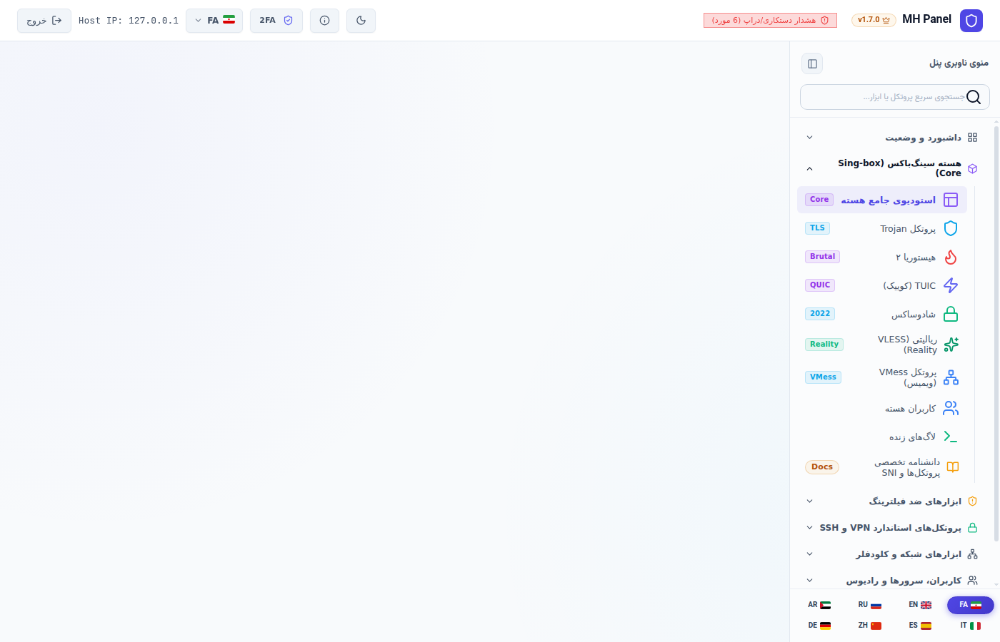
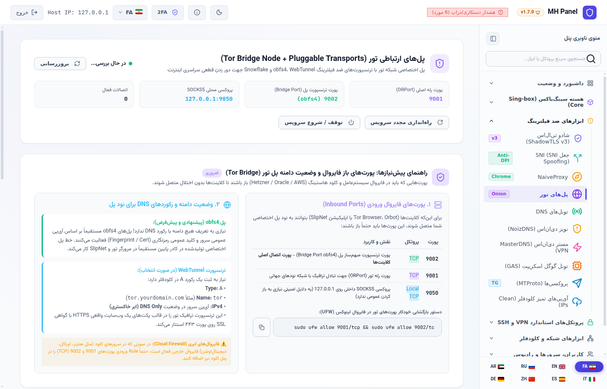
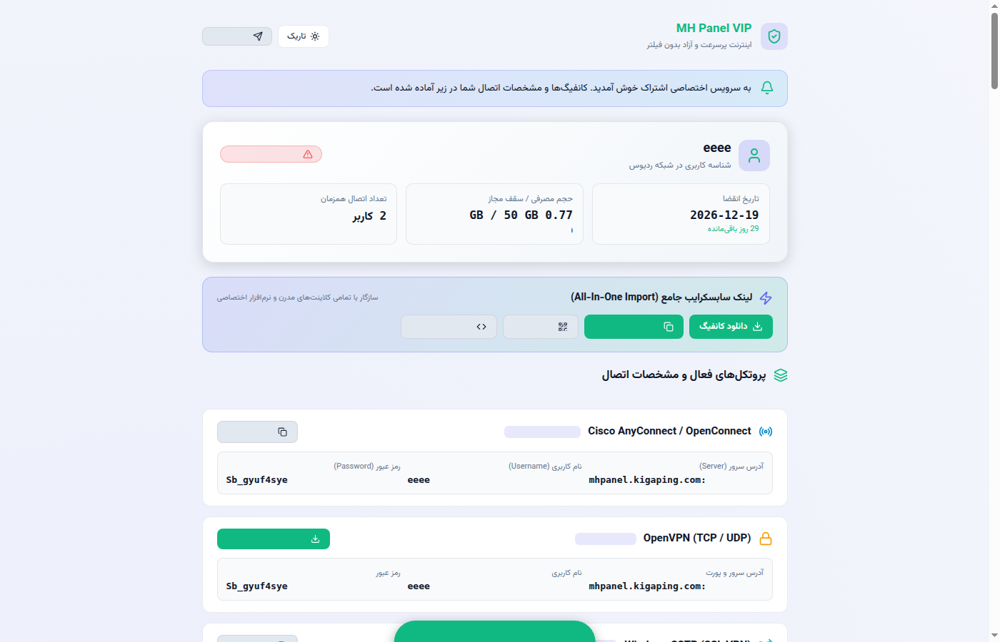

# 🚀 MH Panel - Универсальный центр управления VPN, туннелями обхода блокировок, ядром Sing-box и MikroTik RouterOS

<p align="center">
  <a href="README.md"><b>🇬🇧 English</b></a> |
  <a href="README_FA.md"><b>🇮🇷 فارسی</b></a> |
  <a href="README_RU.md"><b>🇷🇺 Русский</b></a> |
  <a href="README_AR.md"><b>🇸🇦 العربية</b></a> |
  <a href="README_IT.md"><b>🇮🇹 Italiano</b></a> |
  <a href="README_ES.md"><b>🇪🇸 Español</b></a> |
  <a href="README_ZH.md"><b>🇨🇳 简体中文</b></a> |
  <a href="README_DE.md"><b>🇩🇪 Deutsch</b></a>
</p>

<p align="center">
  
  
  
  
  
  
  <a href="https://donito.me/ME_Script" target="_blank"></a>
  
</p>

---

## ⚡ Быстрая установка одной командой (Quick Start)

Разверните **MH Panel** менее чем за 60 секунд с полной автоматической настройкой зависимостей, модулей ядра, сертификатов SSL и служб systemd:

```bash
bash <(curl -fsSL https://raw.githubusercontent.com/t-51/MHPanel/main/install.sh)
```

> [!TIP]
> **Системные требования:**
> - **Операционные системы:** Ubuntu 24.04 LTS, Ubuntu 22.04 LTS, Ubuntu 20.04 LTS, Debian 12 (Bookworm), Debian 11 (Bullseye)
> - **Минимальные ресурсы:** 1 vCPU, 1 ГБ RAM, 10 ГБ на диске
> - **Права доступа:** Права суперпользователя (`root`)

<details>
<summary><b>📦 Альтернатива: Ручная установка через Git</b></summary>

```bash
# Клонирование репозитория
git clone https://github.com/t-51/MHPanel.git /www/wwwroot/mhpanel

# Переход в директорию и запуск скрипта установки
cd /www/wwwroot/mhpanel
sudo bash install.sh
```

После завершения установки в терминале отобразятся URL веб-панели, порт, логин и пароль администратора, а также API-ключ.
</details>

---

## 📡 Универсальный движок умных подписок (Все 23 конфига в 1 ссылке)

В **MH Panel** встроен интеллектуальный генератор подписок, объединяющий все **23 конфигурации Sing-box** и SSH-туннели в **единую ссылку**:

### 🎯 Полная поддержка клиентских приложений:
- **SlipNet** (Автоимпорт, встроенный сканер DoH, чтение QR-мостов Tor)
- **v2rayNG** / **v2rayN** (Универсальный Base64 с автообновлением `profile-update-interval=24`)
- **Hiddify** / **NekoBox** (Нативная поддержка ядра Sing-box, Reality, QUIC и Fragment)
- **Streisand** / **Shadowrocket** / **Clash Meta**

### 🔗 Типы ссылок и эндпоинты:
| Тип подписки | URL эндпоинта | Описание |
|---|---|---|
| **Универсальный Base64** | `https://<DOMAIN>:<PORT>/sub/<TOKEN>/b64` | Единая Base64 ссылка со всеми 23 инбаундами и SSH для SlipNet, v2rayNG и Hiddify. |
| **Sing-box Profile JSON** | `https://<DOMAIN>:<PORT>/sub/<TOKEN>/singbox.json` | Полный JSON-профиль с правилами маршрутизации для официальных клиентов Sing-box. |
| **Fragment / Cloud IP** | `https://<DOMAIN>:<PORT>/sub/<TOKEN>/singbox-fragment.json` | Конфигурации с фрагментацией заголовков TLS SNI для обхода строгой DPI-фильтрации. |
| **Веб-портал пользователя** | `https://<DOMAIN>:<PORT>/sub/<TOKEN>` | Адаптивная веб-страница с отображением расхода трафика, срока действия и единого QR-кода. |

---

## 📑 Содержание

- [⚡ Быстрая установка одной командой](#-быстрая-установка-одной-командой-quick-start)
- [📡 Универсальный движок умных подписок](#-универсальный-движок-умных-подписок-все-23-конфига-в-1-ссылке)
- [🌟 Новое в версии 1.8.0](#-новое-в-версии-170)
- [📸 Галерея интерфейса в светлой теме](#-галерея-интерфейса-в-светлой-теме-light-theme-gallery)
- [📐 Архитектура и пайплайны трафика](#-архитектура-и-пайплайны-трафика)
- [📚 Матрица поддерживаемых протоколов](#-матрица-поддерживаемых-протоколов)
- [🧭 Интерактивная консоль управления (`mhpanel`)](#-интерактивная-консоль-управления-mhpanel)
- [🤝 Благодарности и используемые проекты](#-благодарности-и-используемые-открытые-проекты-upstream-projects)
- [📢 Сообщество и канал](#-официальный-канал-и-сообщество)
- [📄 Лицензия](#-лицензия)

---

## 🌟 Новое в версии 1.8.0

Версия **1.8.0** представляет собой крупнейший шаг вперед в устойчивости к блокировкам, интеграции с ядром Sing-box, эргономике с поддержкой светлой и темной тем, а также универсальной подписке:

1. ⚡ **Сюита 23 протоколов Sing-box:**
   - Автоматическое развертывание: **VLESS Reality** (Vision, TCP, gRPC, HTTPUpgrade), **VLESS TLS**, **VMess**, **Trojan**, **Hysteria 2** (Salamander & Brutal QUIC), **TUIC v5** (0-RTT), **Shadowsocks 2022**, **NaiveProxy** (Chrome Stack) и **ShadowTLS v3**.
2. 📡 **Умный генератор подписок (SlipNet, V2Ray, Sing-box & Hiddify):**
   - 1-клик генерация единой ссылки Base64 со всеми 23 конфигурациями и автоматическим выбором SNI домена.
3. 🎛️ **Лаконичный интерфейс инбаундов и модальное окно управления:**
   - Компактная кнопка `[ ⚙️ 23 Inbounds Active (Manage ⚙️) ]` и интерактивное модальное окно для выборочного включения протоколов конкретному пользователю.
4. 🛡️ **Noise DNS и студия DoH:**
   - Защита от цензуры путем добавления случайного шума в запросы DNS и встроенный резолвер DoH.
5. 🧅 **Мосты Tor и Snowflake:**
   - Поддержка реле Snowflake и мостов obfs4 с увеличенными QR-кодами 220px.
6. 🎨 **Современная светлая тема (Light Elegance):**
   - Полный редизайн интерфейса с высококонтрастной чистой светлой темой наряду с темной темой.

---

## 📸 Галерея интерфейса в светлой теме (Light Theme Gallery)

### 1. 🖥️ Главный дашборд (Master Dashboard)


### 2. ⚡ Студия протоколов Sing-box (23 Inbounds)


### 3. 👥 Управление пользователями и быстрая ссылка подписки


### 4. 🎛️ Интерактивное окно настройки протоколов пользователя


### 5. 🛡️ Студия DNS-туннелей и Noise DNS


### 6. 🧅 Мосты Tor Snowflake и obfs4


### 7. 🌐 Системные L2/L3 туннели ядра


### 8. 🚀 Мультипорт AmneziaWG и WireGuard


### 9. 📱 Клиентский веб-портал подписки


---

## 📐 Архитектура и пайплайны трафика

### Мультиплексирование единого порта 443 (Port 443 SNI Multiplexer)

```text
┌────────────────────────────────────────────────────────────────────────────────────────┐
│                        📱 Клиенты (v2rayNG, Hiddify, SlipNet, AnyConnect, SSTP)        │
└───────────────────────────────────────────┬────────────────────────────────────────────┘
                                            │ Входящее защищенное соединение на порт 443
                                            ▼
┌────────────────────────────────────────────────────────────────────────────────────────┐
│              🔀 Диспетчер SNI и мультиплексор порта 443 (Port Multiplexer)             │
└───────┬─────────────────┬─────────────────┬─────────────────┬─────────────────┬────────┘
        │                 │                 │                 │                 │
  [sni: panel.*]    [sni: vless.*]    [sni: trojan.*]   [sni: cisco.*]    [Неизвестный/DPI]
        │                 │                 │                 │                 │
        ▼                 ▼                 ▼                 ▼                 ▼
 ┌──────────────┐  ┌──────────────┐  ┌──────────────┐  ┌──────────────┐  ┌──────────────┐
 │ Панель       │  │ VLESS        │  │ Trojan       │  │ Cisco        │  │ Сайт         │
 │ управления   │  │ Reality      │  │ TLS          │  │ AnyConnect   │  │ WordPress    │
 │ (Порт 9090)  │  │ (Sing-box)   │  │ (Sing-box)   │  │ (OCServ)     │  │ (Маскировка) │
 └──────────────┘  └──────────────┘  └──────────────┘  └──────────────┘  └──────────────┘
```

---

## 📚 Матрица поддерживаемых протоколов

| # | Протокол | Ядро | Порт | Ключевые преимущества |
|:---:|---|---|:---:|---|
| 1 | **VLESS Reality** | Sing-box | 443 | Маскировка под популярные зарубежные TLS-сайты, нулевая видимость для DPI. |
| 2 | **Trojan TLS** | Sing-box | 8443 (443) | Полная имитация браузерного HTTPS с валидным сертификатом TLS 1.3. |
| 3 | **Hysteria 2** | Sing-box | 7443 UDP | Кастомный QUIC с Brutal CC; максимальная скорость при высоких потерях пакетов. |
| 4 | **TUIC v5** | Sing-box | 8448 UDP | QUIC HTTP/3 протокол с 0-RTT рукопожатием и бережным расходом батареи. |
| 5 | **Shadowsocks 2022**| Sing-box / Rust | 8388 | Новейшие шифры AEAD 2022 с защитой от активного зондирования. |
| 6 | **NaiveProxy** | Sing-box | 8080 | Использование сетевого стека Chrome; неотличим от веб-серфинга. |
| 7 | **Google Apps Script**| Node / V8 | Google Webhook | Релей через IP-адреса Google Edge CDN; полная неблокируемость. |
| 8 | **Сайт-маскировка** | Nginx + WP | 80, 443 | Настоящий сайт на WordPress, возвращающий 200 OK на неавторизованные сканы. |
| 9 | **AmneziaWG (AWG)** | Драйвер ядра | 51820 UDP | WireGuard с мусорными заголовками (`Jc`, `Jmin`, `Jmax`) и защитой от DPI. |
| 10 | **WireGuard** | Драйвер ядра | 51821 UDP | Сверхлегкий P2P туннель с поддержкой IPv4 и IPv6. |
| 11 | **Cisco AnyConnect**| OCServ | 10443 (443) | Корпоративный SSL VPN для официального клиента Cisco на iOS, Android и ПК. |
| 12 | **Windows SSTP** | sstpd | 4443 (443) | Встроенный в Windows протокол без необходимости установки доп. программ. |
| 13 | **IKEv2 / IPsec** | StrongSwan | 500, 4500 | Нативное подключение на iOS и macOS с мгновенным роумингом (MOBIKE). |
| 14 | **OpenVPN XOR** | OpenVPN 2.6 | 1194 | Классический OpenVPN с патчами XOR Scramble против сигнатурного анализа. |
| 15 | **SlowDNS / DNSTT**| DNSTT Suite | 53 UDP | Работает при полном отключении международного интернета через DNS-запросы. |
| 16 | **Мосты Tor** | Tor Core | 9050, 9051 | Официальные мосты Snowflake и obfs4. |
| 17 | **Туннели L2/L3** | Ядро Linux | Переменный | IPIP, GRE, SIT (6in4), GRETAP, VXLAN и WireGuard. |

---

## 🧭 Интерактивная консоль управления (`mhpanel`)

Вы можете в любой момент запустить консоль управления прямо из терминала сервера:

```bash
mhpanel
```

```text
  ========================================================================
     🚀 MH PANEL Enterprise Master CLI Console (Версия 1.8.0)
  ========================================================================
  Статус веб-панели: Online (IP:PORT/PATH) | Команда терминала: mhpanel
  ------------------------------------------------------------------------
  [1]  Полная автоматическая установка (Все компоненты и протоколы)
  [2]  Пошаговый кастомный мастер установки (Custom Wizard)
  [3]  Установка только веб-интерфейса (Lightweight Web UI)
  ------------------------------------------------------------------------
  [4]  Просмотр URL панели, учетных данных и API-ключа
  [5]  Изменение логина и пароля администратора
  [6]  Изменение порта, адреса и секретного URL-пути панели
  [7]  Диагностический отчет и статус служб в реальном времени
  [8]  Управление, установка, удаление и настройка портов VPN-протоколов
  [9]  Хаб туннелей обхода блокировок и мостов MikroTik RouterOS
  [10] Интеграция веб-сервера и сайта-маскировки WordPress
  [11] Уведомления Telegram-бота и центр авто-бэкапов
  [12] Настройки веб-панели (Журналы, перезапуск, 2FA и API-ключ)
  [13] Управление SSL-сертификатами (Let's Encrypt и IP SAN на 10 лет)
  [14] Оптимизация сети и ядра Linux (BBR, IPv4/IPv6 Forwarding)
  [15] Резервное копирование и восстановление настроек (Backup & Restore)
  [16] Справочник быстрых команд терминала и шорткатов
  [17] Проверка и установка обновлений панели из GitHub
  [18] Полное удаление MH Panel с сервера (Uninstall)
  [0]  Выход
  ========================================================================
```

### ⚡ Быстрые команды терминала (CLI Shortcuts):

| Команда | Описание действия |
|---|---|
| `mhpanel` | Открыть интерактивное главное меню. |
| `mhpanel --status` | Быстрый диагностический отчет о состоянии служб и ресурсов. |
| `mhpanel --info` | Вывести URL доступа к панели, учетные данные и ключ API. |
| `mhpanel --user <логин>` | Изменить логин администратора панели. |
| `mhpanel --pass <пароль>` | Изменить пароль администратора панели. |
| `mhpanel --credentials <логин> <пароль>` | Изменить логин и пароль одной командой. |
| `mhpanel --port <порт>` | Изменить порт веб-панели (например: `mhpanel --port 9443`). |
| `mhpanel --path <путь>` | Установить секретный URL-путь (например: `mhpanel --path /secure`). |
| `mhpanel --address <порт> <путь>` | Изменить порт и путь одновременно. |
| `mhpanel --wp` | Мастер развертывания маскировочного сайта WordPress. |
| `mhpanel --tg` | Настройки Telegram-бота и отправка тестового уведомления. |
| `mhpanel --tunnels` | Меню туннелей и интеграции с MikroTik RouterOS. |
| `mhpanel protocol <имя> <команда>` | Управление протоколом (например: `mhpanel protocol singbox restart`). |
| `mhpanel restart` | Мгновенный перезапуск службы `systemctl restart mhpanel`. |
| `mhpanel start` / `mhpanel stop` | Запуск или остановка службы панели. |
| `mhpanel update` | Проверка и установка обновлений из официального репозитория. |
| `mhpanel --uninstall` | Полное удаление всех файлов и служб MH Panel. |
| `mhpanel --help` | Отобразить встроенную справку по командам CLI. |

---

## 🤝 Благодарности и используемые открытые проекты (Upstream Projects)

Проект **MH Panel** выражает глубокую признательность авторам и сообществам открытого исходного кода:
- **[Sing-box (SagerNet)](https://github.com/SagerNet/sing-box)**: Универсальное ядро проксирования (VLESS Reality, VMess, Trojan, ShadowTLS, Shadowsocks, TUIC, Hysteria 2).
- **[Hysteria 2 (AperNet)](https://github.com/apernet/hysteria)**: Высокоскоростной протокол на базе QUIC с Brutal CC.
- **[TUIC (EAimTY)](https://github.com/EAimTY/tuic)**: 0-RTT QUIC HTTP/3 прокси-протокол.
- **[Shadowsocks-rust](https://github.com/shadowsocks/shadowsocks-rust)**: Высокопроизводительная реализация Shadowsocks на Rust.
- **[AmneziaWG](https://github.com/amnezia-vpn/amnezia-wg)** & **[wiresock/amneziawg-install](https://github.com/wiresock/amneziawg-install)**: Обфусцированный WireGuard с мусорными заголовками (`Jc`, `Jmin`, `Jmax`).
- **[WireGuard](https://www.wireguard.com/)** & **[angristan/wireguard-install](https://github.com/angristan/wireguard-install)**: Стандартный WireGuard.
- **[OpenVPN](https://openvpn.net/)** & **[Tunnelblick XOR Patches](https://github.com/Tunnelblick/Tunnelblick)**: OpenVPN с защитой от DPI.
- **[OpenConnect (ocserv)](https://gitlab.com/openconnect/ocserv)**: SSL VPN сервер для клиентов Cisco AnyConnect.
- **[SoftEther VPN](https://github.com/SoftEtherVPN/SoftEtherVPN_Stable)**: Мультипротокольный сервер (L2TP/IPsec, SSTP).
- **[BadVPN (ambrop72)](https://github.com/ambrop72/badvpn)**: UDPGW проброс для SSH-туннелей и игр.
- **[Backhaul](https://github.com/Musixal/Backhaul)**, **[Rathole](https://github.com/rapiz1/rathole)**, **[Chisel](https://github.com/jpillora/chisel)**, **[GOST](https://github.com/go-gost/gost)**: Обратные туннели и мультиплексирование.
- **[Marzban (Gozargah)](https://github.com/Gozargah/Marzban)**, **[3X-UI (MHSanaei)](https://github.com/MHSanaei/3x-ui)**, **[Hiddify Manager](https://github.com/hiddify/hiddify-manager)**: Архитектурные идеи веб-панелей и универсальных подписок.

---

## 💖 Поддержка проекта и донаты (Donate & Support)

Непрерывная разработка **MH Panel**, исследование новых алгоритмов обхода DPI и аренда тестовых серверов в различных странах требуют ресурсов. Если проект помог вам, вы можете поддержать нас:

<p align="center">
  <a href="https://donito.me/ME_Script" target="_blank">
    
  </a>
</p>

<p align="center">
  ☕ <b>Ссылка для доната:</b> <a href="https://donito.me/ME_Script" target="_blank"><b>https://donito.me/ME_Script</b></a>
</p>

---

## 📢 Официальный канал и сообщество

- 📢 **Официальный Telegram-канал:** [@kigaping_fa](https://t.me/kigaping_fa)

---

## 📄 Лицензия

Проект распространяется на условиях открытой лицензии [MIT License](LICENSE).
