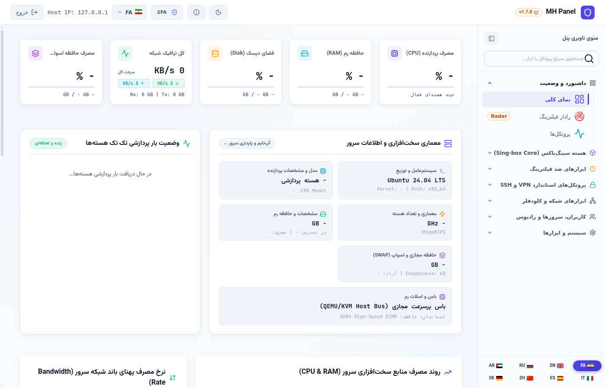

# 🚀 MH Panel - 企业级统一 VPN、反审查隧道、Sing-box 23协议套件与 MikroTik 管理面板

<p align="center">
  <a href="README.md"><b>🇬🇧 English</b></a> |
  <a href="README_FA.md"><b>🇮🇷 فارسی</b></a> |
  <a href="README_RU.md"><b>🇷🇺 Русский</b></a> |
  <a href="README_AR.md"><b>🇸🇦 العربية</b></a> |
  <a href="README_IT.md"><b>🇮🇹 Italiano</b></a> |
  <a href="README_ES.md"><b>🇪🇸 Español</b></a> |
  <a href="README_ZH.md"><b>🇨🇳 简体中文</b></a> |
  <a href="README_DE.md"><b>🇩🇪 Deutsch</b></a>
</p>

<p align="center">
  
  
  
  
  
  
  <a href="https://donito.me/ME_Script" target="_blank"></a>
  
</p>

---

## ⚡ 一键极速安装 (Quick Start)

只需一条命令，在 60 秒内全自动部署 **MH Panel**（自动配置依赖、内核模块、SSL 证书及 systemd 守护进程）：

```bash
bash <(curl -fsSL https://raw.githubusercontent.com/t-51/MHPanel/main/install.sh)
```

> [!TIP]
> **系统要求：**
> - **操作系统：** Ubuntu 24.04 LTS, Ubuntu 22.04 LTS, Ubuntu 20.04 LTS, Debian 12 (Bookworm), Debian 11 (Bullseye)
> - **硬件配置：** 至少 1 核 vCPU、1 GB 内存、10 GB 存储空间
> - **权限要求：** root 超级管理员权限 (`sudo -i` 或 `su -`)

<details>
<summary><b>📦 备选方式：通过 Git Clone 手动安装</b></summary>

```bash
# 克隆代码仓库
git clone https://github.com/t-51/MHPanel.git /www/wwwroot/mhpanel

# 进入目录并执行安装脚本
cd /www/wwwroot/mhpanel
sudo bash install.sh
```

安装完成后，终端将自动打印 Web 面板访问地址、端口、初始管理员账号密码及 API 密钥。
</details>

---

## 📡 通用智能订阅引擎（全部 23 种节点合一）

MH Panel 搭载全能智能订阅引擎，将 **Sing-box 核心的全部 23 种入站协议** 与 SSH 隧道整合为 **单一通用订阅链接**：

### 🎯 深度兼容主流客户端：
- **SlipNet**（全自动导入、内置 DoH 扫描与 Tor 桥接 QR 识别）
- **v2rayNG** / **v2rayN**（标准 Base64 聚合订阅，支持定时自动更新 `profile-update-interval=24`）
- **Hiddify** / **NekoBox**（原生支持 Sing-box 核心特性：Reality、QUIC 与 Fragment）
- **Streisand** / **Shadowrocket** / **Clash Meta**

### 🔗 订阅链接格式与端点：
| 订阅类型 | 访问端点 (URL) | 功能说明 |
|---|---|---|
| **通用 Base64** | `https://<域名>:<端口>/sub/<TOKEN>/b64` | 汇集全部 23 个入站节点与 SSH 配置，面板用户列表支持一键复制到剪贴板。 |
| **Sing-box JSON 配置** | `https://<域名>:<端口>/sub/<TOKEN>/singbox.json` | 官方 Sing-box 客户端原生 JSON 规则配置，具备智能路由与防 DNS 泄露机制。 |
| **Fragment / Cloud IP** | `https://<域名>:<端口>/sub/<TOKEN>/singbox-fragment.json` | 具备 TLS SNI 分片与 Cloudflare 优选 IP 的防封锁节点。 |
| **客户端专属网页门户** | `https://<域名>:<端口>/sub/<TOKEN>` | 自适应浅色与深色主题网页，展示已用流量、剩余有效期及聚合二维码。 |

---

## 📑 目录导航

- [⚡ 一键极速安装](#-一键极速安装-quick-start)
- [📡 通用智能订阅引擎](#-通用智能订阅引擎全部-23-种节点合一)
- [🌟 版本 1.7.0 核心特性](#-版本-170-核心特性)
- [📸 浅色主题视觉画廊](#-浅色主题视觉画廊-light-theme-gallery)
- [📐 架构图解与流量链路](#-架构图解与流量链路)
- [📚 支持协议与核心矩阵](#-支持协议与核心矩阵)
- [🧭 终端交互式控制台 (`mhpanel`)](#-终端交互式控制台-mhpanel)
- [🤝 鸣谢与上游开源项目](#-鸣谢与上游开源项目-upstream-projects)
- [📢 官方社群与频道](#-官方社群与频道)
- [📄 开源许可](#-开源许可)

---

## 🌟 版本 1.7.0 核心特性

版本 **1.7.0** 标志着反审查封锁能力、Sing-box 全能核心整合与双主题人机交互界面的重大飞跃：

1. ⚡ **Sing-box 23 模态全套协议阵列：**
   - 自动化部署全部现代传输层：**VLESS Reality** (Vision, TCP, gRPC, HTTPUpgrade), **VLESS TLS**, **VMess**, **Trojan**, **Hysteria 2** (Salamander 混淆与 Brutal QUIC), **TUIC v5** (0-RTT), **Shadowsocks 2022**, **NaiveProxy** (Chrome 协议栈伪装) 与 **ShadowTLS v3**。
2. 📡 **全能智能订阅系统 (SlipNet, V2Ray, Sing-box & Hiddify)：**
   - 一键生成多节点聚合订阅，自动优先调度有效 SSL 证书域名，杜绝握手证书错误。
3. 🎛️ **极简单行入站 UI 与交互式协议管理弹窗：**
   - 用户列表节点栏精简为单行优雅胶囊 `[ ⚙️ 23 Inbounds Active (Manage ⚙️) ]`，弹窗支持为单一用户自由增删协议。
4. 🛡️ **Noise DNS（混淆防污染）与 DoH 引擎：**
   - 向 DNS 查询注入随机噪点数据包，击溃 ISP DPI 阻断，内置 DoH 服务端。
5. 🧅 **Tor 桥接与 Snowflake 节点部署：**
   - 一键运行 Snowflake 中继与 obfs4 桥接，220px 大尺寸高对比度二维码直扫。
6. 🎨 **高雅浅色与深色主题系统 (Light Elegance)：**
   - 适配白底浅色主题，字迹清晰高对比，支持零刷新秒切深浅色彩。

---

## 📸 浅色主题视觉画廊 (Light Theme Gallery)

### 1. 🖥️ 主仪表盘总览 (Master Dashboard)


### 2. ⚡ Sing-box 23 种入站节点工作室


### 3. 👥 用户管理与一键直拷订阅


### 4. 🎛️ 用户专属协议分配弹窗


### 5. 🛡️ DNS 隧道与 Noise DNS 工作室


### 6. 🧅 Tor 桥接与 Snowflake 部署


### 7. 🌐 内核 L2/L3 隧道与防审查盾


### 8. 🚀 AmneziaWG 与 WireGuard 多端口


### 9. 📱 客户端用户网页订阅门户


---

## 📐 架构图解与流量链路

### 单 443 端口多协议复用分发 (Port Multiplexer)

```text
┌────────────────────────────────────────────────────────────────────────────────────────┐
│                        📱 全球各平台客户端 (SlipNet, v2rayNG, Hiddify, AnyConnect)     │
└───────────────────────────────────────────┬────────────────────────────────────────────┘
                                            │ 443 端口传入的安全 HTTPS 流量
                                            ▼
┌────────────────────────────────────────────────────────────────────────────────────────┐
│              🔀 443 端口多路复用与 SNI 智能分发层 (Universal Port Multiplexer)         │
└───────┬─────────────────┬─────────────────┬─────────────────┬─────────────────┬────────┘
        │                 │                 │                 │                 │
  [sni: panel.*]    [sni: vless.*]    [sni: trojan.*]   [sni: cisco.*]    [非白名单/DPI探针]
        │                 │                 │                 │                 │
        ▼                 ▼                 ▼                 ▼                 ▼
 ┌──────────────┐  ┌──────────────┐  ┌──────────────┐  ┌──────────────┐  ┌──────────────┐
 │ Web 管理     │  │ VLESS        │  │ Trojan       │  │ Cisco        │  │ WordPress    │
 │ 面板后台     │  │ Reality      │  │ TLS          │  │ AnyConnect   │  │ 伪装诱饵网站 │
 │ (9090端口)   │  │ (Sing-box)   │  │ (Sing-box)   │  │ (OCServ)     │  │ (Anti-DPI)   │
 └──────────────┘  └──────────────┘  └──────────────┘  └──────────────┘  └──────────────┘
```

---

## 📚 支持协议与核心矩阵

| # | 协议名称 | 运行核心 | 默认端口 | 安全机制与核心优势 |
|:---:|---|---|:---:|---|
| 1 | **VLESS Reality** | Sing-box | 443 | 借用境外真实大型网站 TLS 身份，无需本地证书，100% 免疫主动探测。 |
| 2 | **Trojan TLS** | Sing-box | 8443 (443) | 伪装成标准的浏览器 HTTPS 流量，搭载合法的 TLS 1.3 证书。 |
| 3 | **Hysteria 2** | Sing-box | 7443 UDP | 定制 QUIC 搭配 Brutal 拥塞控制算法；在恶劣高丢包网络中依然维持极速。 |
| 4 | **TUIC v5** | Sing-box | 8448 UDP | QUIC HTTP/3 架构，0-RTT 极速握手，移动端极低耗电。 |
| 5 | **Shadowsocks 2022**| Sing-box / Rust | 8388 | 现代 AEAD 2022 密码套件，防探测防封锁。 |
| 6 | **NaiveProxy** | Sing-box | 8080 | 完美复刻 Google Chrome 浏览器真实网络协议栈，流量与正常网页浏览毫无二致。 |
| 7 | **Google Apps Script**| Node / V8 | Google Webhook | 流量经由 Google Edge CDN 边缘节点中转，审查系统无法封禁谷歌 IP。 |
| 8 | **WordPress 伪装站点**| Nginx + WP | 80, 443 | 真实运行的 WordPress 博客，探测流量返回 200 OK，掩盖代理特征。 |
| 9 | **AmneziaWG (AWG)** | Linux 内核驱动 | 51820 UDP | 混淆版 WireGuard，注入随机垃圾包头 (`Jc`, `Jmin`, `Jmax`) 规避 DPI 拦截。 |
| 10 | **标准 WireGuard** | Linux 内核驱动 | 51821 UDP | 内核级极速点对点隧道，支持 IPv4 与 IPv6 双栈。 |
| 11 | **Cisco AnyConnect**| OCServ | 10443 (443) | 完美兼容 Cisco 官方客户端，横跨手机与电脑端。 |
| 12 | **Windows SSTP** | sstpd | 4443 (443) | Windows 原生自带接入支持，无需安装任何额外第三方软件。 |
| 13 | **SlowDNS / DNSTT**| DNSTT Suite | 53 UDP | 国际断网极端封锁时期，利用递归 DNS 查询强行穿透。 |
| 14 | **Tor 官方网桥** | Tor Core | 9050, 9051 | Snowflake 与 obfs4 混淆网桥，保护隐私接入洋葱路由网络。 |

---

## 🧭 终端交互式控制台 (`mhpanel`)

无论何时，只需在服务器终端键入以下命令即可唤起管理控制台：

```bash
mhpanel
```

```text
  ========================================================================
     🚀 MH PANEL Enterprise 终端主控控制台 (版本 1.7.0)
  ========================================================================
  Web 面板状态: Online (IP:PORT/PATH) | 快捷命令: mhpanel
  ------------------------------------------------------------------------
  [1]  执行全自动化完整安装（一键配齐所有协议与必要组件）
  [2]  运行步骤自定义安装向导（Custom Wizard）
  [3]  仅安装轻量级 Web 管理面板（Web UI Only）
  ------------------------------------------------------------------------
  [4]  查看面板访问地址、登录凭据及 API 密钥
  [5]  修改管理员账号与密码
  [6]  修改面板端口、绑定地址及访问安全路径
  [7]  实时系统与各服务状态诊断报告 (Diagnostic Report)
  [8]  管理、安装、卸载及调整各 VPN 协议端口
  [9]  反审查隧道与 MikroTik RouterOS 路由脚本中心
  [10] Web 服务器整合与 WordPress 伪装站点工作室
  [11] Telegram 机器人告警与自动数据备份分发
  [12] Web 面板高级设置（日志查看、服务重启、2FA与API）
  [13] SSL 证书生命周期管理（Let's Encrypt 与 10年 IP SAN）
  [14] 网络与内核网络栈调优（启用 BBR 与 IPv4/IPv6 转发）
  [15] 备份与还原面板完整配置（Backup & Restore Hub）
  [16] 查看终端便捷命令指南与操作快捷方式
  [17] 从 GitHub 检测并一键应用官方更新
  [18] 从服务器彻底卸载并清理 MH Panel (Uninstall)
  [0]  退出控制台
  ========================================================================
```

### ⚡ 终端非交互式快捷命令 (CLI Shortcuts)：

管理员可在 Shell 中直接运行以下快捷指令，无需逐级进入菜单：

| 快捷命令 | 执行操作说明 |
|---|---|
| `mhpanel` | 打开交互式主菜单。 |
| `mhpanel --status` | 快速输出系统硬件、端口占用及各协议服务诊断报告。 |
| `mhpanel --info` | 打印当前 Web 面板访问 URL、账号密码及 API 令牌。 |
| `mhpanel --user <新用户名>` | 一键修改管理员登录账号。 |
| `mhpanel --pass <新密码>` | 一键修改管理员登录密码。 |
| `mhpanel --credentials <账号> <密码>` | 单条命令同时修改账号与密码。 |
| `mhpanel --port <端口>` | 修改 Web 面板监听端口（如 `mhpanel --port 9443`）。 |
| `mhpanel --path <安全路径>` | 设置私密访问路径后缀（如 `mhpanel --path /admin_sec`）。 |
| `mhpanel --address <端口> <路径>` | 同时变更面板端口与私密路径。 |
| `mhpanel --wp` | 进入 WordPress 伪装站点配置。 |
| `mhpanel --tg` | 调试 Telegram 报警与备份设置。 |
| `mhpanel --tunnels` | 唤起隧道控制与 MikroTik 脚本生成。 |
| `mhpanel protocol <名称> <动作>` | 管理具体协议（如 `mhpanel protocol singbox restart`）。 |
| `mhpanel restart` | 热重载并重启面板守护服务 (`systemctl restart mhpanel`)。 |
| `mhpanel start` / `mhpanel stop` | 启动或停止面板后台进程。 |
| `mhpanel update` | 从 GitHub 拉取最新代码并热更新。 |
| `mhpanel --uninstall` | 彻底干净地卸载并清除残留配置。 |
| `mhpanel --help` | 查看终端命令帮助文档。 |

---

## 🤝 鸣谢与上游开源项目 (Upstream Projects)

MH Panel 基于全球开源社区的卓越创新而铸就，我们向以下项目致以崇高的敬意：
- **[Sing-box (SagerNet)](https://github.com/SagerNet/sing-box)**：全能通用代理平台（驱动 VLESS Reality、VMess、Trojan、ShadowTLS、Shadowsocks、TUIC、Hysteria 2）。
- **[Hysteria 2 (AperNet)](https://github.com/apernet/hysteria)**：基于定制 QUIC 与 Brutal 拥塞控制的高速抗丢包协议。
- **[TUIC (EAimTY)](https://github.com/EAimTY/tuic)**：0-RTT 低延迟 QUIC HTTP/3 代理协议。
- **[Shadowsocks-rust](https://github.com/shadowsocks/shadowsocks-rust)**：超高性能 Shadowsocks Rust 语言实现。
- **[AmneziaWG](https://github.com/amnezia-vpn/amnezia-wg)** 与 **[wiresock/amneziawg-install](https://github.com/wiresock/amneziawg-install)**：基于包头垃圾数据注入的混淆 WireGuard。
- **[OpenConnect (ocserv)](https://gitlab.com/openconnect/ocserv)**：专为 Cisco AnyConnect 客户端设计的企业级 SSL VPN 服务端。
- **[Backhaul](https://github.com/Musixal/Backhaul)**、**[Rathole](https://github.com/rapiz1/rathole)**、**[Chisel](https://github.com/jpillora/chisel)**：轻量级反向隧道与内网穿透工具。
- **[Marzban (Gozargah)](https://github.com/Gozargah/Marzban)**、**[3X-UI (MHSanaei)](https://github.com/MHSanaei/3x-ui)**、**[Hiddify Manager](https://github.com/hiddify/hiddify-manager)**：在现代化订阅架构、交互 UI 与多协议路由方面提供的灵感。

---

## 💖 赞助项目与捐赠 (Donate & Support)

持续维护 **MH Panel**、跟进前沿抗 DPI 封锁技术研究并在全球各大数据中心部署测试服务器需要大量的时间与资金投入。如果本项目为您提供了帮助，欢迎赞助支持：

<p align="center">
  <a href="https://donito.me/ME_Script" target="_blank">
    
  </a>
</p>

<p align="center">
  ☕ <b>官方赞助通道：</b> <a href="https://donito.me/ME_Script" target="_blank"><b>https://donito.me/ME_Script</b></a>
</p>

---

## 📢 官方社群与频道

- 📢 **官方 Telegram 频道：** [@kigaping_fa](https://t.me/kigaping_fa)

---

## 📄 开源许可

本项目遵循开源 [MIT License](LICENSE) 许可协议发布。
