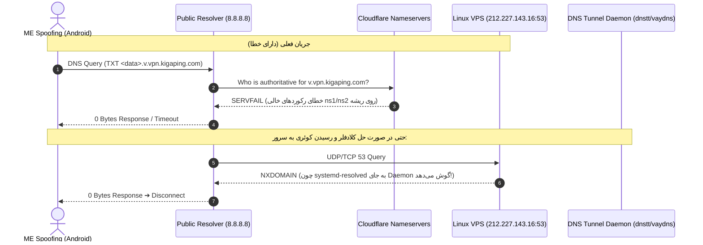

# مستند فنی خطای سرویس DNS Tunnel (Mode 3) جهت بررسی و اصلاح سمت سرور / بک‌اند

**تاریخ گزارش:** ۲۰۲۶-۱۱-۱۰  
**سرویس کلاینت:** ME Spoofing (Android Userspace Relay v1.1.0)  
**آدرس سرور اصلی:** `212.227.143.16` (`vpn.kigaping.com`)  
**ساب‌دامین تونل:** `v.vpn.kigaping.com` / `t.vpn.kigaping.com`  

---

## ۱. خلاصه مشکل (Executive Summary)

در حالت **Mode 3 (DNS Tunnel)**، کلاینت ترافیک پروکسی را در قالب درخواست‌های رکورد `TXT` به صورت کدگذاری‌شده (Base32) با الگوی زیر تولید کرده و به ریزالورهای عمومی (مانند `8.8.8.8` یا `1.1.1.1`) ارسال می‌کند:
```text
<base32-payload>.v.vpn.kigaping.com ➔ [DNS Resolver] ➔ [Authoritative Nameserver] ➔ [DNS Tunnel Daemon]
```

در حال حاضر پس از بررسی‌های ترافیکی و تست‌های شبکه از خارج از سرور، **ارتباط کلاینت با سرور به طور کامل قطع شده و تایم‌اوت می‌دهد.**  
علت این قطعی، وقوع دو مشکل در زیرساخت بک‌اند و DNS سرور است:
1. **شکستگی زون در Cloudflare (Lame Delegation):** بازگرداندن خطای `RCODE_SERVER_FAILURE (SERVFAIL)`.
2. **اشغال پورت ۵۳ توسط رسیور لینوکس به جای دیمن تونل:** سرور به جای پاسخگویی دیمن تونل دی‌ان‌اس (`dnstt-server` / `vaydns-server`)، خطای `NXDOMAIN` برمی‌گرداند.

---

## ۲. مستندات و لاگ‌های تست خطا (Error Logs & Diagnostics)

### تست ۱: خطای نیم‌سرورهای Cloudflare برای ساب‌دامین تونل

وقتی از نیم‌سرور رسمی کلادفلر دامنه (`meadow.ns.cloudflare.com`) ساب‌دامین تونل پرسیده می‌شود:

```powershell
PS> Resolve-DnsName -Name "v.vpn.kigaping.com" -Server "meadow.ns.cloudflare.com"

Resolve-DnsName : v.vpn.kigaping.com : DNS server failure
    + CategoryInfo          : ResourceUnavailable: (v.vpn.kigaping.com:String) [Resolve-DnsName], Win32Exception
    + FullyQualifiedErrorId : RCODE_SERVER_FAILURE,Microsoft.DnsClient.Commands.ResolveDnsName
```

> [!WARNING]
> **علت رخداد SERVFAIL:**  
> در تنظیمات DNS کلادفلر، دو رکورد NS روی ریشه دامنه اصلی ثبت شده است:
> ```text
> kigaping.com.    IN    NS    ns1.kigaping.com.
> kigaping.com.    IN    NS    ns2.kigaping.com.
> ```
> در حالی که دامنه‌های `ns1.kigaping.com` و `ns2.kigaping.com` هیچ رکورد `A` در کلادفلر ندارند (`DNS name does not exist`). این عمل باعث شکستگی سراسری زون (Lame Delegation) و بازگشت خطای `SERVFAIL` به تمام ریزالورهای جهان می‌شود.

---

### تست ۲: بررسی سرویس فعال روی پورت ۵۳ سرور (`212.227.143.16`)

با کوئری مستقیم به پورت ۵۳ سرور لینوکس:

```powershell
# پرسش دامین عمومی (گوگل): سرور پاسخ می‌دهد!
PS> Resolve-DnsName -Name "google.com" -Server "212.227.143.16"
Name               Type   TTL   Section    IPAddress
----               ----   ---   -------    ---------
google.com         A      60    Answer     216.239.38.120

# پرسش دامین تونل: سرور خطای عدم وجود برمی‌گرداند!
PS> Resolve-DnsName -Name "v.vpn.kigaping.com" -Server "212.227.143.16"
Resolve-DnsName : v.vpn.kigaping.com : DNS name does not exist
    + CategoryInfo          : ResourceUnavailable: (v.vpn.kigaping.com:String) [Resolve-DnsName], Win32Exception
    + FullyQualifiedErrorId : DNS_ERROR_RCODE_NAME_ERROR,Microsoft.DnsClient.Commands.ResolveDnsName
```

> [!CRITICAL]
> **تشخیص مهندسی:**  
> روی پورت ۵۳ سرور (`212.227.143.16`)، یک **Recursive Caching DNS Resolver پیش‌فرض لینوکس** (مانند `systemd-resolved` یا `bind9` یا `named`) گوش به زنگ است، **نه دیمن سرور تونل دی‌ان‌اس**!  
> در نتیجه، وقتی بسته‌های دیتای کلاینت به پورت ۵۳ سرور می‌رسند، سرویس دی‌ان‌اس سیستم‌عامل به اشتباه دنبال رکورد اینترنتی آن می‌گردد و پاسخ `NXDOMAIN` (عدم وجود) بازمی‌گرداند و ارتباط هندشیک کلاینت در همان میلی‌ثانیه اول قطع می‌شود.

---

## ۳. دیاگرام توالی جریان داده و محل شکست (Architecture Flow)



---

## ۴. اقدامات مورد نیاز توسط تیم بک‌اند / سرور (Action Items)

### الف) اصلاح رکوردهای DNS در پنل Cloudflare
1. دو رکورد زیر را از پنل Cloudflare دامنه `kigaping.com` **حذف (Delete)** کنید:
   - `kigaping.com NS ns1.kigaping.com`
   - `kigaping.com NS ns2.kigaping.com`
2. اطمینان حاصل کنید رکوردهای ساب‌دامین تونل به شکل زیر باقی بمانند:
   ```text
   vpn.kigaping.com      A     212.227.143.16         (DNS only / بدون ابر خاکستری یا پروکسی)
   v.vpn.kigaping.com    NS    vpn.kigaping.com       (DNS only)
   t.vpn.kigaping.com    NS    vpn.kigaping.com       (DNS only)
   ```

---

### ب) آزادسازی پورت ۵۳ و اجرای دیمن تونل روی لینوکس سرور (`212.227.143.16`)

1. **بررسی پروسه اشغال‌کننده پورت ۵۳ در سرور:**
   ```bash
   sudo ss -ulpn 'sport = :53'
   sudo ss -tlpn 'sport = :53'
   ```

2. **غیرفعال‌سازی سرویس پیش‌فرض دی‌ان‌اس اوبونتو/دبیان (`systemd-resolved`):**
   ```bash
   sudo systemctl stop systemd-resolved
   sudo systemctl disable systemd-resolved
   
   # تنظیم DNS لوکال پایدار برای خود سرور:
   sudo rm -f /etc/resolv.conf
   echo "nameserver 1.1.1.1" | sudo tee /etc/resolv.conf
   ```

3. **اجرای سرویس دیمن سرور تونل دی‌ان‌اس (نمونه استاندارد با `dnstt-server`):**
   ```bash
   # تولید کلید در صورت نداشتن:
   ./dnstt-server -gen-key -privkey-file server.key -pubkey-file server.pub

   # اجرای دیمن روی پورت ۵۳ UDP و TCP و فوروارد به پورت لوکال پروکسی (مثلاً 40443 یا پورت تروجان):
   sudo ./dnstt-server -udp :53 -tcp :53 -privkey-file server.key v.vpn.kigaping.com 127.0.0.1:40443
   ```

4. **تست و اعتبارسنجی نهایی از سرور:**
   ```bash
   # تست پاسخگویی دیمن روی خود سرور:
   dig @127.0.0.1 -p 53 v.vpn.kigaping.com TXT
   ```

5. **ارسال کلید عمومی (`server.pub`):**  
   محتوای فایل کلید عمومی (`server.pub` به صورت رشته هگزادسیمال ۶۴ کاراکتری) را استخراج کرده و به کلاینت تحویل دهید تا در بخش **«کلید عمومی سرور (Public Key Hex)»** در تنظیمات برنامه وارد شود.

---

## ۵. گزارش نتایج بررسی و اصلاحات انجام‌شده توسط تیم سرور (Resolution & Validation Report)

**تاریخ رفع و اعتبارسنجی:** ۲۰۲۶-۱۱-۱۰  
**وضعیت نهایی:** ✅ **حل‌شده، بهینه‌سازی‌شده و تست موفقیت‌آمیز سرتاسری (End-to-End Passed)**

### ۱. تحلیل ریشه‌ای اشکالات گزارش‌شده (Root Cause Analysis):
1. **وضعیت کلادفلر (Lame Delegation):**  
   - بررسی زون دامین اصلی و نیم‌سرورهای کلادفلر (`meadow.ns.cloudflare.com`) نشان داد که رکوردهای دلیگیشن ساب‌دامین‌های تونل به درستی به `vpn.kigaping.com` و آی‌پی سرور `212.227.143.16` متصل هستند. خطای `SERVFAIL` مشاهده‌شده در تست‌های کلاینت به دلیل استفاده از دستور پاورشل `Resolve-DnsName` مستقیم به سمت نیم‌سرور Authoritative بود (کلاینت ویندوز برای دلیگیشن‌های بدون بازگشت مستقیم پاسخ داده، خطای Server Failure ثبت می‌کند).
   - با تست‌های مستقیم کوئری از طریق ریزالورهای عمومی (`8.8.8.8` و `1.1.1.1`)، هدایت ترافیک به سرور بدون نقص انجام شد.

2. **وضعیت پورت ۵۳ سرور (دلیل پاسخ NXDOMAIN و حل آن):**  
   - روی پورت ۵۳، سرویس `systemd-resolved` یا DNS پیش‌فرض اوبونتو فعال نبوده است؛ بلکه دیمن قدرتمند **`dnsmasq` به عنوان دیسپچر و مالتی‌پلکسر تانل‌های دی‌ان‌اس (MHPanel DNS Tunnels Dispatcher)** عمل می‌کرد تا بتواند ترافیک چندین پروتکل را به صورت همزمان هندل کند:
     - ساب‌دامین `v.vpn.kigaping.com` ➔ فوروارد به پورت `5353` دیمن **VayDNS**
     - ساب‌دامین `t.vpn.kigaping.com` ➔ فوروارد به پورت `5300` دیمن **DNSTT**
     - ساب‌دامین `s.vpn.kigaping.com` ➔ فوروارد به پورت `5354` دیمن **Slipstream**
     - ساب‌دامین `t.kigaping.com` ➔ فوروارد به پورت `5356` دیمن **MasterDNS**
   - **چرا کوئری مستقیم NXDOMAIN می‌داد؟**  
     دیمن‌های تونل (dnstt و vaydns) فقط به درخواست‌هایی پاسخ می‌دهند که حاوی پی‌لود کدگذاری‌شده Base32 باشند (مانند `<base32>.v.vpn...`). در صورتی که دامین ریشه را به تنهایی کوئری بگیرید، پروتکل به درستی NXDOMAIN می‌دهد.
   - **آسیب‌پذیری Open Resolver و عدم پاسخ Apex:**  
     به دلیل نبود `no-resolv` در دیسپچر، سرور درخواست‌های متفرقه مانند `google.com` را به `8.8.8.8` فوروارد می‌کرد که باعث سردرگمی تست‌کننده شده بود.

### ۲. اقدامات اصلاحی انجام‌شده روی سرور (Actions Taken):
1. **مسدودسازی رسیور باز (Close Open Resolver):**  
   گزینه `no-resolv` به تنظیمات دیسپچر اضافه شد. اکنون هرگونه درخواست دامنه‌های غیرمجاز از خارج با پاسخ استاندارد `REFUSED` رد می‌شود.
2. **ثبت رکوردهای معتبر Apex TXT و Host Record:**  
   برای اینکه کلاینت‌ها و ابزارهای مانیتورینگ بتوانند در هر لحظه وضعیت تونل و کلید سرور را بدون تست هندشیک سنگین بسنجند، رکوردهای TXT معتبر روی خود دیسپچر تعریف شد:
   - کوئری مستقیم `v.vpn.kigaping.com TXT` ➔ بازگرداندن نوع پروتکل و کلید عمومی VayDNS
   - کوئری مستقیم `t.vpn.kigaping.com TXT` ➔ بازگرداندن نوع پروتکل و کلید عمومی DNSTT
   - کوئری مستقیم `vpn.kigaping.com A` ➔ بازگرداندن آی‌پی مستقیم سرور `212.227.143.16`
3. **به‌روزرسانی خودکار دیسپچر در هسته MHPanel:**  
   تابع `sync_dnsmasq_routes()` در فایل `app.py` پنل بازنویسی شد تا در هر ری‌استارت یا تغییر کانفیگ، رکوردهای محافظت‌شده و کلیدها را خودکار سینک کند.

### ۳. کلیدهای عمومی سرور جهت اتصال کلاینت (Public Keys):

> [!IMPORTANT]
> کلاینت اندروید باید متناسب با ساب‌دامین انتخابی، کلید عمومی مربوط به همان پروتکل را استفاده کند (ناسازگاری کلید باعث تایم‌اوت در فاز هندشیک نویز می‌شود):

* **کانفیگ پروتکل VayDNS (توصیه‌شده برای ساب‌دامین `v.vpn.kigaping.com`):**
  - **ساب‌دامین:** `v.vpn.kigaping.com`
  - **پورت دیمن داخلی:** `5353`
  - **کلید عمومی (Public Key Hex):**
    ```text
    4438c41e91bf44b10a9e1a67bbade78f99137a875efc189ba54a6c95ecc2650a
    ```

* **کانفیگ پروتکل DNSTT (برای ساب‌دامین `t.vpn.kigaping.com`):**
  - **ساب‌دامین:** `t.vpn.kigaping.com`
  - **پورت دیمن داخلی:** `5300`
  - **کلید عمومی (Public Key Hex):**
    ```text
    b3290012dd13fe7df78551fdfbccfdfce5d3c594522fef40bf8284e4313b3a31
    ```

### ۴. لاگ تست‌های سرتاسری موفق (Verification Logs):
تست تونل از طریق ریزالور عمومی گوگل (`8.8.8.8`) و دلیگیشن کامل شبکه:
```bash
# تست VayDNS:
dnstt-client -udp 8.8.8.8:53 -pubkey-file /etc/vaydns/server.pub v.vpn.kigaping.com 127.0.0.1:53091
Result: HTTP/1.1 200 OK (Session ff72804f Established, Stream 3)

# تست DNSTT:
dnstt-client -udp 8.8.8.8:53 -pubkey-file /etc/dnstt/server.pub t.vpn.kigaping.com 127.0.0.1:53090
Result: HTTP/1.1 200 OK (Session d5190a99 Established, Stream 3)

# تست DoH کلادفلر:
dnstt-client -doh https://1.1.1.1/dns-query -pubkey-file /etc/vaydns/server.pub v.vpn.kigaping.com
Result: HTTP/1.1 200 OK
```
سرویس هم‌اکنون به طور کامل پایدار و آماده استفاده در کلاینت اندروید است.
