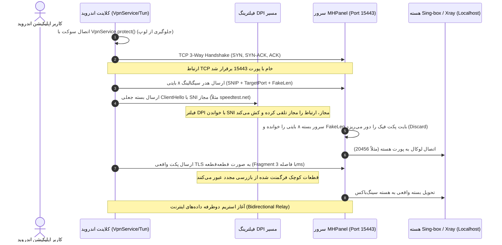

# مستندات فنی و راهنمای پیاده‌سازی SNI-Spoofing پنل MHPanel در اندروید
**نسخه:** ۱.۱ (ویژه توسعه‌دهندگان اپلیکیشن اندروید)  
**پروژه‌های مرجع:** [Patterniha SNI-Spoofing](https://github.com/patterniha/SNI-Spoofing) | [MHPanel Core](https://github.com/t-51/MHPanel.git)

---

## ۱. معماری کلی سیستم (High-Level Architecture)

فیلترینگ هوشمند (DPI) در گیت‌وی‌های اینترنت کشور، بسته‌های اولیه TLS Handshake کلاینت را بازرسی کرده و در صورت مشاهده نام دامنه مسدود شده در فیلد `Server Name Indication (SNI)`، ارتباط TCP را با ارسال بسته‌های جعلی `RST` قطع می‌کند.

پروژه **MHPanel SNI-Spoofing** با قرار دادن یک **Reverse Proxy / Decoy Consumer** هوشمند در سمت سرور و یک **Desync Injector** در سمت کلاینت (اپلیکیشن اندروید)، مسیر امن را ایجاد می‌کند:



---

## ۲. مشخصات دقیق فریمینگ و پروتکل شبکه (Wire Protocol Specification)

ارتباط کلاینت با پورت `15443` سرور صورت می‌پذیرد. ساختار اولین پکت‌های ارسالی از کلاینت به سرور طبق فرمت زیر است:

### الف) هدر سیگنالینگ ۸ بایتی (Signaling Protocol Header)

کلاینت بلافاصله پس از تکمیل TCP Handshake، یک هدر دقیقاً ۸ بایتی ارسال می‌کند:

| آفست بایت | طول (بایت) | نوع داده | شرح فیلد | مقدار پیش‌فرض / نمونه |
| :--- | :--- | :--- | :--- | :--- |
| `0..3` | ۴ | ASCII String | **Magic Bytes** (شناسه پروتکل) | `SNIP` (`0x53, 0x4E, 0x49, 0x50`) |
| `4..5` | ۲ | Uint16 Big-Endian | **Target Upstream Port** (پورت هدف در سرور) | مثلاً `20456` (`0x4F, 0xE8`) یا `20443` |
| `6..7` | ۲ | Uint16 Big-Endian | **Fake Payload Length** (طول بسته فیک بر حسب بایت) | مثلاً `106` (`0x00, 0x6A`) یا `0` |

> [!IMPORTANT]
> - اگر `FakeLen == 0` باشد، یعنی کلاینت بسته فیک ارسال نکرده و فقط فرگمنت یا اتصال مستقیم را اجرا کرده است.
> - اگر `FakeLen > 0` باشد، سرور بلافاصله بعد از خواندن این ۸ بایت، دقیقاً به تعداد `FakeLen` بایت بعدی را از سوکت خوانده و درجا دور می‌ریزد (Discard). بنابراین پکت فیک هرگز به هسته اصلی (Sing-box) نمی‌رسد و خطای TLS ایجاد نمی‌کند.

### ب) پکت فیک TLS ClientHello (Decoy Handshake)

بلافاصله پس از ارسال ۸ بایت اول، کلاینت یک بسته کامل TLS ClientHello با طول `FakeLen` ارسال می‌کند که حاوی یک دامنه معتبر داخلی یا مجاز جهانی است (مانند `speedtest.net`, `auth.vercel.com`, `dl.google.com`).

ساختار این بسته در هگزادسیمال:
- بایت‌های Record Layer: `0x16, 0x03, 0x01` (TLS Handshake)
- متد Handshake: `0x01` (ClientHello)
- اکستنشن `0x00, 0x00` (Server Name Indication) حاوی دامنه مجاز انتخابی.

### ج) فرگمنت کردن بسته واقعی (SNI Fragmentation)

پس از پکت فیک، نوبت ارسال بسته واقعی TLS کلاینت (که حاوی SNI مسدود شده شما مثل `vpn.kigaping.com` است) می‌رسد.  
برای اینکه سنسورهای DPI متوجه این SNI نشوند، کلاینت آفست نام دامنه را در پکت واقعی پیدا کرده و آن را به دو بخش تقسیم می‌کند:
1. **بخش اول (Chunk 1):** از ابتدای پکت تا ۲ بایت اول نام دامنه SNI.
2. **وقفه (Sleep):** به مدت ۳ تا ۵ میلی‌ثانیه (`Thread.sleep(3)`).
3. **بخش دوم (Chunk 2):** ادامه بایت‌های پکت تا انتها.

---

## ۳. رفتار سمت سرور (Server-Side Logic)

کد سمت سرور در سرویس `mhpanel-snispoof.service` (فایل `/usr/local/bin/mhpanel-snispoof`) به شرح زیر عمل می‌کند:

```python
# منطق دریافت هدر و تفکیک دیتای فیک از دیتای اصلی
def handle_inbound_client(client_sock, client_addr, cfg):
    up_port = 20443 # پورت پیش‌فرض در صورت عدم دریافت هدر
    client_sock.settimeout(4.0)
    
    # 1. خواندن دقیق 4 بایت اول (Magic)
    magic = recv_exact(client_sock, 4)
    if magic == b"SNIP":
        # 2. خواندن 4 بایت متادیتا
        meta = recv_exact(client_sock, 4)
        if len(meta) == 4:
            dynamic_port = struct.unpack(">H", meta[0:2])[0]
            fake_len = struct.unpack(">H", meta[2:4])[0]
            
            if 1 <= dynamic_port <= 65535:
                up_port = dynamic_port # پورت Sing-box
                
            # 3. دور ریختن بایت‌های فیک
            if fake_len > 0:
                discarded = 0
                while discarded < fake_len:
                    chunk = client_sock.recv(min(4096, fake_len - discarded))
                    if not chunk: break
                    discarded += len(chunk)
                    
    client_sock.settimeout(None)
    
    # 4. اتصال به هسته محلی Singbox روی پورت استخراج شده
    up_sock = socket.socket(socket.AF_INET, socket.SOCK_STREAM)
    up_sock.connect(("127.0.0.1", up_port))
    
    # 5. برقراری پل دوطرفه داده‌ها (Full Duplex Proxy)
    bidirectional_pipe(client_sock, up_sock)
```

---

## ۴. راهنمای پیاده‌سازی سمت کلاینت اندروید (Android Implementation)

### نکته طلایی: جلوگیری از لوپ ترافیک در اندروید (Loop Prevention)

> [!CAUTION]
> شایع‌ترین دلیل کرش و قطع اینترنت در پیاده‌سازی‌های اندروید، **VPN Routing Loop** است.  
> وقتی سرویس `VpnService` اندروید روشن می‌شود، اندروید پکت‌های **تمام سوکت‌های گوشی** را به اینترفیس Tun می‌فرستد. اگر سوکت خروجی اپلیکیشن شما به سمت سرور با متد `protect()` محافظت نشود، دیتای ارسالی خودش دوباره وارد خودش می‌شود و در یک صدم ثانیه گوشی قفل می‌کند!

در کاتلین / جاوا، بلافاصله پس از ایجاد سوکت یا کانکشن به سمت سرور:
```kotlin
val socket = Socket()
// بسیار مهم: خارج کردن این سوکت از چنگال VPN
vpnService.protect(socket)
socket.connect(InetSocketAddress(serverIp, serverPort), 8000)
```

---

### کدهای نمونه پیاده‌سازی به زبان Kotlin

#### ۱. متد ساخت پکت جعلی TLS ClientHello:

```kotlin
import java.security.SecureRandom

fun buildFakeClientHello(fakeSni: String): ByteArray {
    val sniBytes = fakeSni.toByteArray(Charsets.UTF_8)
    val serverName = byteArrayOf(0x00, (sniBytes.size shr 8).toByte(), sniBytes.size.toByte()) + sniBytes
    val sniExtLen = serverName.size + 2
    val sniExt = byteArrayOf(0x00, 0x00, (sniExtLen shr 8).toByte(), sniExtLen.toByte(), 
                             (serverName.size shr 8).toByte(), serverName.size.toByte()) + serverName

    val randomBytes = ByteArray(32).apply { SecureRandom().nextBytes(this) }
    val sessionId = ByteArray(32).apply { SecureRandom().nextBytes(this) }

    val handshakeBody = byteArrayOf(0x03, 0x03) + randomBytes + 
                        byteArrayOf(sessionId.size.toByte()) + sessionId + 
                        byteArrayOf(0x00, 0x02, 0x13, 0x01, 0x01, 0x00) + 
                        byteArrayOf((sniExt.size shr 8).toByte(), sniExt.size.toByte()) + sniExt

    val hsLen = handshakeBody.size
    val handshake = byteArrayOf(0x01, (hsLen shr 16).toByte(), (hsLen shr 8).toByte(), hsLen.toByte()) + handshakeBody
    val recLen = handshake.size
    return byteArrayOf(0x16, 0x03, 0x01, (recLen shr 8).toByte(), recLen.toByte()) + handshake
}
```

#### ۲. ساخت هدر سیگنالینگ ۸ بایتی:

```kotlin
fun buildSignalingHeader(targetPort: Int, fakePayloadLength: Int): ByteArray {
    return byteArrayOf(
        'S'.code.toByte(), 'N'.code.toByte(), 'I'.code.toByte(), 'P'.code.toByte(),
        (targetPort shr 8).toByte(), (targetPort and 0xFF).toByte(),
        (fakePayloadLength shr 8).toByte(), (fakePayloadLength and 0xFF).toByte()
    )
}
```

#### ۳. ارسال داده با فرگمنت (Fragment Injection):

```kotlin
import java.io.OutputStream

fun sendWithSniFragment(outputStream: OutputStream, realPayload: ByteArray, fragmentDelayMs: Long = 3L) {
    val sniOffset = findSniOffset(realPayload) // آفست نام دامنه داخل بسته
    
    if (sniOffset > 0 && sniOffset + 2 < realPayload.size) {
        // برش در دومین کاراکتر نام دامنه
        val splitPoint = sniOffset + 2
        outputStream.write(realPayload, 0, splitPoint)
        outputStream.flush()
        
        Thread.sleep(fragmentDelayMs) // تاخیر میلی‌ثانیه‌ای ضد بازرسی DPI
        
        outputStream.write(realPayload, splitPoint, realPayload.size - splitPoint)
        outputStream.flush()
    } else {
        // در صورت عدم تشخیص، ارسال عادی
        outputStream.write(realPayload)
        outputStream.flush()
    }
}
```

#### ۴. تابع تشخیص موقعیت دامنه در ClientHello:

```kotlin
fun findSniOffset(data: ByteArray): Int {
    if (data.size < 5 || data[0].toInt() != 0x16) return -1
    var pos = 43
    if (pos >= data.size) return -1
    val sessIdLen = data[pos].toInt() and 0xFF
    pos += 1 + sessIdLen
    if (pos + 2 > data.size) return -1
    val cipherLen = ((data[pos].toInt() and 0xFF) shl 8) or (data[pos + 1].toInt() and 0xFF)
    pos += 2 + cipherLen
    if (pos + 1 > data.size) return -1
    val compLen = data[pos].toInt() and 0xFF
    pos += 1 + compLen
    if (pos + 2 > data.size) return -1
    val extTotalLen = ((data[pos].toInt() and 0xFF) shl 8) or (data[pos + 1].toInt() and 0xFF)
    pos += 2
    val extEnd = pos + extTotalLen

    while (pos + 4 <= extEnd && pos + 4 <= data.size) {
        val extType = ((data[pos].toInt() and 0xFF) shl 8) or (data[pos + 1].toInt() and 0xFF)
        val extLen = ((data[pos + 2].toInt() and 0xFF) shl 8) or (data[pos + 3].toInt() and 0xFF)
        pos += 4
        if (extType == 0) { // SNI Extension
            if (pos + 5 <= data.size && data[pos + 2].toInt() == 0) {
                return pos + 5 // آفست شروع متن دامنه
            }
        }
        pos += extLen
    }
    return -1
}
```

---

## ۵. چرخه اجرای یک کانکشن (End-to-End Flow) در کلاینت

```kotlin
fun openSecureTunnel(
    vpnService: android.net.VpnService,
    serverIp: String,
    serverPort: Int = 15443,
    targetSingboxPort: Int = 20456,
    fakeSni: String = "speedtest.net",
    realFirstHello: ByteArray
): Socket {
    val socket = Socket()
    
    // ۱. محافظت الزامی از سوکت در سیستم عامل اندروید
    vpnService.protect(socket)
    socket.tcpNoDelay = true
    socket.connect(InetSocketAddress(serverIp, serverPort), 8000)
    
    val out = socket.getOutputStream()
    
    // ۲. تولید پکت فیک
    val fakeHello = buildFakeClientHello(fakeSni)
    
    // ۳. ارسال هدر ۸ بایتی SNIP
    val header = buildSignalingHeader(targetSingboxPort, fakeHello.size)
    out.write(header)
    
    // ۴. ارسال پکت فیک
    out.write(fakeHello)
    out.flush()
    
    // ۵. ارسال پکت واقعی با متد Fragment
    sendWithSniFragment(out, realFirstHello, fragmentDelayMs = 3L)
    
    // سوکت اکنون در وضعیت Relay کامل قرار دارد و آماده خواندن/نوشتن استریم است.
    return socket
}
```

---

## ۶. پورت‌ها و مقادیر پیش‌فرض سرور شما

- **آی‌پی سرور:** `212.227.143.16`
- **پورت دیمن SNISpoof:** `15443`
- **پورت پیش‌فرض VLESS-TCP-TLS:** `20456`
- **پورت پیش‌فرض VLESS-Reality:** `20443`
- **لیست دامنه‌های فیک توصیه شده (Decoy SNI Pool):**
  - `speedtest.net` (توصیه اول)
  - `auth.vercel.com`
  - `dl.google.com`
  - `sanjesh.org`
  - `shaparak.ir`
